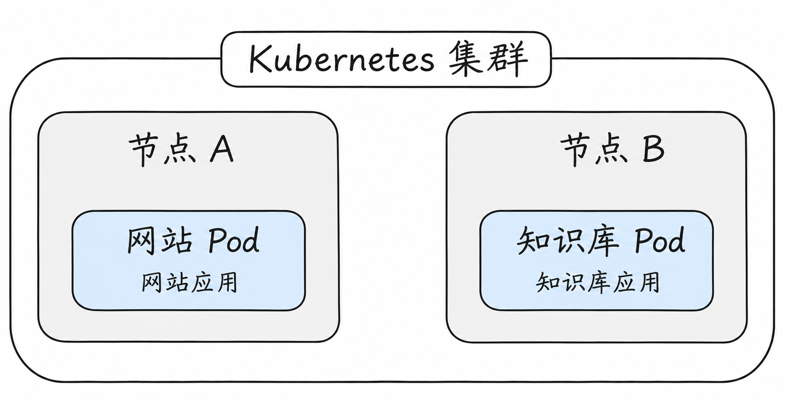
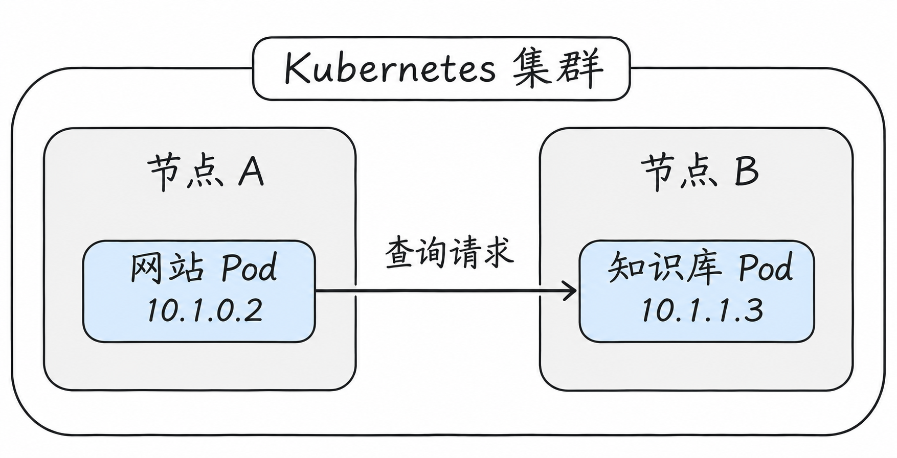
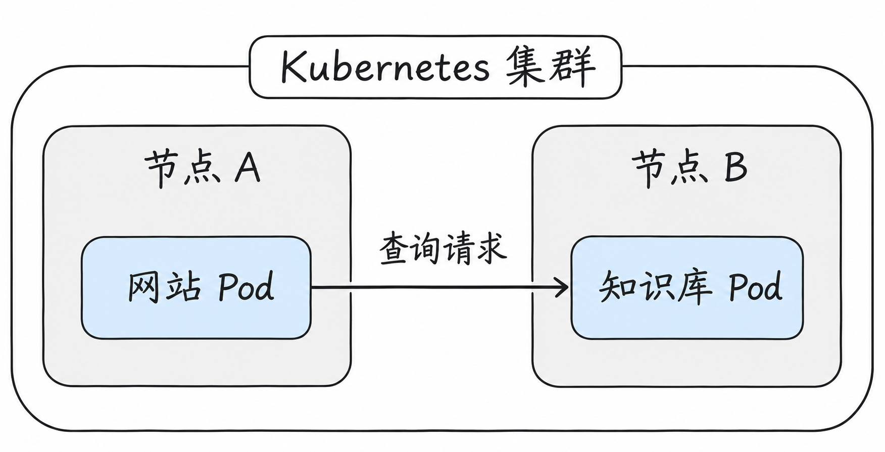
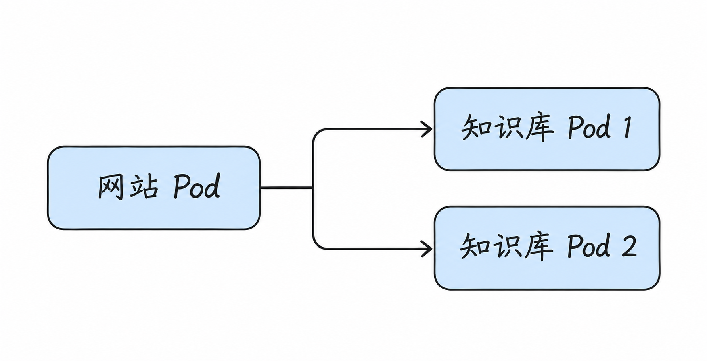
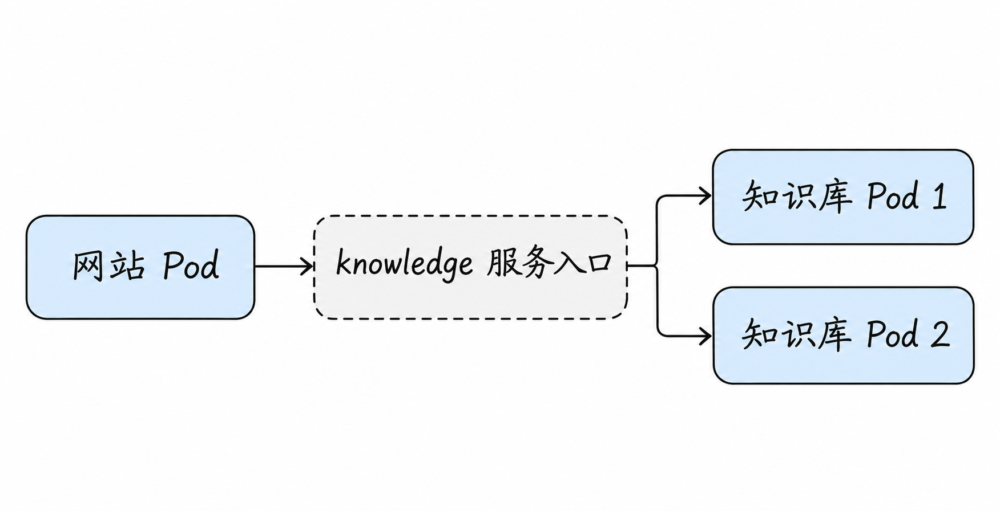
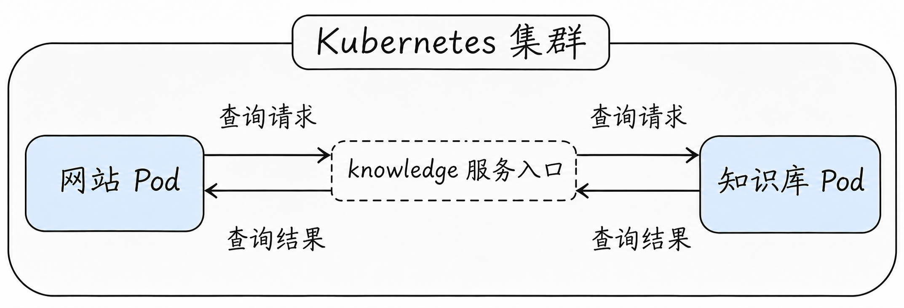
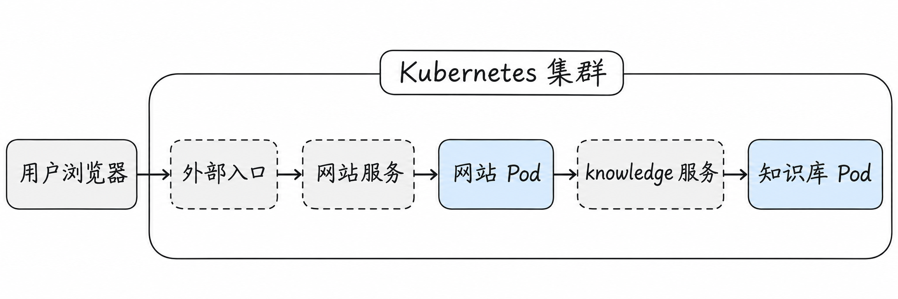

# Kubernetes 网络全景初探

假设我们要运行一个知识库网站。用户在浏览器中输入“什么是 Kubernetes”，网站收到问题后，会向知识库查询资料，再把结果返回给用户。

为了运行这个网站，我们准备了两台计算机，并用 Kubernetes 管理它们。Kubernetes 管理的一组计算机组成一个**集群**；其中每台计算机称为一个**节点（Node）**。节点可以是物理机，也可以是虚拟机。

我们先走进集群，看看网站是怎样运行起来的。

## 网站运行在什么地方？

我们把网站拆成两个应用：一个接收用户访问，称为“网站应用”；另一个负责查询资料，称为“知识库应用”。

在 Kubernetes 中，应用通常运行在 **Pod** 里。可以先把 Pod 看作 Kubernetes 安排应用运行的一个单元：Kubernetes 会为 Pod 选择一个节点，再在该节点上启动其中的应用。

假设 Kubernetes 把网站应用安排在节点 A，把知识库应用安排在节点 B：

网站应用收到用户的问题后，要向知识库应用发出查询请求。但现在两个应用运行在不同的节点上，网站 Pod 怎么联系到知识库 Pod？

## 两个 Pod 怎样互相联系？

要联系另一个 Pod，首先需要知道它的网络地址。Kubernetes 集群中的普通 Pod 都有自己的地址，称为 **Pod IP**。下面为两个 Pod 各举一个地址：

这些地址只用于示例。知道知识库 Pod 的地址后，网站应用就可以向它发起请求；知识库应用收到请求并完成查询，再将结果返回。

两个 Pod 无论在同一节点还是不同节点，应用之间的通信方式都应该保持一致。Kubernetes 的网络模型期望：只要没有设置限制，Pod 之间就能够直接通信，包括跨节点的情况。

不过，知道地址只是第一步。两个节点是独立的计算机，请求还需要有一条从节点 A 通往节点 B、最终到达知识库 Pod 的路径。

集群中安装的**网络实现**负责打通这条路径。它为 Pod 接入网络，并与节点之间的网络配合，让请求能够到达目标 Pod。具体的连接方式有多种，我们会在后续文章中细看。

现在，网站和知识库之间已经有了一条基本的通信路径：

## 一个 Pod 不够用了，怎么办？

网站刚开始只有少量用户，一个知识库 Pod 就能处理所有查询。随着用户增多，我们决定再运行一个知识库 Pod，让它们共同分担请求。

两条箭头表示可以选择不同的目标，不表示每次查询都要同时发送给两个 Pod。

现在，网站应用有了两个可以请求的目标。我们可以把两个 Pod 的地址都写进网站配置，但这些地址不会永远不变：

- 其中一个 Pod 出现故障，Kubernetes 创建了一个新 Pod 来替换它。
- 我们根据访问量增加或减少 Pod 数量。
- 更新应用时，旧 Pod 被逐步替换为新 Pod。

也就是说，实际提供服务的 Pod 及其地址会随着运行情况发生变化。如果每次都要修改网站配置，就会很麻烦。

Kubernetes 提供的解决办法是 **Service**。

## Service：给一组 Pod 一个固定的服务入口

我们为知识库应用创建一个 Service，给它起名叫 `knowledge`。之后，网站应用只需要使用这个服务名称，就不必在配置里列出每个知识库 Pod 的地址。

请求发往 `knowledge` 后，集群会将它送到当前可用的知识库 Pod。当某个 Pod 被替换，只要新 Pod 符合服务的配置并可以接收请求，它就能加入服务。网站应用仍然使用原来的名称。

Pod 和 Service 在这里各有分工：**Pod 运行知识库应用，负责处理查询；Service 为这些 Pod 提供一个稳定的访问入口。**

注意，图中的服务入口表示一种访问关系，并不一定是一个单独运行的中转程序。

到这里，我们的内部通信路径变成了：

这张图展示的是通过服务进行请求和响应的**逻辑关系**，并不表示数据包一定经过一个独立的 Service 中转设备。以常见的地址转换方式为例，返回流量也需要进行相应的地址处理，让网站应用能够识别出这是原来那次连接的响应。具体过程会随网络实现而变化，后面的文章会进一步介绍。

## 集群外的用户怎么访问网站？

现在，集群里的两个应用已经可以互相联系了。但用户的浏览器在集群外面，用户的请求又该怎样找到网站应用？

先像知识库应用一样，为网站应用设置一个服务入口。然后，再为集群配置一个**外部入口**：它接收来自集群外的请求，并根据配置将请求送往网站服务。

这样，用户的访问就能和集群内部的查询连接起来：

用户的请求通过外部入口找到网站应用；网站应用再向知识库查询。知识库查到资料后，将结果交还给网站应用，由网站应用返回给用户。

这是一种常见的组织方式。实际集群可以采用不同的外部入口方案，具体转发路径也会有所不同。

## 是不是所有应用都应该互相访问？

集群网络让 Pod 能够通信，但有了通信能力，不代表所有访问都应该被允许。

假设集群里后来又运行了一个无关的测试应用。我们希望网站应用能够查询知识库，却不希望测试应用随意访问。这时，可以为 Pod 设置网络访问规则，规定哪些访问允许通过。

Kubernetes 提供了 **NetworkPolicy**，用于描述一部分 Pod 的网络访问规则。它能否真正生效，还需要集群使用支持该功能的网络实现。

因此，即使两个应用之间的网络已经连通，请求仍可能因为访问规则被阻止。判断一次访问能否成功，要同时考虑通路和规则。

## 把整个过程连起来

用户打开网站、发起查询，看起来只是一次简单的操作。沿着请求往里看，却能看到几部分各自的作用：外部入口让请求找到网站，Service 让应用找到当前可用的知识库 Pod，集群网络负责连接不同的 Pod，网络规则决定哪些访问可以通过。

在应用层面，我们已经看到了一套简单却完整的网络链路，并建立了基本认知。要进一步理解请求怎样从一台计算机传到另一台，需要先认识计算机网络本身。

下一篇：[网络基础：二层、三层与数据包](02-network-fundamentals.md)。
