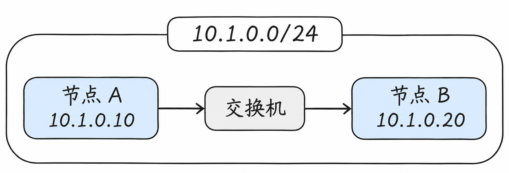
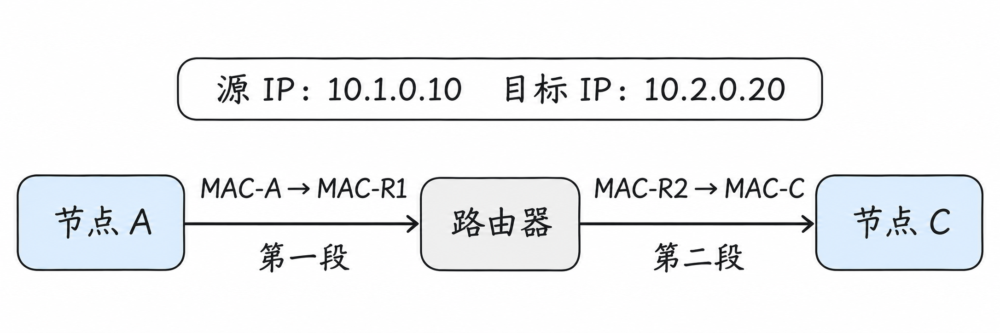

# 网络基础：从一次通信看懂二层、三层与数据包

上一篇中，网站 Pod 和知识库 Pod 运行在不同的节点上。我们说，集群网络会让它们能够互相通信。但数据到底怎样从一台计算机到达另一台？

这次我们先把 Pod 放在一边，看看两台普通计算机之间会发生什么。理解了这条路，再回到 Kubernetes，节点网络和 Pod 网络就有了可以依靠的基础。

## 两台计算机怎样找到彼此？

假设我们有两台计算机，它们各自通过网线连接到同一台交换机。为了和上一篇保持联系，我们仍然把这两台计算机叫作节点 A 和节点 B。



节点 A 的地址是 `10.1.0.10`，节点 B 的地址是 `10.1.0.20`。这些数字是 **IP 地址**：当节点 A 要联系节点 B 时，可以使用这个地址指出自己的目标。

假设 B 上运行着网站应用，A 要向它发送一条查询请求。A 知道目标 IP 后，会把请求交给操作系统，由网络逐步将数据送到 B。图中的箭头只表示这次发送的方向；B 返回响应时，数据会向相反方向传递。

图上方的 `10.1.0.0/24` 表示两台节点属于同一个 IP 子网。先不急着理解 `/24` 怎么算，只要知道：在这个例子中，A 判断 B 可以在本地网络中找到，因此不需要先把数据交给路由器。

在继续追踪请求之前，我们先看看图里的连接使用了什么通信方式，以及这些地址属于哪一套协议。

## 先认识以太网和 IP

计算机之间要通信，双方得先约定数据如何组织、怎样传送。这样的约定称为**网络协议**。一次通信通常需要几种协议配合：有的负责在当前网络中交付数据，有的负责跨网络寻找目标。

**以太网（Ethernet）**是常见的局域网通信技术。上面的例子中，节点通过以太网网卡、网线和交换机连接，按以太网的规则在本地网络中传递数据。以太网中传递的数据单位叫作**帧**。后面讲的 MAC 地址，就是这种帧用来标识本地发送方和接收方的地址。

**IP（互联网协议）**则为设备提供 IP 地址，让数据能够在相互连接的网络之间寻找目标。上图中的 `10.1.0.10` 和 `10.1.0.20` 使用的是 **IPv4**：它的地址由 32 位组成，通常写成四段十进制数。

更准确地说，在我们这个例子中，IP 地址配置在节点的网络接口上。一台节点可以有多个接口，一个接口也可能配置多个 IP 地址；图里为了便于理解，每个节点只画出一个地址。

IP 还有 **IPv6** 版本，它使用 128 位地址，写法与 IPv4 不同，例如 `2001:db8::10`。两者都是 IP，但地址格式以及一些配套机制不同。为了先把一条路径讲清楚，本文后面的例子统一使用 **IPv4 和以太网**；实际网络可以使用 IPv4、IPv6 或同时使用两者。

以太网和 IP 并不是两个互相替代的选择：在这个例子里，IP 数据包会由以太网帧承载，在本地链路上传递。现在再看网卡与地址，区别就更容易理解了。

## 已经有 IP 地址，为什么还需要 MAC 地址？

先把节点 A、交换机和节点 B 之间的连接画得更细一些：


每个节点都通过自己的**网卡**接入网络。图中 `MAC-A` 和 `MAC-B` 分别代表两块网卡的 MAC 地址；真实的 MAC 地址通常写成六组十六进制数，例如：

| 对象 | 图中简称 | 示例 MAC 地址 |
| --- | --- | --- |
| 节点 A 的网卡 | `MAC-A` | `02:00:00:00:00:0a` |
| 节点 B 的网卡 | `MAC-B` | `02:00:00:00:00:0b` |

这两个地址和下文的表格都是为了演示而假设的，不代表你机器上的实际值。

假设 A 要把一条查询请求发给 `10.1.0.20`。**IP 地址告诉 A：这次通信的最终目标是谁。**但在当前这段以太网上，A 的网卡还需要按照以太网的规则，把数据交给某块网卡。以太网帧的地址字段使用的是 MAC 地址，普通二层交换机也根据目标 MAC 地址决定往哪个端口转发。

所以，在这个具体例子中，A 要同时准备两层信息：

| 放在哪一层 | 目标地址 | 作用 |
| --- | --- | --- |
| IP 数据包 | `10.1.0.20` | 指明最终要访问节点 B 的 IP 地址 |
| 以太网帧 | `MAC-B` | 告诉当前以太网这帧要交给 B 的网卡 |

帧里装着 IP 数据包：A 的网卡发送帧，交换机根据帧的目标 MAC 找到端口 2，B 的网卡收到后，再由 B 的网络协议栈处理里面的 IP 数据包。

这不是说所有网络都必然使用以太网或 MAC 地址。关键在于：**这个例子使用以太网，而以太网本地交付使用 MAC 地址；IP 提供跨网络的地址和路由能力。**它们配合完成不同范围的交付。

接下来就剩一个问题：A 起初只知道 B 的 IP，`MAC-B` 从哪里来？

## ARP：用下一站的 IP 找到 MAC

在 IPv4 以太网中，节点 A 可以通过 **ARP** 查询当前链路上某个 IP 地址对应的 MAC 地址。

假设 A 的缓存里还没有 B 的信息，而 A 已经根据路由信息确定 B 在本地网络上：

1. A 在当前二层网络中广播 ARP 请求：“谁使用 `10.1.0.20`？请告诉我你的 MAC 地址。”
2. B 发现询问的是自己的地址，向 A 回复：`10.1.0.20` 对应 `MAC-B`。
3. A 将这条对应关系暂存起来，然后发送目标 MAC 为 `MAC-B` 的数据帧。

这份暂存信息通常称为 **ARP 缓存**；在 Linux 中，它属于邻居表的一部分。假设 A 查询过 B，并且还查询过网关，表可能是这样：

| 邻居 IP | 邻居 MAC | 接口 | 状态示例 |
| --- | --- | --- | --- |
| `10.1.0.20` | `02:00:00:00:00:0b`（`MAC-B`） | `eth0` | `REACHABLE` |
| `10.1.0.1` | `02:00:00:00:00:01`（`MAC-R1`） | `eth0` | `REACHABLE` |

这里的 `eth0` 是示例接口名；`REACHABLE` 表示邻居近期被确认可达。真实系统还可能显示其他状态，缓存也会老化或更新。表中的每一行都是**本机某个接口上，邻居 IP 和链路层地址的对应信息**，不是整个集群的 Pod 名单。

上面的网关记录先留作铺垫：如果最终目标在另一个网段，A 通常需要解析的是网关的 MAC，而不是远端目标的 MAC。[ARP 规范，RFC 826](https://www.rfc-editor.org/rfc/rfc826.html)

本节的 ARP 只适用于 IPv4 场景。IPv6 在以太网上使用邻居发现协议完成类似的地址解析和邻居管理，不使用 ARP。[IPv6 邻居发现，RFC 4861](https://www.rfc-editor.org/rfc/rfc4861.html)

## 交换机又是怎么知道走哪个端口的？

A 知道了 `MAC-B`，就能把目标 MAC 写入以太网帧。但交换机还有自己的问题：**`MAC-B` 在哪个端口？**

交换机维护一张 MAC 地址表。它收到帧时，会根据帧的**源 MAC** 和进入端口学习对应关系；转发时，再根据**目标 MAC** 查找出口。

例如，A 的 ARP 请求从端口 1 进入，交换机可以学习到 `MAC-A → 端口 1`；B 的 ARP 回复从端口 2 进入，交换机又能学习到 `MAC-B → 端口 2`。学习完成后，表可以简化为：

| MAC 地址 | 所在端口 | 所属 VLAN |
| --- | --- | --- |
| `MAC-A` | 端口 1 | VLAN 10（示例） |
| `MAC-B` | 端口 2 | VLAN 10（示例） |

于是，交换机收到目标为 `MAC-B` 的帧后，可以在对应 VLAN 中查表，从端口 2 转发。这里的 VLAN 暂时只表示两个端口属于同一个二层网络，后面再详细解释。

如果交换机还不知道目标 MAC 的端口，它通常会在同一 VLAN 内向其他适当端口泛洪未知目标的帧；ARP 的广播请求也会在相应的二层广播域中传播。MAC 表并非永久有效，动态条目通常会老化。

**注意两张表不在同一个地方，也解决不同问题：**节点 A 的 ARP 缓存回答“邻居 IP 对应什么 MAC”；交换机的 MAC 地址表回答“目标 MAC 在哪个端口”。

网卡、MAC 地址、帧和交换机，属于通常所说的**二层：数据链路层**。目前可以把二层理解为：在一段本地网络中，设备之间如何交付一个帧。

## IP 地址后面的 `/24` 是什么意思？

回到最初那张图：A 是 `10.1.0.10`，B 是 `10.1.0.20`，它们都位于 `10.1.0.0/24`。

在 IPv4 中，地址由 32 个二进制位组成。`/24` 表示前 24 位是网络前缀，剩余 8 位用于区分这个子网中的地址。对于这个具体例子，它对应的子网掩码是 `255.255.255.0`：前面三个十进制数共同标识这个 `/24` 子网。

因此：

- `10.1.0.10/24` 与 `10.1.0.20/24` 的网络前缀都是 `10.1.0.0/24`。
- `10.2.0.20` 不属于 `10.1.0.0/24`。

`10.1.0.0/24` 是一个 **CIDR** 写法，用地址加前缀长度表示一个网段。对于常规 `/24` 子网，地址从 `10.1.0.0` 到 `10.1.0.255`；其中 `.0` 通常表示网络地址，`.255` 通常作为该子网的广播地址。实际地址是否能分配，还要看网络和平台的配置。

不要只看 IP 的前几段数字是否相同就判断“同网段”：还必须知道前缀长度。比如 `/16` 和 `/24` 的划分范围不同。

## 如果目标在另一个网段呢？

现在我们增加节点 C。它的 IP 是 `10.2.0.20`，属于 `10.2.0.0/24`。节点 A 仍在 `10.1.0.0/24` 中，两个网段之间由一台路由器连接。


图中，路由器连接两个网络：在 A 所在网络的一侧使用 `10.1.0.1`，在 C 所在网络的一侧使用 `10.2.0.1`。这里将 `10.1.0.1` 配置为 A 的默认网关。两侧网络都假设使用以太网。

### 先查路由表：这一包交给谁？

节点 A 发数据前，要先决定从哪个网络接口发出，以及在这一段网络中应该交给谁。这个决定依据**路由表**。对于上图的网络，A 的路由表可以简化成：

| 目标范围 | 下一跳 | 发送接口 | 含义 |
| --- | --- | --- | --- |
| `10.1.0.0/24` | 直接交付 | `eth0` | 目标在本地子网，通过 `eth0` 直接找目标 |
| `0.0.0.0/0` | `10.1.0.1` | `eth0` | 其他没有更具体匹配的 IPv4 目标交给网关 |

`0.0.0.0/0` 表示默认路由：它能匹配所有 IPv4 目标，但只有没有更具体的可用匹配时才会被选中。表格省略了真实路由表可能出现的来源、优先级等信息；实际路径还可能受策略路由等配置影响。

在这个简单例子中，A 向本地的 B（`10.1.0.20`）发送时，匹配第一行，直接找 B；向 C（`10.2.0.20`）发送时，不匹配第一行，于是选中默认路由，把 `10.1.0.1` 当作下一跳。

路由表从哪里来？节点配置 IP 地址和子网时，操作系统通常会建立相应的直连路由；默认网关可能由管理员、网络配置工具或 DHCP 等方式提供。其他路由也可以由管理员配置，或由路由协议、集群网络组件等写入。**路由表描述的是如何走，不是 ARP 缓存中的 IP 到 MAC 对照表。**

### 再查邻居缓存：下一跳的 MAC 是多少？

A 已经确定要把帧交给网关 `10.1.0.1`，接下来才在 `eth0` 上查询这个下一跳的 MAC 地址。前面的 ARP 缓存示例中，`10.1.0.1` 对应 `MAC-R1`；如果没有可用缓存，A 就先通过 ARP 解析网关地址。


图中是本例的简化发送顺序。对于直连目标，下一跳就是目标本身；对于经网关转发的目标，下一跳是网关。缓存尚未建立时，需要先完成地址解析，才能继续交付。

### 到了路由器，MAC 地址为什么变了？

为方便说明，把路由器在 A 所在网络一侧的网卡地址叫作 `MAC-R1`，在 C 所在网络一侧的网卡地址叫作 `MAC-R2`；节点 C 的网卡地址叫作 `MAC-C`。



对于 A 发给 C 的请求，在没有 NAT 等额外处理的前提下：

| 发送在哪一段 | IP 数据包中的源和目标 | 这一段帧的源和目标 MAC |
| --- | --- | --- |
| A → 路由器 | `10.1.0.10` → `10.2.0.20` | `MAC-A` → `MAC-R1` |
| 路由器 → C | `10.1.0.10` → `10.2.0.20` | `MAC-R2` → `MAC-C` |

第一段的帧交给路由器后，路由器根据目标 IP 查自己的路由表，发现 C 所在的 `10.2.0.0/24` 是它直接连接的网络，再为第二段链路构造新的以太网帧。它要在第二段找到 C 的 MAC，也可能使用自己的邻居缓存或 ARP。

因此，A 从来没有必要在第一段广播询问 C 的 MAC：C 不在 A 当前的二层网络中，A 先交付给的是网关。源和目标 IP 在此例中保持不变，但路由器转发时也会更新 IP 头中的一些字段，例如 TTL；“IP 地址不变”不等于整个数据包的每个字节都不变。

路由器收到数据后如果没有可用路由，或者 C 没有可用的返回路径，通信仍然会失败。上图只画出了从 A 到 C 的方向；响应返回也需要逐段转发。

IP、子网和路由属于通常所说的**三层：网络层**。二层解决当前链路上的交付；三层让数据能够在不同网络之间逐跳前进。

## 同一台交换机，能不能分成几张网络？

随着设备增多，我们可能希望一部分机器和另一部分机器分开。例如，下面四台主机接在同一台交换机上，但 A、B 属于一组，C、D 属于另一组。


**VLAN** 可以在交换机上划分逻辑上的二层网络。在这个例子中，A、B 所连接的交换机端口属于 VLAN 10；C、D 所连接的端口属于 VLAN 20。

虽然共用一台物理交换机，VLAN 10 中的普通二层广播不会直接扩散到 VLAN 20。想让两个 VLAN 之间的主机通信，需要通过具备相应路由能力的设备或配置，并考虑访问控制。

一组 VLAN 也可以跨多台交换机，前提是交换机之间的连接配置允许相应 VLAN 通过。这类连接常称为 **Trunk**；连接普通终端的端口常被配置为 **Access**。不同设备的配置术语和细节可能有所不同，这里先理解它们各自解决的问题即可。

有两个容易混淆的点：

- **VLAN 是二层的逻辑划分，IP 子网是三层的地址划分。** 实际部署中常把一个 VLAN 与一个 IP 子网对应，但它们不是同一个概念。
- **处于同一 IP 子网不自动保证二层互通。** VLAN、交换机配置和其他限制仍可能让设备无法直接相互到达。

VLAN 划分的广播域及跨 VLAN 路由，可参考 [Cisco 的 VLAN 与路由说明](https://www.cisco.com/en/US/docs/ios/lanswitch/configuration/guide/lsw_rtng_vlan_ovw.html)。

## 数据真正发出去时，里面装了什么？

前面一直在说“把请求发给另一台计算机”。现在把这个请求打开看一眼。

假设网站使用 HTTP 接收查询，网络使用 TCP 传输，底层链路使用以太网。为了便于理解，下图把一次**足够小、可以放进一个 TCP 报文段**的请求画成层层包含的形式：


每一层都在处理自己关心的事情：

- **HTTP 请求**表达应用要做什么，例如查询某个资源。
- **TCP** 帮助两端应用建立连接，并可靠、有序地传输字节流。
- **IP** 负责使用源 IP 和目标 IP，让数据能够跨网络传递。
- **以太网**使用当前链路上的 MAC 地址，将帧交给这一段网络中的下一站。

图中的嵌套是帮助理解的简化模型。真实通信中，一个 HTTP 请求可能跨越多个 TCP 报文段；HTTPS 还会涉及 TLS；并且不是所有底层链路都使用以太网帧。

## 到了目标计算机，怎么找到具体应用？

IP 地址让数据到达目标计算机，但一台计算机上可能同时运行网站、数据库和其他应用。如何知道数据应该交给谁？

这就需要**端口**。例如，假设节点 B 上的网站应用监听 TCP 端口 `8080`，节点 A 就可以连接 `10.1.0.20:8080`。

`10.1.0.20` 指定目标地址，`8080` 指定目标端口。发送方也会使用自己的源端口，以便区分不同连接。端口号需要结合传输协议理解：TCP 端口与 UDP 端口属于不同的协议空间。

TCP 在传数据前会建立连接，接收方确认已经收到的数据，发送方在必要时重传，接收端再按顺序向应用交付字节流。即使如此，连接仍可能因为目标未监听、网络故障或超时而失败；TCP 的可靠性不意味着请求一定成功。[TCP 规范，RFC 9293](https://www.rfc-editor.org/rfc/rfc9293.html)

另一种常见传输协议是 UDP。它按数据报发送，不像 TCP 一样提供连接建立、可靠重传和有序字节流。是否需要重试、如何处理丢包，取决于使用它的应用或上层协议。

## 我们为什么更习惯使用名字？

记住 `10.1.0.20:8080` 并不方便，地址变化后还要修改配置。因此，应用通常使用名字，例如 `knowledge.example.com`。

**DNS** 的工作之一，就是回答“这个名字对应哪个 IP 地址”。应用获得地址后，再使用 IP 地址和端口建立连接。

可以把一次访问分成两个先后的动作：先查名字，得到地址；再向地址发起连接。名字查到了，只说明解析得到了结果，不代表目标应用一定在运行，也不代表端口或网络一定可达。

Kubernetes 中的服务发现同样需要名字解析。上一篇的网站应用可以使用 `knowledge` 这样的服务名称；关于集群内名称如何解析、Service 如何选择后端，会在本系列第 6 篇展开。

## 私有地址怎样访问外部网络？

前面的 `10.1.0.10` 属于私有 IPv4 地址范围。私有地址可以在内部网络使用，但通常不能直接作为公网中可路由的地址使用。[私有地址规范，RFC 1918](https://www.rfc-editor.org/rfc/rfc1918.html)

假设节点 A 需要访问外部网站，而出口设备拥有可供外部网络返回流量的地址。一种常见做法是 **NAT：网络地址转换**。

当请求经过出口设备时，设备可以将数据包中的源地址换成出口地址；响应回来后，再根据保存的连接信息做相应的反向转换，交还给 A。这种改变源地址的方式称为 **SNAT**。多个内部连接共用一个外部地址时，设备还可能转换端口，以区分不同连接。

如果是把请求的**目标地址**改为另一个地址，则称为 **DNAT**。上一篇提到的某些 Service 实现，就会用目标地址转换把发往服务入口的请求导向后端 Pod。

NAT 并不是网络通信的必经环节；是否使用、在哪里使用，要看地址规划、路由和具体实现。公网访问也可能经过代理或其他出口设施。

## 为什么有时小包能通，大包却不通？

假设 A 和 C 之间的路由都正确，小请求成功了，较大的传输却频繁失败。这时除了应用和防火墙，还可以检查 **MTU**。

MTU 表示一个网络接口能够承载的最大 IP 数据包大小。通信路径上可能有多段链路，其中某一段支持的大小更小，就会限制整条路径能够顺利传递的包。

IPv4 在特定条件下允许分片，但分片存在代价；如果包不允许分片，网络设备可能丢弃过大的包并返回相应的 ICMP 提示。发送方可以借助路径 MTU 发现机制调整发送大小；如果必要的提示报文也被阻断，就可能出现小包能通、大包不通的现象。[路径 MTU 发现，RFC 1191](https://www.rfc-editor.org/rfc/rfc1191.html)

这与 Kubernetes 有什么关系？后面介绍跨节点网络时会看到：某些网络方案会在原始数据之外增加一层封装。外层信息也要占空间，因此需要在网络配置中考虑 MTU。并不是每个集群都使用封装，具体数值要结合实际链路和方案确定。

## 如何在自己的机器上观察？

读懂上面的例子后，可以在一台 Linux 机器上做几项**只读观察**。这些命令不会修改网络配置；输出中的接口名、地址和下一跳取决于你实际所在的网络。

```bash
# 查看网络接口和地址
ip -br address

# 查看 IPv4 路由表
ip -4 route

# 看看系统准备如何发送到某个目标；将地址换成你要观察的目标
ip -4 route get 10.2.0.20

# 查看当前已知的 IPv4 邻居地址信息
ip -4 neigh
```

重点观察：目标走哪个接口？有没有 `via` 指出的下一跳？邻居表里有没有下一跳或同网段目标的地址？邻居信息有生命周期，因此表中没有某项不必然说明网络故障。

例如，在本文假设的节点 A 上，`ip -4 route` 和 `ip -4 neigh` 可能分别显示类似下面的内容；这只是对应前文的示意输出：

```text
# ip -4 route
default via 10.1.0.1 dev eth0
10.1.0.0/24 dev eth0 proto kernel scope link src 10.1.0.10

# ip -4 neigh
10.1.0.20 dev eth0 lladdr 02:00:00:00:00:0b REACHABLE
10.1.0.1 dev eth0 lladdr 02:00:00:00:00:01 STALE
```

第一组是路由：默认流量经 `10.1.0.1`，本地子网通过 `eth0` 直连。第二组是邻居信息：B 的 IP 对应 `MAC-B`，网关的 IP 对应 `MAC-R1`。`STALE` 表示邻居信息不再被认为是近期确认过的，不等于这个地址一定失效；系统会根据需要继续验证或更新。

如果你暂时没有 Linux 环境，也可以先只读文章；本系列后续会结合 Linux 网络和实际环境继续操作。

## 再回到 Kubernetes

现在回看第一篇中的两个 Pod：它们运行在节点 A 和节点 B 上，发送请求时，底层仍然离不开网络接口、地址和转发路径。

但 Kubernetes 还要解决一个额外问题：**Pod 不是直接插在物理交换机上的普通计算机。** 集群需要在节点内部为它们构建网络，并把不同节点上的 Pod 网络连接起来。

理解这里介绍的二层、三层和路由后，我们就可以继续向下看：一台 Linux 节点里，Pod 是怎样拥有自己的网络空间，又是怎样接到节点网络上的。

下一篇：[Linux 网络：一台主机里的虚拟网络](03-linux-networking.md)（待编写）。

## 参考资料

- [RFC 826：ARP](https://www.rfc-editor.org/rfc/rfc826.html)
- [RFC 4861：IPv6 邻居发现](https://www.rfc-editor.org/rfc/rfc4861.html)
- [RFC 791：IPv4](https://www.rfc-editor.org/rfc/rfc791.html)
- [RFC 9293：TCP](https://www.rfc-editor.org/rfc/rfc9293.html)
- [RFC 1918：私有 IPv4 地址](https://www.rfc-editor.org/rfc/rfc1918.html)
- [RFC 1191：路径 MTU 发现](https://www.rfc-editor.org/rfc/rfc1191.html)
- [Cisco：VLAN 与跨 VLAN 路由](https://www.cisco.com/en/US/docs/ios/lanswitch/configuration/guide/lsw_rtng_vlan_ovw.html)
