# 网络基础：从一次通信看懂二层、三层与数据包

上一篇中，网站 Pod 和知识库 Pod 运行在不同的节点上。我们说，集群网络会让它们能够互相通信。但数据到底怎样从一台计算机到达另一台？

这次我们先把 Pod 放在一边，看看两台普通计算机之间会发生什么。理解了这条路，再回到 Kubernetes，节点网络和 Pod 网络就有了可以依靠的基础。

## 两台计算机怎样找到彼此？

假设我们有两台计算机，每台计算机各有一块有线网卡。为了和上一篇保持联系，我们仍然把这两台计算机叫作节点 A 和节点 B。

为了让两台节点可以直接连接并通信，最简单的情况是，用一根兼容的网线连接两端网卡：

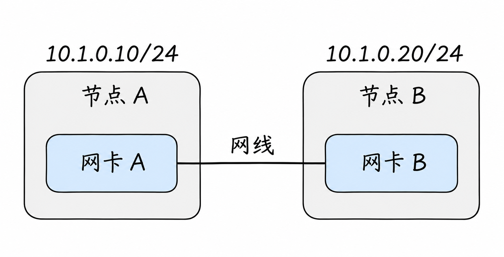

假设两端网卡和网线兼容、连接正常，我们分别为 A 和 B 配置图中的 IP 地址：`10.1.0.10/24` 和 `10.1.0.20/24`。这两个地址属于同一个 IP 子网 `10.1.0.0/24`；先不急着计算 `/24`，只要知道在这个例子里，A 可以通过直连链路找到 B。**网线本身不会给两端分配这些地址**：这里假设我们已经手动配置好地址；如果网络中有相应的自动配置服务，也可以使用其他配置方式。

假设 B 上运行着网站应用，A 知道 B 的 IP 地址后，就可以向它发起连接。两台机器之间只访问彼此时，不需要交换机转发，也不需要先把数据交给网关；两端的地址、路由、应用和访问规则仍需要配置正确。

这里的网线只在 A 和 B 之间建立了一条连接：A 发出的信号直接到达 B 的网卡，B 也可以通过同一条连接向 A 返回数据。**连接建立并不等于已经连上互联网**；如果其中一台机器还要访问其他网络，就需要有通往那些网络的连接和相应的路由配置。

反过来，即使两端都配置了看起来属于同一个子网的 IP 地址，也不代表一定能够通信。网线未插好、网卡未启用、地址冲突或防火墙规则等，都可能导致访问失败。可以先把它理解成两个条件：网卡之间要有一条可用的连接，操作系统还要知道怎样通过它找到对方。

实际接线时，两端网卡和线缆必须兼容。部分设备支持自动适配线序，较老的设备可能需要交叉网线，不能假定任何网卡和线缆组合都能直连。[Intel：以太网线缆与直连](https://www.intel.com/content/www/us/en/support/articles/000007187/ethernet-products.html)；[Cisco：自动线序适配](https://docs.manage.security.cisco.com/cdfmc/c_auto-mdi_mdix_feature.html)

要理解 A 发出的请求怎样穿过网线、到达 B 上的应用，我们先看计算机内部的网卡和网络接口。

## 计算机、网卡和网络接口是什么关系？

先从节点 A 看起。**网卡**是计算机用来收发网络数据的硬件。在刚才的直连例子中，网线的一端接在 A 的网卡上，另一端接在 B 的网卡上。

应用不会直接操作网卡收发数据。节点 A 启动后，操作系统通过**驱动程序**——负责让操作系统与网卡协作的软件——管理这块网卡，并为它提供一个**网络接口**。接口可以理解为操作系统中管理和使用这块网卡的入口：操作系统通过它配置地址、发送和接收数据。

假设 Linux 给 A 的这个接口起名叫 `eth0`，那么在本文例子里：

- **节点 A**是一整台计算机，里面运行着应用和操作系统。
- **网卡 A**是节点 A 中连接网线、收发数据的硬件。
- **`eth0`** 是操作系统中对应网卡 A 的网络接口；它不是再插在网卡后面的另一块硬件。
- **`10.1.0.10`** 是配置在 `eth0` 上的 IP 地址。B 侧也有自己的网卡、接口和 IP 地址。

因此，说“节点 A 通过网卡连接到网络”，描述的是整台计算机怎样使用硬件接入；说“IP 地址配置在网络接口上”，描述的是操作系统怎样管理这块网卡的地址。它们说的是同一条连接的不同部分。

用本文的两台计算机对照一下，就能看清这些名称各自指向哪里：

| | 节点 A | 节点 B |
| --- | --- | --- |
| 计算机 | 节点 A | 节点 B |
| 本例中使用的硬件 | 网卡 A | 网卡 B |
| 操作系统中的接口名 | `eth0`（假设） | `eth0`（假设） |
| 配置在该接口上的 IP 地址 | `10.1.0.10` | `10.1.0.20` |

两台计算机各有自己的操作系统，因此接口可以同名，而它们的 IP 地址各自配置。`eth0` 只是示例名称，实际接口名可能不同。这里还假设一块物理网卡对应一个用于通信的接口；更一般地，一台计算机可能有多块网卡，操作系统也可以创建没有独立物理网卡的**虚拟网络接口**。这些虚拟接口会在下一篇 Linux 网络文章中展开。

把这条路径展开来看：

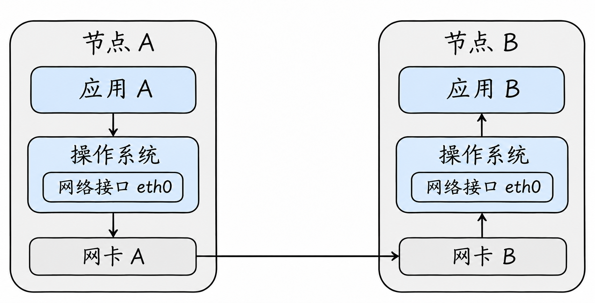

图中只画了**请求从 A 发往 B 的方向**。A 的应用先把数据交给 A 的操作系统；操作系统根据网络配置选择 `eth0`，通过网卡 A 把数据发出去。数据经网线直接到达网卡 B，B 的操作系统再接收并交给相应应用。B 返回响应时，也需要经过各自的操作系统、网卡和可用的网络路径。

图中将操作系统、接口和网卡分开，是为了看清各自的作用：`eth0` 是操作系统中的接口，网卡 A 是执行实际收发的硬件。它们共同完成节点 A 这一侧的通信，不是两块依次插在网线上的硬件。

## 有了更多节点，为什么常用交换机？

一根网线可以连接 A 和 B。假设以后还要加入更多机器，并希望它们都能互相通信：如果每两台机器之间都单独拉一根网线，节点越多，需要的接口和连接就越多。

一种常见做法是将每台机器的网卡连接到同一台**交换机**。交换机是一种连接多台设备的网络设备：它接收某个端口上的数据，再根据规则决定从哪些端口转发。这样，多台节点可以通过交换机连接到同一张本地网络，而不需要为每一对节点单独布线。

现在把 A 和 B 从刚才的直连方式，改成分别连接到交换机的两个端口：

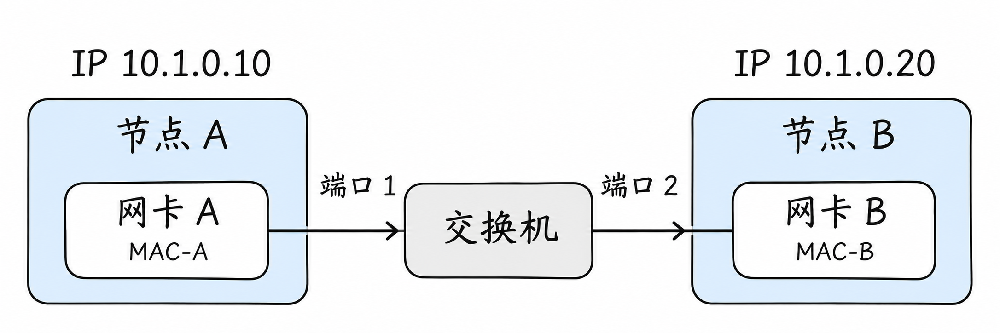

图中的 `MAC-A` 和 `MAC-B` 代表两块网卡使用的地址，我们会在后面解释。先看路径的变化：A 发出的数据经过自己的网卡到达交换机，再由交换机转发到 B 的网卡；B 的响应也可以经交换机返回。

我们假设改接后 A 和 B 的接口仍使用 `10.1.0.10/24` 和 `10.1.0.20/24`，交换机端口属于同一网络，地址配置和访问规则也正确。在这个例子中，A 访问 B 仍不需要经过网关。**交换机是这里的一种连接方式，不是两台节点通信的必需品。**

后面讲 IP、MAC、ARP 和交换机地址表时，除非特别说明，都使用这张通过交换机连接 A、B 的图；如果把它们换回网线直连，两端仍然可以在以太网上使用 IP、MAC 和 ARP，只是中间没有交换机及其转发表。

## 一台节点有多块网卡，就会有多个 IP 吗？

很可能会。前面为了简单，每个节点只画了一块网卡。现在假设节点 A 有两块有线网卡，分别连接两张网络：

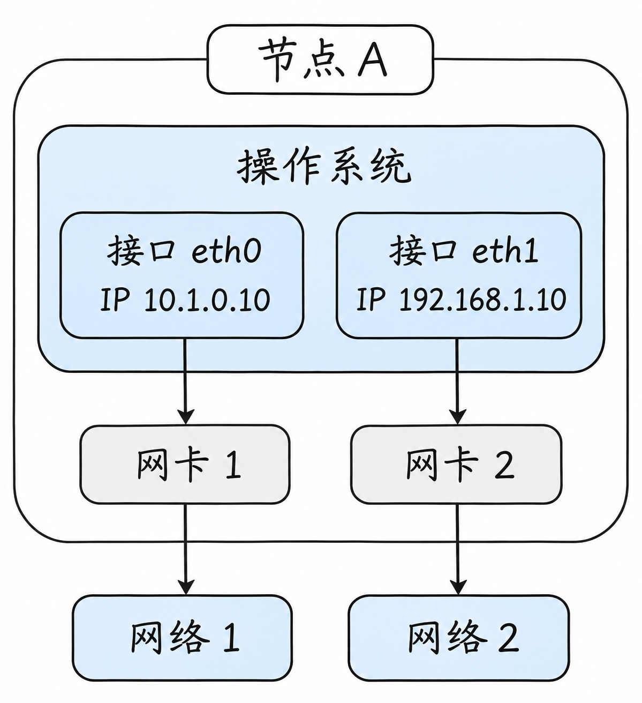

在这个假设的例子里，操作系统为两块网卡分别提供接口，我们将它们命名为 `eth0` 和 `eth1`，并作如下配置：

| 接口 | 对应的网卡 | 连接的网络 | 配置的 IPv4 地址 |
| --- | --- | --- | --- |
| `eth0` | 网卡 1 | 网络 1 | `10.1.0.10/24` |
| `eth1` | 网卡 2 | 网络 2 | `192.168.1.10/24` |

因此，**同一台节点可以同时有多个 IP 地址**。其他设备在可达且允许访问的情况下，可以通过适当的地址联系它；使用哪个地址，取决于它们处于哪张网络以及网络如何配置。

这里是为了演示而给每个接口各配了一个 IPv4 地址，并不是所有接口都必须有 IP：有的接口可以不配 IP，有的接口可以同时配置多个地址，包括 IPv4 和 IPv6 地址。网络接口也不总与物理网卡一一对应，例如虚拟接口可以由软件创建。

那么 IP 还算不算“唯一标识”？它更适合理解为**网络中的地址，而不是一台物理计算机永远唯一的身份证号**。一台机器可以有多个地址；在不同的隔离网络里，也可能重复使用同一个私有 IP。在同一个需要直接通信的普通网络中，地址应按该网络的规则分配，避免冲突；虚拟 IP、特殊路由等还有其他用法。

当这台双网卡节点主动访问其他地址时，操作系统还要决定从哪个接口发送。在上例中，如果两张网络的子网和路由都按图中的地址正确配置，访问 `10.1.0.20` 通常会选择 `eth0`，访问 `192.168.1.20` 通常会选择 `eth1`。决定依据是**路由表**，具体会在后面讲跨网段通信时展开。

补充一点：Linux 上虽然通过接口配置 IP，但收包和回答地址查询的行为还受整个主机的网络配置影响。这个例子不表示某个 IP 永远只能从它所配置的接口被访问。

### 多块网卡也可以连接同一张网络

刚才的例子中，节点 A 的两块网卡分别连接两张网络。这只是其中一种接法：它们也可以连接到**同一张网络**。例如，两块网卡分别接到同一台交换机的两个端口，并且这两个端口属于同一个二层网络：

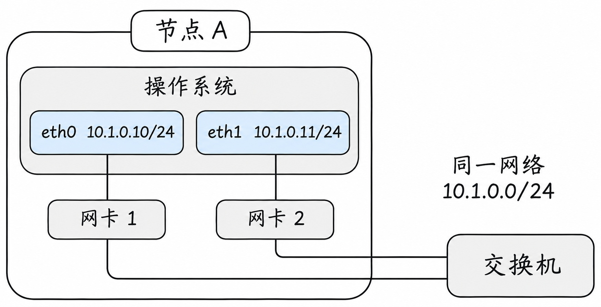

假设这张网络使用 `10.1.0.0/24`，可以让两个接口各用一个不同的地址：

| 接口 | 对应的网卡 | 配置的 IPv4 地址 |
| --- | --- | --- |
| `eth0` | 网卡 1 | `10.1.0.10/24` |
| `eth1` | 网卡 2 | `10.1.0.11/24` |

这样，两个地址都属于同一台节点，也属于同一个子网。当节点发送数据时，选择哪个接口仍取决于路由等配置；在 Linux 上，这种同子网多接口配置还需要结合 ARP 行为考虑，不能简单假定数据一定从某一个接口发出或返回。[Linux 网络配置文档](https://docs.kernel.org/networking/ip-sysctl.html)

还要注意：两块网卡接到同一台交换机，不自动意味着它们处于同一个二层网络。交换机可以划分网络，两个端口的配置也可能不同；本例假设它们确实属于同一个二层网络。后面介绍 VLAN 时会看到这种划分。

### 也可以把两块网卡组合为一个逻辑接口

上面的 `eth0` 和 `eth1` 是分别使用的。另一种常见做法是通过 **bonding**，把它们交给操作系统中的一个逻辑接口统一管理，通常叫作 `bond0`。此时，IP 地址通常配置在 `bond0` 上，由 `bond0` 按所选模式使用下面的物理网卡。

例如，某种模式下可以让一块网卡工作、另一块作为备用；网卡或链路故障时切换。另一些模式可以在多条链路间分担流量。具体能力和交换机是否需要配合，取决于 bonding 模式；多块网卡也不意味着每一条连接的速度都会翻倍。[Linux Bonding 文档](https://docs.kernel.org/networking/bonding.html)

通过这两种接法可以看到：**网卡数量、操作系统中的接口数量、IP 地址数量和网络数量，并不需要相等。**

## 先认识以太网和 IP

计算机之间要通信，双方得先约定数据如何组织、怎样传送。这样的约定称为**网络协议**。一次通信通常需要几种协议配合：有的负责在当前网络中交付数据，有的负责跨网络寻找目标。

**以太网（Ethernet）**是常见的局域网通信技术。上面的例子中，两块网卡通过网线和交换机连接，并按以太网的规则在本地网络中传递数据。以太网中传递的数据单位叫作**帧**：可以先把它理解为带有本地发送方、接收方等信息的一份数据。后面讲的 MAC 地址，就用于标识这一段以太网上的发送方和接收方。

文章中说的“二层网络”，在这个例子里可以先理解为这些设备能够直接交换以太网帧的本地网络；稍后还会讲到交换机如何把它划分为多个部分。

**IP（互联网协议）**则为设备提供 IP 地址，让数据能够在相互连接的网络之间寻找目标。文章开头节点 A 和 B 使用的 `10.1.0.10` 和 `10.1.0.20` 是 **IPv4** 地址：它由 32 位组成，通常写成四段十进制数。

在文章开头的例子中，这些 IP 地址分别配置在 A、B 的网络接口上。一个接口也可能配置多个 IP 地址；开头为了便于理解，每个节点只使用一个地址。

IP 还有 **IPv6** 版本，它使用 128 位地址，写法与 IPv4 不同，例如 `2001:db8::10`。两者都是 IP，但地址格式以及一些配套机制不同。为了先把一条路径讲清楚，本文后面的例子统一使用 **IPv4 和以太网**；实际网络可以使用 IPv4、IPv6 或同时使用两者。

以太网和 IP 并不是两个互相替代的选择。**IP 数据包**可以先理解为按 IP 规则组织、带有源 IP 和目标 IP 的一份数据；在这个例子里，它由以太网帧承载，在本地链路上传递。现在再看网卡与地址，区别就更容易理解了。

## 已经有 IP 地址，为什么还需要 MAC 地址？

回到前面 A、B 连接交换机的那张网卡图。图中 `MAC-A` 和 `MAC-B` 分别代表网卡 A、网卡 B 使用的 MAC 地址；真实的 MAC 地址通常写成六组十六进制数，例如：

| 对象 | 图中简称 | 示例 MAC 地址 |
| --- | --- | --- |
| 节点 A 的网卡 | `MAC-A` | `02:00:00:00:00:0a` |
| 节点 B 的网卡 | `MAC-B` | `02:00:00:00:00:0b` |

这两个地址和下文的表格都是为了演示而假设的，不代表你机器上的实际值。

### IP 在接口上，MAC 却在网卡上？

之前把它们说成“IP 配在接口上、MAC 配在网卡上”，很容易让人以为这两个地址分别属于互不相干的两个地方。这个说法不够准确。

在 Linux 中查看一个以太网接口时，通常既能看到这个接口配置的 IP 地址，也能看到它**当前使用的 MAC 地址**。对于物理网卡，网卡通常带有厂商提供的硬件地址，驱动会将地址提供给操作系统；但接口当前使用的 MAC 在许多环境下也可以通过软件设置。虚拟网络接口没有独立的物理网卡，也可以有自己的 MAC 地址。

所以，更准确的理解是：**IP 和当前使用的 MAC 都与网络接口有关，但它们在通信中承担不同任务。** IP 地址通常根据网络规划配置，可以由管理员设置，或由地址分配服务通过 DHCP 等方式提供；MAC 是以太网链路层使用的地址，物理网卡通常有出厂地址，但实际使用的地址未必永远不能改变。它们之间也不是固定的一对一关系：一个接口可以没有 IP、也可以有多个 IP。

例如，在 Linux 中执行 `ip address show dev eth0`，可能看到类似下面的内容。为了突出地址关系，这里省略了其他字段，并额外假设同一个接口还配置了 `10.1.0.11`。这是一个独立的配置示例，不与前面把 `10.1.0.11` 配置在 `eth1` 上的双网卡示例同时使用：

```text
2: eth0: ...
    link/ether 02:00:00:00:00:0a ...
    inet 10.1.0.10/24 ...
    inet 10.1.0.11/24 ...
```

在这段示例输出中，`link/ether` 后面是接口当前使用的 MAC 地址，两行 `inet` 则是配置在同一个接口上的两个 IPv4 地址。它们显示在一起，并不意味着作用相同。[Linux `ip address` 手册](https://man7.org/linux/man-pages/man8/ip-address.8.html)

假设 A 要把一条查询请求发给 `10.1.0.20`。**IP 地址告诉 A：这次通信的最终目标是谁。**但在当前这段以太网上，A 的网卡还需要按照以太网的规则，把数据交给某块网卡。以太网帧的地址字段使用的是 MAC 地址，普通二层交换机也根据目标 MAC 地址决定往哪个端口转发。

所以，在这个具体例子中，A 要同时准备两层信息：

| 放在哪一层 | 目标地址 | 作用 |
| --- | --- | --- |
| IP 数据包 | `10.1.0.20` | 指明最终要访问节点 B 的 IP 地址 |
| 以太网帧 | `MAC-B` | 告诉当前以太网这帧要交给 B 的网卡 |

在这个例子中，帧里装着 IP 数据包：A 的网卡发送帧；如果交换机已经知道 `MAC-B` 所在的端口，就从端口 2 转发；B 的网卡收到后，再交给 B 的操作系统处理里面的 IP 数据包。交换机如何知道端口，我们马上会讲到。

这里的交换机是中间转发设备，帧的目标 MAC 仍然是 `MAC-B`，不是交换机自己的 MAC。交换机查看目标 MAC 来选择端口，但通常不会把经过它的普通二层帧改成“目标是交换机自己”。直连时没有交换机，这一帧直接经网线到达 B；有交换机时，则由交换机把同一段以太网中的帧转发给 B。

这不是说所有网络都必然使用以太网或 MAC 地址。关键在于：**这个例子使用以太网，而以太网本地交付使用 MAC 地址；IP 提供跨网络的地址和路由能力。**它们配合完成不同范围的交付。

再设想 B 不在本地网络，而在另一台路由器后面：A 仍然要把 IP 数据包发往 B 的 IP 地址，但 A 在第一段以太网中要交付的对象是路由器，因此帧中使用的是路由器这一侧的 MAC 地址。路由器收到后，再在下一段链路中使用适合那一段的 MAC 地址。也就是说，**同一个目标 IP，不要求沿途使用同一个目标 MAC**。后面的跨网段示例会把每一段画出来。

IP 地址能够按照网络前缀组织，让路由器依据目标网络选择路径；以太网则用 MAC 地址在本地链路上交付帧，并且还可以承载 IP 之外的协议。这是现有 IP 与以太网组合的分工，并不意味着其他网络技术也必须使用相同的地址方式。

接下来就剩一个问题：A 起初只知道 B 的 IP，`MAC-B` 从哪里来？

## ARP：用下一站的 IP 找到 MAC

在 IPv4 以太网中，节点 A 可以通过 **ARP** 查询当前链路上某个 IP 地址对应的 MAC 地址。

假设 A 已经判断 B 可以在本地网络中直接找到，但还不知道 B 的 MAC 地址：

1. A 在当前二层网络中广播 ARP 请求，让同一网络中的设备都能收到询问：“谁使用 `10.1.0.20`？请告诉我你的 MAC 地址。”
2. B 发现询问的是自己的地址，向 A 回复：`10.1.0.20` 对应 `MAC-B`。
3. A 将这条对应关系暂存起来，然后发送目标 MAC 为 `MAC-B` 的数据帧。

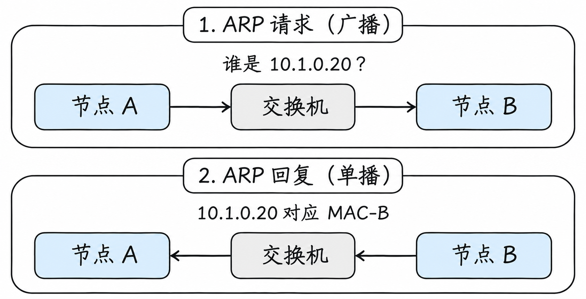

图分两步展示了同一组节点，箭头分别表示请求和回复的方向。上面的请求是广播：图里只画出 B，但如果交换机还有属于同一二层网络的其他适用端口，请求通常也会被转发过去；下面 B 的回复针对 A，通常使用单播。

在这三步中，ARP 询问和后面的业务数据不是同一份数据：询问是为了获得下一站的 MAC；得到答案后，A 才能构造目标 MAC 为 `MAC-B`、里面承载业务 IP 数据包的以太网帧。如果缓存中已有可用记录，A 通常不必在每个业务数据包之前都重新广播一次。

这个过程不以交换机为前提。如果 A 和 B 像文章开头那样通过网线直连，A 的 ARP 询问仍会通过这条链路到达 B，B 可以直接回复；此时中间没有交换机，也就没有需要查询的交换机 MAC 地址表。

这份暂存信息通常称为 **ARP 缓存**；在 Linux 中，它属于邻居表的一部分。这里的“邻居”可以先理解为在当前网络上能直接交付数据的对方。假设 A 查询过 B，它的表中可能出现这样一行：

| 邻居 IP | 邻居 MAC | 接口 | 状态示例 |
| --- | --- | --- | --- |
| `10.1.0.20` | `02:00:00:00:00:0b`（`MAC-B`） | `eth0` | `REACHABLE` |

这里的 `eth0` 是示例接口名；`REACHABLE` 表示邻居近期被确认可达。真实系统还可能显示其他状态，缓存也会老化或更新。表中的每一行都是**本机某个接口上，邻居 IP 和链路层地址的对应信息**，不是整个集群的 Pod 名单。

如果最终目标在另一个网段，A 还可能先把数据交给一台中间设备。这时需要解析谁的 MAC，我们会在后面的跨网段例子中看到。[ARP 规范，RFC 826](https://www.rfc-editor.org/rfc/rfc826.html)

本节的 ARP 只适用于 IPv4 场景。IPv6 在以太网上使用邻居发现协议完成类似的地址解析和邻居管理，不使用 ARP。[IPv6 邻居发现，RFC 4861](https://www.rfc-editor.org/rfc/rfc4861.html)

## 交换机又是怎么知道走哪个端口的？

A 知道了 `MAC-B`，就能把目标 MAC 写入以太网帧。但交换机还有自己的问题：**`MAC-B` 在哪个端口？**

交换机维护一张 MAC 地址表。它收到帧时，会根据帧的**源 MAC** 和进入端口学习对应关系；转发时，再根据**目标 MAC** 查找出口。

例如，A 的 ARP 请求从端口 1 进入，交换机可以学习到 `MAC-A → 端口 1`；B 的 ARP 回复从端口 2 进入，交换机又能学习到 `MAC-B → 端口 2`。学习完成后，表可以简化为：

| MAC 地址 | 所在端口 |
| --- | --- |
| `MAC-A` | 端口 1 |
| `MAC-B` | 端口 2 |

于是，在我们这个简单网络里，交换机收到目标为 `MAC-B` 的帧后，可以查表并从端口 2 转发。

如果交换机还不知道目标 MAC 的端口，它通常会在对应的二层网络范围内，向其他适当端口**泛洪**这个帧，也就是把它发送到多个可能通向目标的端口；ARP 请求属于广播，同样会在一定的二层网络范围内传播。这个范围之后可以通过 VLAN 划分。MAC 表并非永久有效，动态条目通常会老化。

**注意两张表不在同一个地方，也解决不同问题：**节点 A 的 ARP 缓存回答“邻居 IP 对应什么 MAC”；交换机的 MAC 地址表回答“目标 MAC 在哪个端口”。

网卡、MAC 地址、帧和交换机，属于通常所说的**二层：数据链路层**。目前可以把二层理解为：在一段本地网络中，设备之间如何交付一个帧。

## IP 地址后面的 `/24` 是什么意思？

回到最初那张图：A 是 `10.1.0.10`，B 是 `10.1.0.20`，它们都位于 `10.1.0.0/24`。

在 IPv4 中，地址由 32 个二进制位组成。`/24` 表示前 24 位是网络前缀，剩余 8 位用于区分这个子网中的地址。对于这个具体例子，它对应的子网掩码是 `255.255.255.0`：前面三个十进制数共同标识这个 `/24` 子网。

因此：

- `10.1.0.10/24` 与 `10.1.0.20/24` 的网络前缀都是 `10.1.0.0/24`。
- `10.2.0.20` 不属于 `10.1.0.0/24`。

`10.1.0.0/24` 是一个 **CIDR** 写法，用地址加前缀长度表示一个网段。对于常规 `/24` 子网，地址从 `10.1.0.0` 到 `10.1.0.255`；其中 `.0` 通常表示网络地址，`.255` 通常作为该子网的广播地址。实际地址是否能分配，还要看网络和平台的配置。

不要只看 IP 的前几段数字是否相同就判断“同网段”：还必须知道前缀长度。比如 `/16` 和 `/24` 的划分范围不同。

来看一个具体对照：若 A 配置为 `10.1.0.10/24`，目标 `10.1.1.20` 的前三段与 A 不同，不属于 A 的 `10.1.0.0/24`；但若 A 配置为 `10.1.0.10/16`，前两段都是 `10.1`，这个目标就属于 `10.1.0.0/16` 的地址范围。两种结果来自**A 自己配置的前缀长度**，不是目标地址单独决定的。

不过，地址范围内的目标能否直接找到，还取决于它们是否有可用的二层连接和双方配置。如果两台机器物理隔离或被 VLAN 分开，即使地址都落在同一个子网，ARP 也不能凭地址跨过这些隔离自动找到对方。

## 如果目标在另一个网段呢？

现在我们增加节点 C。它的 IP 是 `10.2.0.20`，属于 `10.2.0.0/24`。节点 A 仍在 `10.1.0.0/24` 中，两个网段之间由一台路由器连接。

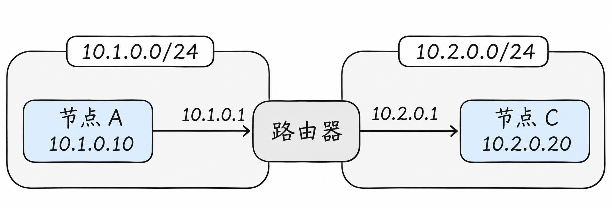

图中，**路由器**是一台连接不同网络并转发数据的设备：它在 A 所在网络的一侧使用 `10.1.0.1`，在 C 所在网络的一侧使用 `10.2.0.1`。A 在需要时可以先将数据交给这台路由器；对 A 来说，`10.1.0.1` 就是通往其他网络的一处出口，也称为**网关**。这里将它配置为 A 的默认网关。两侧网络都假设使用以太网。

### 先查路由表：这一包交给谁？

节点 A 发数据前，要先决定从哪个网络接口发出，以及在这一段网络中应该交给谁。这个决定依据**路由表**。对于上图的网络，A 的路由表可以简化成：

| 目标范围 | 下一跳 | 发送接口 | 含义 |
| --- | --- | --- | --- |
| `10.1.0.0/24` | 直接交付 | `eth0` | 目标在本地子网，通过 `eth0` 直接找目标 |
| `0.0.0.0/0` | `10.1.0.1` | `eth0` | 其他没有更具体匹配的 IPv4 目标交给网关 |

`0.0.0.0/0` 表示默认路由：它能匹配所有 IPv4 目标，但只有没有更具体的可用匹配时才会被选中。表格省略了真实路由表可能出现的来源、优先级等信息；实际路径还可能受策略路由等配置影响。

在这个简单例子中，A 向本地的 B（`10.1.0.20`）发送时，匹配第一行，直接找 B；向 C（`10.2.0.20`）发送时，不匹配第一行，于是选中默认路由，把 `10.1.0.1` 当作下一跳。

路由表从哪里来？节点配置 IP 地址和子网时，操作系统通常会建立相应的直连路由；默认网关可能由管理员或网络配置工具设置，也可能由 **DHCP**——一种提供 IP 地址等网络配置信息的协议——告知节点。其他路由也可以由管理员配置，或由路由协议、集群网络组件等写入。**路由表描述的是如何走，不是 ARP 缓存中的 IP 到 MAC 对照表。**

### 再查邻居缓存：下一跳的 MAC 是多少？

A 已经确定要把帧交给网关 `10.1.0.1`，接下来才在 `eth0` 上查询这个下一跳的 MAC 地址。假设网关这一侧的接口使用 `02:00:00:00:00:01`，我们把它简称为 `MAC-R1`。如果 A 之前解析过网关，邻居表中可能多出一行：

| 邻居 IP | 邻居 MAC | 接口 | 状态示例 |
| --- | --- | --- | --- |
| `10.1.0.1` | `02:00:00:00:00:01`（`MAC-R1`） | `eth0` | `REACHABLE` |

如果没有可用缓存，A 就先通过 ARP 解析网关地址，再建立或更新这条记录。

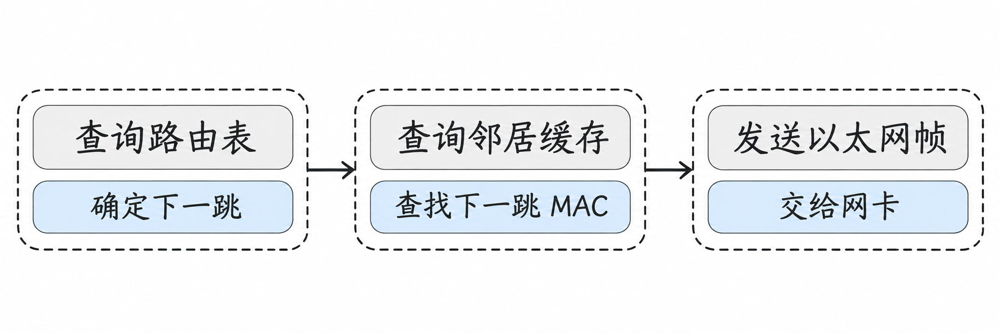

图中是本例的简化发送顺序。对于直连目标，下一跳就是目标本身；对于经网关转发的目标，下一跳是网关。缓存尚未建立时，需要先完成地址解析，才能继续交付。

### 到了路由器，MAC 地址为什么变了？

为方便说明，把路由器在 A 所在网络一侧的网卡地址叫作 `MAC-R1`，在 C 所在网络一侧的网卡地址叫作 `MAC-R2`；节点 C 的网卡地址叫作 `MAC-C`。

再把两侧可能存在的交换机也画出来：下面假设 A 和路由器左侧连接同一台交换机，路由器右侧和 C 连接另一台交换机。交换机在各自网络内转发帧，路由器负责把 IP 数据包从一个网络交到另一个网络。

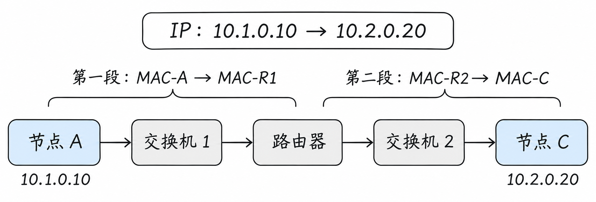

图中仅画出从 A 发往 C 的方向。上方 IP 是这个例子的源和目标；两段 MAC 标识的是各段以太网帧的源和目标，并不是交换机自身的地址。

对于 A 发给 C 的请求，在没有 NAT 等额外处理的前提下：

| 发送在哪一段 | IP 数据包中的源和目标 | 这一段帧的源和目标 MAC |
| --- | --- | --- |
| A → 路由器 | `10.1.0.10` → `10.2.0.20` | `MAC-A` → `MAC-R1` |
| 路由器 → C | `10.1.0.10` → `10.2.0.20` | `MAC-R2` → `MAC-C` |

第一段的帧交给路由器后，路由器根据目标 IP 查自己的路由表，发现 C 所在的 `10.2.0.0/24` 是它直接连接的网络，再为第二段链路构造新的以太网帧。它要在第二段找到 C 的 MAC，也可能使用自己的邻居缓存或 ARP。

因此，在这个例子中，A 不需要在第一段广播询问 C 的 MAC：C 不在 A 当前的二层网络中，A 先交付给的是网关。源和目标 IP 在此例中保持不变，但路由器转发时也会更新 IP 头中的一些字段，例如 **TTL**——一个限制数据包在网络中继续转发次数的字段，每经过路由器通常会减一。“IP 地址不变”不等于整个数据包的每个字节都不变。

路由器收到数据后如果没有可用路由，或者 C 没有可用的返回路径，通信仍然会失败。上图只画出了从 A 到 C 的方向；响应返回也需要逐段转发。

IP、子网和路由属于通常所说的**三层：网络层**。二层解决当前链路上的交付；三层让数据能够在不同网络之间逐跳前进。

## 同一台交换机，能不能分成几张网络？

随着设备增多，我们可能希望一部分机器和另一部分机器分开。下面换一个独立的例子：四台主机接在同一台交换机上，但 A、B 属于一组，C、D 属于另一组。

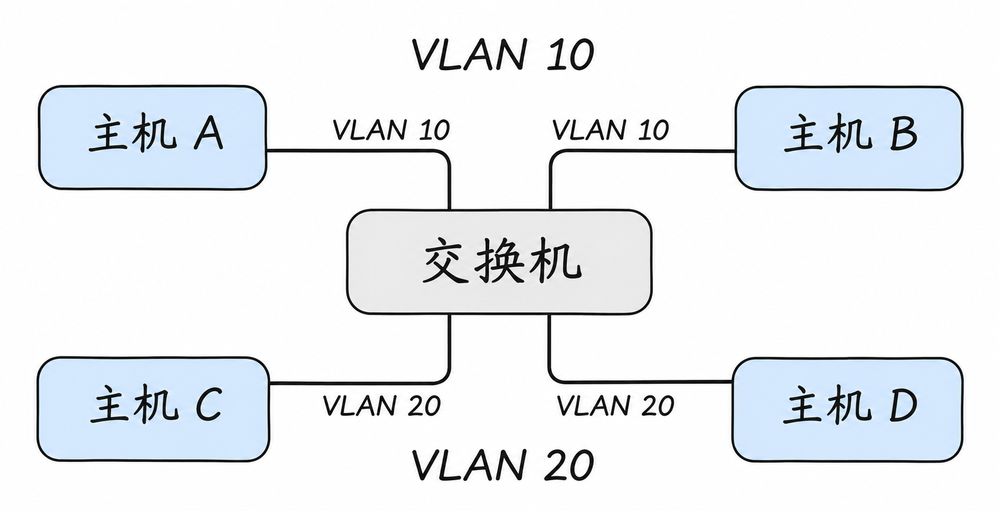

**VLAN** 可以在交换机上划分逻辑上的二层网络。在这个例子中，A、B 所连接的交换机端口属于 VLAN 10；C、D 所连接的端口属于 VLAN 20。

虽然共用一台物理交换机，VLAN 10 中的普通二层广播不会直接扩散到 VLAN 20。想让两个 VLAN 之间的主机通信，需要通过具备相应路由能力的设备或配置，并考虑访问控制。

一组 VLAN 也可以跨多台交换机，前提是交换机之间的连接配置允许相应 VLAN 通过。这类连接常称为 **Trunk**；连接普通终端的端口常被配置为 **Access**。不同设备的配置术语和细节可能有所不同，这里先理解它们各自解决的问题即可。

例如，交换机 1 的 A 与交换机 2 的 B 都要加入 VLAN 10，那么交换机之间的链路必须允许 VLAN 10 的流量通过。常见的 802.1Q Trunk 用标签让接收端区分不同 VLAN；接普通终端的 Access 端口则通常将无标签帧归入配置的 VLAN。具体标签、原生 VLAN 和端口行为以设备配置为准。**VLAN 标签让交换机区分所属的二层网络，并不代替 IP 地址或跨网段路由。**

有两个容易混淆的点：

- **VLAN 是二层的逻辑划分，IP 子网是三层的地址划分。** 实际部署中常把一个 VLAN 与一个 IP 子网对应，但它们不是同一个概念。
- **处于同一 IP 子网不自动保证二层互通。** VLAN、交换机配置和其他限制仍可能让设备无法直接相互到达。

VLAN 划分的广播域及跨 VLAN 路由，可参考 [Cisco 的 VLAN 与路由说明](https://www.cisco.com/en/US/docs/ios/lanswitch/configuration/guide/lsw_rtng_vlan_ovw.html)。

## 数据真正发出去时，里面装了什么？

前面一直在说“把请求发给另一台计算机”。现在把这个请求打开看一眼。

假设网站使用 HTTP 接收查询，网络使用 TCP 传输，底层链路使用以太网。为了便于理解，下图把一次**足够小、可以放进一个 TCP 报文段**的请求画成层层包含的形式：

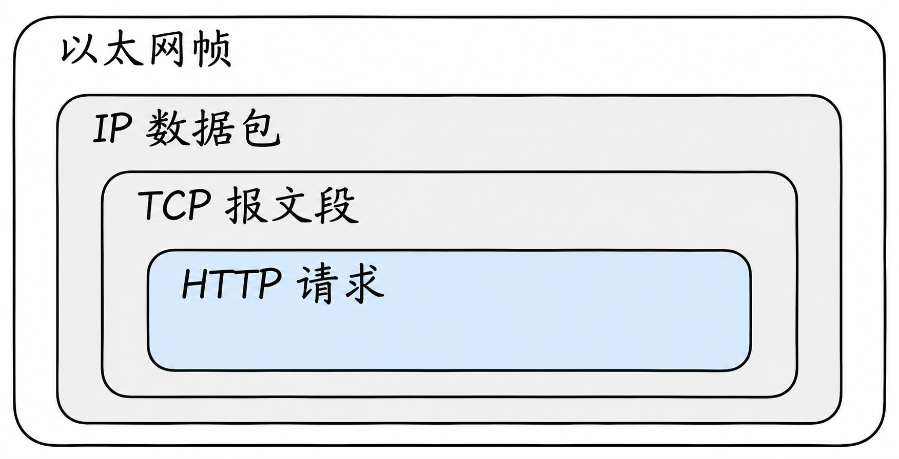

每一层都在处理自己关心的事情：

- **HTTP 请求**表达应用要做什么，例如查询某个资源。
- **TCP** 帮助两端应用建立连接，并可靠、有序地传输字节流。
- **IP** 负责使用源 IP 和目标 IP，让数据能够跨网络传递。
- **以太网**使用当前链路上的 MAC 地址，将帧交给这一段网络中的下一站。

图中的嵌套是帮助理解的简化模型。真实通信中，一个 HTTP 请求可能跨越多个 TCP 报文段；HTTPS 还会涉及 TLS；并且不是所有底层链路都使用以太网帧。

## 到了目标计算机，怎么找到具体应用？

IP 地址让数据到达目标计算机，但一台计算机上可能同时运行网站、数据库和其他应用。如何知道数据应该交给谁？

这就需要**端口**。例如，假设节点 B 上的网站应用监听 TCP 端口 `8080`，节点 A 就可以连接 `10.1.0.20:8080`。

`10.1.0.20` 指定目标地址，`8080` 指定目标端口。发送方也会使用自己的源端口，以便区分不同连接。端口号需要结合传输协议理解：TCP 端口与 UDP 端口属于不同的协议空间。

假设节点 A 的应用连接 `10.1.0.20:8080` 时，操作系统临时分配了源端口 `53000`：从通信两端看，这条 TCP 连接可以用“源 IP、源端口、目标 IP、目标端口及协议”来区分。B 的响应发回 `10.1.0.10:53000`，而不是只写一个节点 A 的 IP；A 的操作系统据此把它交给对应连接。客户端端口值在实际运行中由系统或应用选择，不必固定为 `53000`。

还要看应用**监听在哪个地址**。如果 B 的服务只监听 `127.0.0.1:8080`，它接受的是 B 自己的回环地址上的连接，A 访问 `10.1.0.20:8080` 通常无法到达它。若服务监听 `0.0.0.0:8080`，通常表示监听本机所有 IPv4 地址上的该端口；这也不自动放行防火墙或保证网络路径正常。

TCP 在传数据前会建立连接，接收方确认已经收到的数据，发送方在必要时重传，接收端再按顺序向应用交付字节流。即使如此，连接仍可能因为目标未监听、网络故障或超时而失败；TCP 的可靠性不意味着请求一定成功。[TCP 规范，RFC 9293](https://www.rfc-editor.org/rfc/rfc9293.html)

另一种常见传输协议是 UDP。它按数据报发送，不像 TCP 一样提供连接建立、可靠重传和有序字节流。是否需要重试、如何处理丢包，取决于使用它的应用或上层协议。

## 我们为什么更习惯使用名字？

记住 `10.1.0.20:8080` 并不方便，地址变化后还要修改配置。因此，应用通常使用名字，例如 `knowledge.example.com`。

**DNS** 的工作之一，就是回答“这个名字对应哪个 IP 地址”。应用获得地址后，再使用 IP 地址和端口建立连接。

可以把一次访问分成两个先后的动作：先查名字，得到地址；再向地址发起连接。名字查到了，只说明解析得到了结果，不代表目标应用一定在运行，也不代表端口或网络一定可达。

Kubernetes 中的服务发现同样需要名字解析。上一篇的网站应用可以使用 `knowledge` 这样的服务名称；关于集群内名称如何解析、Service 如何选择后端，会在本系列第 6 篇展开。

## 私有地址怎样访问外部网络？

前面的 `10.1.0.10` 属于私有 IPv4 地址范围。私有地址可以在内部网络使用，但通常不能直接作为公网中可路由的地址使用。[私有地址规范，RFC 1918](https://www.rfc-editor.org/rfc/rfc1918.html)

假设节点 A 需要访问外部网站，而出口设备拥有可供外部网络返回流量的地址。一种常见做法是 **NAT：网络地址转换**。

当请求经过出口设备时，设备可以将数据包中的源地址换成出口地址；响应回来后，再根据保存的连接信息做相应的反向转换，交还给 A。这种改变源地址的方式称为 **SNAT**。多个内部连接共用一个外部地址时，设备还可能转换端口，以区分不同连接。

如果是把请求的**目标地址**改为另一个地址，则称为 **DNAT**。上一篇提到的某些 Service 实现，就会用目标地址转换把发往服务入口的请求导向后端 Pod。

继续把一次出站连接展开。假设内部 A 为 `10.1.0.10:53000`，访问外部 `203.0.113.20:443`；出口设备使用 `198.51.100.10`，并在这个例子中将源端口改为 `40001`。这些地址和端口仅用于说明过程：

| 观察时刻 | 源地址和端口 | 目标地址和端口 |
| --- | --- | --- |
| A 发出请求 | `10.1.0.10:53000` | `203.0.113.20:443` |
| 出口完成源地址转换 | `198.51.100.10:40001` | `203.0.113.20:443` |
| 外部服务发送响应 | `203.0.113.20:443` | `198.51.100.10:40001` |
| 出口按连接状态反向转换后 | `203.0.113.20:443` | `10.1.0.10:53000` |

出口设备需要保存转换关系，才能知道返回到 `198.51.100.10:40001` 的响应应交还给哪条内部连接。是否改写端口取决于实现和连接情况，并非每次 SNAT 都一定改变端口；响应也必须经过能够正确处理这份转换状态的路径。

NAT 并不是网络通信的必经环节；是否使用、在哪里使用，要看地址规划、路由和具体实现。公网访问也可能经过代理或其他出口设施。

## 为什么有时小包能通，大包却不通？

假设 A 和 C 之间的路由都正确，小请求成功了，较大的传输却频繁失败。这时除了应用和防火墙，还可以检查 **MTU**。

MTU 表示一个网络接口能够承载的最大 IP 数据包大小。通信路径上可能有多段链路，其中某一段支持的大小更小，就会限制整条路径能够顺利传递的包。

IPv4 在特定条件下允许分片，但分片存在代价；如果包不允许分片，网络设备可能丢弃过大的包并返回相应的 ICMP 提示。发送方可以借助路径 MTU 发现机制调整发送大小；如果必要的提示报文也被阻断，就可能出现小包能通、大包不通的现象。[路径 MTU 发现，RFC 1191](https://www.rfc-editor.org/rfc/rfc1191.html)

这与 Kubernetes 有什么关系？后面介绍跨节点网络时会看到：某些网络方案会在原始数据之外增加一层封装。外层信息也要占空间，因此需要在网络配置中考虑 MTU。并不是每个集群都使用封装，具体数值要结合实际链路和方案确定。

## 如何在自己的机器上观察？

读懂上面的例子后，可以在一台 Linux 机器上做几项**只读观察**。这些命令不会修改网络配置；输出中的接口名、地址和下一跳取决于你实际所在的网络。

```bash
# 查看网络接口和地址
ip -br address

# 查看 IPv4 路由表
ip -4 route

# 看看系统准备如何发送到某个目标；将地址换成你要观察的目标
ip -4 route get 10.2.0.20

# 在已配置的例子中，观察 A 发往 B 时会选择哪条路
ip -4 route get 10.1.0.20

# 查看当前已知的 IPv4 邻居地址信息
ip -4 neigh
```

重点观察：目标走哪个接口？有没有 `via` 指出的下一跳？邻居表里有没有下一跳或同网段目标的地址？邻居信息有生命周期，因此表中没有某项不必然说明网络故障。

如果你已经实际配置好文章开头的 A、B 直连环境，也可以在 A 上执行 `ping -c 3 10.1.0.20`，让 A 向 B 发送少量测试报文，然后再查看 `ip -4 neigh`。`ping` 会产生网络流量；如果失败，可能是链路、地址、路由或防火墙等原因，也可能只是对方不响应这类测试报文，不能单凭失败就断定网线不通。

在这个只有 A、B 两端的直连例子中，假设 A 使用 `eth0`，`ip -4 route get 10.1.0.20` 可能显示：

```text
10.1.0.20 dev eth0 src 10.1.0.10
```

它表示系统准备从 `eth0` 发往 B，并使用 `10.1.0.10` 作为源地址。这里没有 `via`，也就是这条示例路径没有指定网关作为下一跳。通信时，A 仍需知道 B 在这条以太网链路上使用的 MAC 地址；前面讲过，它可以通过 ARP 获得，之后可能在 `ip -4 neigh` 的输出中看到对应记录。**没有交换机，ARP 仍然可以在两端之间工作。**

再换回前面通过交换机连接、并配置了网关 `10.1.0.1` 的网络，节点 A 的 `ip -4 route` 和 `ip -4 neigh` 可能分别显示如下内容。这是另一个场景的示意输出，并不是说只有 A、B 和一根网线时，网关也会自动出现：

```text
# ip -4 route
default via 10.1.0.1 dev eth0
10.1.0.0/24 dev eth0 proto kernel scope link src 10.1.0.10

# ip -4 neigh
10.1.0.20 dev eth0 lladdr 02:00:00:00:00:0b REACHABLE
10.1.0.1 dev eth0 lladdr 02:00:00:00:00:01 STALE
```

第一组是路由：默认流量经 `10.1.0.1`，本地子网通过 `eth0` 直连。第二组是邻居信息：B 的 IP 对应 `MAC-B`，网关的 IP 对应 `MAC-R1`。`STALE` 表示邻居信息不再被认为是近期确认过的，不等于这个地址一定失效；系统会根据需要继续验证或更新。

如果你暂时没有 Linux 环境，也可以先只读文章；本系列后续会结合 Linux 网络和实际环境继续操作。

## 再回到 Kubernetes

现在回看第一篇中的两个 Pod：它们运行在节点 A 和节点 B 上，发送请求时，底层仍然离不开网络接口、地址和转发路径。两个节点的网卡可以直连，也可以通过交换机连接；节点之间能够通信，是集群网络的重要基础。

但**节点互通不自动等于 Pod 互通**。Pod 不是直接插在物理交换机上的普通计算机；集群还需要在节点内部为它们构建网络，并把不同节点上的 Pod 网络连接起来。这取决于所采用的网络实现和配置。

理解这里介绍的二层、三层和路由后，我们就可以继续向下看：一台 Linux 节点里，Pod 是怎样拥有自己的网络空间，又是怎样接到节点网络上的。

下一篇：[Linux 网络：一台主机里的虚拟网络](03-linux-networking.md)。

## 参考资料

- [RFC 826：ARP](https://www.rfc-editor.org/rfc/rfc826.html)
- [RFC 4861：IPv6 邻居发现](https://www.rfc-editor.org/rfc/rfc4861.html)
- [RFC 791：IPv4](https://www.rfc-editor.org/rfc/rfc791.html)
- [RFC 9293：TCP](https://www.rfc-editor.org/rfc/rfc9293.html)
- [RFC 1918：私有 IPv4 地址](https://www.rfc-editor.org/rfc/rfc1918.html)
- [RFC 1191：路径 MTU 发现](https://www.rfc-editor.org/rfc/rfc1191.html)
- [Cisco：VLAN 与跨 VLAN 路由](https://www.cisco.com/en/US/docs/ios/lanswitch/configuration/guide/lsw_rtng_vlan_ovw.html)
