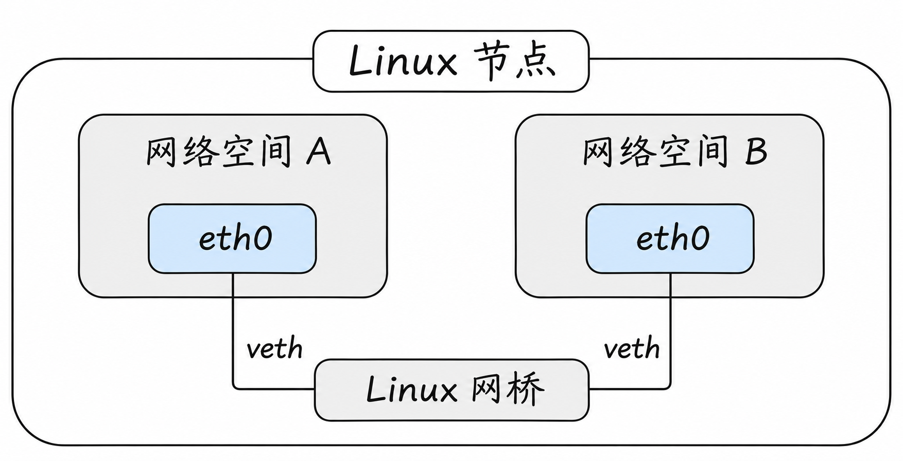
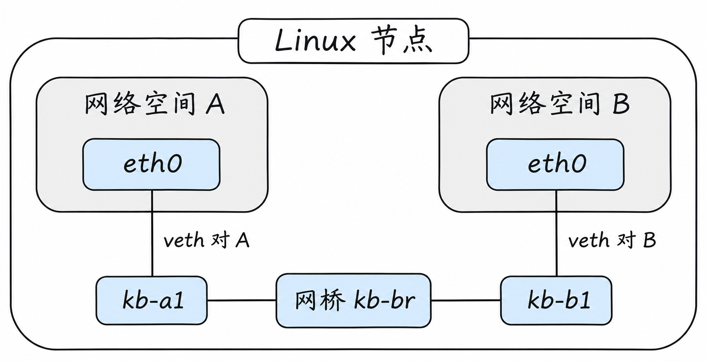
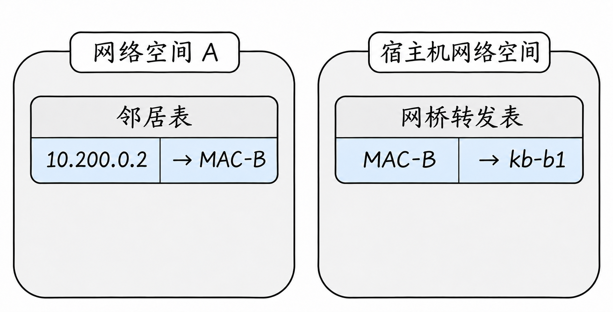
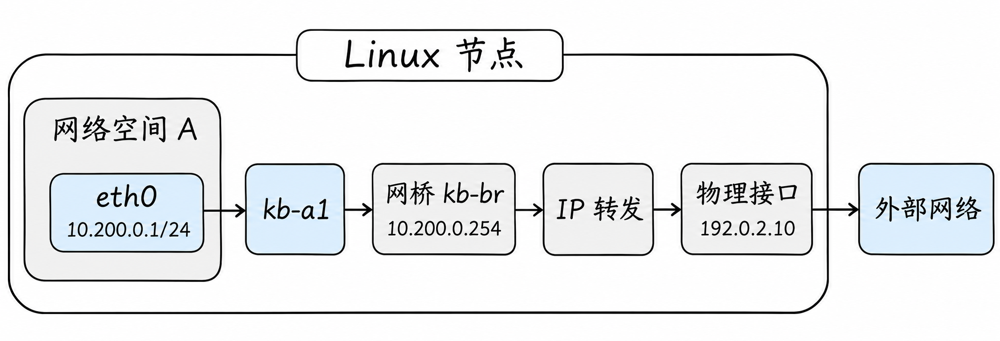

# Linux 网络：一台主机里的虚拟网络

上一篇中，我们用两台计算机、网卡和交换机走通了一次通信。现在把问题缩小到一台 Linux 节点：如果两份应用都运行在同一台机器上，能否让它们各自拥有网卡、地址和路由，又能互相访问？

答案是可以。Linux 并没有给每个应用变出一台新的物理机器，而是在同一个内核中提供不同的网络空间，再用虚拟网络设备把它们连接起来。本篇从这个例子出发，一步步认识后续理解 Pod 网络所需的部件。

## 1. 为什么要分出网络空间？

假设网站应用和知识库应用原本都作为普通进程运行在节点 A 上。如果它们都要监听同一个本地地址和端口，例如 `0.0.0.0:8080`，通常会发生端口冲突。它们还共享节点当前的网络接口和路由视图。

Linux 的 **network namespace（网络命名空间）**提供了一组相互隔离的网络资源视图。不同网络命名空间可以各有接口、IP 地址、路由表、端口空间和防火墙规则。因此，空间 A 中的应用与空间 B 中的应用都可以各自监听 `8080`，互不占用同一个网络空间里的端口。

可以把网络空间理解为内核中一套独立的网络环境，而不是一张虚拟机器的磁盘或一份新的操作系统。进程处在哪个网络空间，看到的接口和路由就来自哪个空间。每个空间通常还有自己的 `lo` 回环接口：当空间 A 内的进程访问 `127.0.0.1`，它访问的是 A 的回环，而不是 B 或宿主机的回环。

这里的“隔离”首先是隔离各自的网络配置和视图，并不意味着它们永远不能通信；后面正是要通过接口和转发规则把这些空间连接起来。网络空间也不独自决定文件、进程或用户权限是否隔离；容器通常还会结合其他隔离机制。[Linux 网络命名空间](https://man7.org/linux/man-pages/man7/network_namespaces.7.html)

这不是两份 Linux 内核。它们仍使用同一台机器的内核，只是进程看到的网络资源不同。一个网络命名空间可以由多个进程共享；在普通 Kubernetes Pod 中，同一个 Pod 的容器通常共享网络命名空间，所以它们可以通过 `localhost` 互相访问，也要避免端口冲突。`localhost` 指当前网络命名空间，并不自动指整台节点。[network_namespaces(7)](https://man7.org/linux/man-pages/man7/network_namespaces.7.html)

有了隔离之后，又出现了新的问题：空间 A 看不到空间 B 的接口，它们怎么通信？

## 2. 用 veth 把网络空间接出来

**veth pair** 是一对相连的虚拟以太网接口。数据从一端发出，会出现在另一端。它们是内核中的软件设备，不是物理网卡。

例如，创建一对 veth，把一端放入空间 A 并命名为 `eth0`，另一端留在宿主机网络空间。空间 A 里的进程看到的是自己的 `eth0`；宿主机一侧看到的是另一端的接口。两端名字可以不同，`eth0` 只是空间 A 内的名字。

要把多个空间接到一起，一种常见做法是在宿主机侧创建 **Linux bridge（网桥）**：



图里每条标记为 veth 的连接实际上由**一对接口**组成：一端在各自的网络空间里，另一端接入宿主机网桥。图为了突出连接关系省略了宿主机侧的接口名称。[veth(4)](https://man7.org/linux/man-pages/man4/veth.4.html)

网桥可以理解成 Linux 内核中的二层交换设备。它有端口，也会学习 MAC 地址和端口的对应关系。这里的网桥、veth 和两个网络空间构成了一张软件实现的本地网络；没有为每个空间插入一块物理网卡。[Linux bridge 文档](https://docs.kernel.org/networking/bridge.html)

注意“veth 的一端接入网桥”表达的是内核中两个网络设备之间的关联：假设把 A 的 veth 宿主机端命名为 `kb-a1`，把网桥命名为 `kb-br`，那么 `kb-a1` 自己是一张虚拟接口，同时可以成为 `kb-br` 的一个端口。它不是一根插入虚拟网卡之后又插入网桥的真实网线。不同容器网络方案可以采用不同设备，这里先把这一种拓扑理解透彻。

## 3. 同一节点内的一次通信

假设空间 A 的 `eth0` 是 `10.200.0.1/24`，空间 B 的 `eth0` 是 `10.200.0.2/24`；各自的 veth 宿主机端都连接同一个网桥。两个空间中的接口和网桥端口均已启用。

空间 A 的应用访问 `10.200.0.2` 时：

1. A 的路由表判断目标在直连子网，通过自己的 `eth0` 发出。
2. 如果不知道 B 的 MAC，A 使用 ARP 获取；ARP 请求经 veth 到达网桥，网桥在适当端口转发。
3. B 回复自己的 MAC；随后 A 发送携带 IP 数据包的以太网帧。
4. 帧从 A 的 veth 另一端进入网桥，网桥根据目标 MAC 转发到 B 的 veth 宿主机端；B 的 `eth0` 收到数据。

这与上一篇的物理交换机例子很像：**变化的是网卡、网线和交换机可以由软件实现，IP、MAC 和二层转发的职责仍要分清。**但不是所有容器网络都使用网桥；有的实现将 veth 与节点三层路由直接结合，或使用其他设备。

### 把每一个接口对上号

为了不把“一对 veth”误认为一根独立于网卡的线，可以给四个接口起名字：



图中的竖线用来表示两个 veth 端点之间的配对关系，不是一根额外插入的物理网线。宿主机侧的两个接口再分别作为网桥端口，形成同一张二层网络。

| 所在位置 | 接口 | 另一端 | IP 地址示例 |
| --- | --- | --- | --- |
| 空间 A | `eth0` | 宿主机的 `kb-a1` | `10.200.0.1/24` |
| 宿主机 | `kb-a1` | 空间 A 的 `eth0` | 本例不配置 IP |
| 空间 B | `eth0` | 宿主机的 `kb-b1` | `10.200.0.2/24` |
| 宿主机 | `kb-b1` | 空间 B 的 `eth0` | 本例不配置 IP |

`eth0` 与 `kb-a1` 构成一对，另两个构成另一对。两个宿主机接口作为 `kb-br` 的端口；桥并不需要知道应用叫网站还是知识库，它看到的是帧与 MAC。桥学习完成后，转发表可能记录“B 的 MAC 从 `kb-b1` 可达”。

从 A 看，目标 `10.200.0.2` 在 `10.200.0.0/24` 中，直连路由选择 A 的 `eth0`，ARP 缓存记录 B 的 IP 对应 B 的 MAC。交换机式网桥的转发表则记录 B 的 MAC 对应宿主机端口 `kb-b1`。两张表在不同网络空间或设备上，不能混为一张。



两张表的建立过程也不同。A 初次询问 `10.200.0.2` 时，ARP 请求是广播，网桥将它交给适当的其他端口，B 收到后回复。A 收到回复，将 `10.200.0.2 → MAC-B` 放入自己的邻居表；网桥在收到 B 发来的帧时，根据源 MAC 和入端口学习 `MAC-B → kb-b1`。接下来 A 的帧以 `MAC-B` 为目标，网桥就可以根据已学到的端口转发。示例假设地址正常、两端均允许 ARP，实际表项会过期或变化。

如果网桥暂时没有目标 MAC 的记录，符合条件的未知单播可能在其他可转发端口泛洪；这与 A 的邻居表里是否有 B 的 IP/MAC 记录是两件事。一台机器内的虚拟网络仍然需要这些本地交付步骤。

这一例中桥接的是同一子网的二层帧，不是把桥当成默认网关。A 不需要先把包送到一个有 IP 的路由器才能找到 B；如果目标换成其他网段，再检查默认路由和网关。

### 为什么重名的 `eth0` 不冲突？

名称用于在所属网络空间中找到接口，空间 A 和空间 B 分别维护自己的接口集合，因此都可以有 `eth0`。同一网络空间里则不能有两个同名接口。同样，两边 `127.0.0.1` 分别指向各自空间的回环接口；A 请求自己的 `localhost:8080` 不会自动到 B。

宿主机自己的网络空间与这两个空间也不同。查看命名空间之前，先确认命令在哪一个空间执行：同一条 `ip route` 在不同空间给出的答案可能完全不一样。

## 4. 网桥、宿主机与物理网卡

网桥端口连接的可以是 veth，也可以在合理配置下连接其他网络设备。网桥本身也是一个网络设备，是否在它上面配置地址取决于需求：上面的两个空间在同一子网通信，不要求网桥一定有 IP；如果宿主机也要以 IP 方式参与该网络，则需要相应地址和路由配置。

不要因为“网桥像交换机”，就推断它必然连接物理网卡或外网。图里的桥只连接了两个虚拟空间；要访问节点外部，还需要路由、转发以及底层网络的配合。

另外，接口所在的网络命名空间决定了从哪里查看它。宿主机执行 `ip addr` 与在空间 A 中执行 `ip addr`，看到的接口列表可能不同。接口的名称也只需在所属网络空间内区分，因此不同空间都可以有 `eth0`。

## 5. 要访问另一张网络：路由和转发

同网段时，网桥按 MAC 转发帧；如果目标不在本地网段，空间 A 要根据自己的路由表选择网关。网关可以是宿主机某个接口，但前提是地址、路由和节点的 IP 转发都已配置，并且目标有可用返回路径。

### 用一个具体例子走出节点

前面的同网段例子中，网桥没有配置 IP，A、B 可以通过这张虚拟网络直接访问彼此。现在换成一个**额外配置后的假设场景**：宿主机给网桥 `kb-br` 配置 `10.200.0.254/24`；空间 A 仍使用 `10.200.0.1/24`，并将 `10.200.0.254` 设为默认网关。宿主机的物理接口 `enp1s0` 使用 `192.0.2.10/24`，其上游网关是 `192.0.2.1`。空间 A 中的应用要访问外部服务器 `203.0.113.20`。



图只画了请求从 A 走向外部的方向。`IP 转发`表示宿主机内核的处理过程，并非另插入的一块网卡；图中没有展开宿主机上游网关和外部服务器。

这与之前同网段找 B 不同：`203.0.113.20` 不在 A 的 `10.200.0.0/24` 中，A 先把包交给默认网关。下面是为说明这个场景而简化的路由，**不是前面实验运行后自动出现的配置**：

| 查路由的位置 | 目标 | 如何走 |
| --- | --- | --- |
| 空间 A | `10.200.0.0/24` | 从 A 的 `eth0` 直接交付 |
| 空间 A | 其他目标 | 经 `10.200.0.254`，从 A 的 `eth0` 发出 |
| 宿主机 | `10.200.0.0/24` | 通过 `kb-br` 交付 |
| 宿主机 | `192.0.2.0/24` | 通过 `enp1s0` 直接交付 |
| 宿主机 | 其他目标 | 经 `192.0.2.1`，从 `enp1s0` 发出 |

先看从 A 出去的过程：

1. A 判断外部地址不在直连网段，选中默认路由。A 通过 ARP 获取网关 `10.200.0.254` 使用的 MAC，然后把目标 MAC 设为网关 MAC；IP 包的目标仍是 `203.0.113.20`。
2. 帧经 A 的 `eth0`、veth 宿主机端和网桥到达宿主机的网关接口。由于帧交给了网桥接口本身，宿主机可以继续按 IP 处理其中的数据包。
3. 宿主机查**自己的**路由表，把 `192.0.2.1` 作为下一跳；在 IPv4 转发已启用、过滤规则允许的前提下，从 `enp1s0` 送出。必要时宿主机先解析上游网关的 MAC，再构造这一段链路的以太网帧。
4. 外部网络继续路由数据包到服务器。没有地址转换时，包的源 IP 仍是 `10.200.0.1`、目标 IP 仍是 `203.0.113.20`；每段帧中的 MAC 地址则用于该段的交付。IP 头中的 TTL 等字段会在转发时变化。

响应也必须能回来。例如上游网络可以有一条到 `10.200.0.0/24`、下一跳为 `192.0.2.10` 的路由；响应回到宿主机后，宿主机再通过 `kb-br` 和 A 的 veth 交给 A。如果外部网络没有这样的返回路由，即使请求成功到达服务器，A 也可能收不到响应。是否使用源地址转换是另一种设计选择，马上讨论。

网桥的两种角色要区分开：在同子网访问 B 时，网桥按目标 MAC 在端口之间转发；在此处访问外网时，A 把帧交给网桥接口的 MAC，宿主机接收 IP 包后再做三层路由。**把物理网卡加入网桥**也是一种网络设计，但并不是这个通过宿主机路由出网的例子所必需的操作；远程机器上随意更改网桥成员可能中断连接。

Linux 的 `net.ipv4.ip_forward` 决定 IPv4 转发是否启用；启用它只解决其中一环，不会自动提供远端路由、防火墙放行或目标服务。跨节点时，节点之间还必须知道怎样到达目标网络，或者通过隧道承载流量，这留到下一篇讨论。

在授权的 Linux 环境中，`sysctl net.ipv4.ip_forward` 可以只读查看当前网络空间的设置。这里的网关例子依赖宿主机网络空间启用 IPv4 转发；不要在生产节点为了实验直接修改它。设置、过滤规则和路由仍需结合实际网络空间一起判断。[Linux IP 转发设置](https://docs.kernel.org/networking/ip-sysctl.html)

## 6. 防火墙、NAT 与连接状态放在哪里？

一份数据沿路径流动时，Linux 内核可以在不同处理位置执行过滤、地址转换等操作。**Netfilter** 是内核提供相关处理钩子的框架。管理员可使用 `iptables` 等工具配置规则；Linux 也提供 nftables 子系统及其 `nft` 命令。它们具体如何组合、所使用的后端以及规则经过哪些位置，与系统配置和网络方案有关。

例如，宿主机路由表能够找到外部目标，不代表这条转发一定被允许：如果过滤规则拒绝空间 A 到外部的流量，请求仍会被丢弃。路由回答“往哪里走”，过滤规则回答“是否允许经过这里”，两者共同影响结果。

举一个简化的出站例子：空间 A 访问外网，外部网络没有到 `10.200.0.1` 的返回路由。若节点配置了合适的源地址转换，出去时可以把源地址改为节点出口地址；返回流量再根据连接跟踪状态进行相应还原。是否需要以及是否实际发生 NAT，要看路由和网络方案，不能默认“所有容器流量都会 NAT”。

**conntrack（连接跟踪）**记录相关连接状态，供地址转换与有状态规则使用。它不是应用协议本身，也不是 DNS；连接表耗尽、规则不匹配或返回路径不对，都可能表现为连接异常。

例如，假设 Pod 地址 `10.200.0.1` 访问外部地址 `203.0.113.20:443`，并且出口配置为将源地址改成节点地址 `192.0.2.10`。外部服务看到的连接来自出口地址；响应回到执行转换的路径后，连接跟踪可帮助还原原来的内侧目标。这里的地址是文档示例，不是要求你在真实网络中配置的值。

把一次 TCP 连接的地址和端口写出来，会更容易看清“改写”和“还原”。假设原来的客户端端口为 `53000`，出口选择了端口 `45000`；实际转换可能保留原端口，也可能根据可用情况更换：

| 观察位置 | 源地址 | 目标地址 |
| --- | --- | --- |
| A 发出请求 | `10.200.0.1:53000` | `203.0.113.20:443` |
| 经宿主机源地址转换后 | `192.0.2.10:45000` | `203.0.113.20:443` |
| 外部服务器发出响应 | `203.0.113.20:443` | `192.0.2.10:45000` |
| 响应经反向转换后 | `203.0.113.20:443` | `10.200.0.1:53000` |

在这个有状态 NAT 例子中，宿主机会为连接保存关联信息，从而知道返回到 `192.0.2.10:45000` 的响应应交还给 A 的哪个地址和端口。图中未提供 NAT 规则或配置命令，因此前面的最小实验**不会自动产生这条转换**。如果使用 NAT，外部只需能把响应路由回转换后的源地址；如果不使用 NAT，则仍需到原始内部地址的返回路由。两种方式都需要考虑过滤规则和实际路径。

连接跟踪除了帮助 NAT 找到反向转换关系，也可被有状态过滤规则使用。例如，一个规则可以区别已建立连接的响应与新发起的连接；但有连接记录不代表所有方向的规则都一定放行。

需要留意，帧经网桥二层转发，与 IP 包经过节点进行三层转发并不是同一件事。Netfilter 的具体处理位置还受网络命名空间、是否启用桥接相关处理、插件和内核配置影响；不能把某张通用流程图里的每个钩子都机械套到所有集群。

Service 的某些实现也会利用类似机制选择后端并处理返回流量；Service 是 Kubernetes 的抽象，不等于一条固定的 iptables 命令，详见第 6 篇。

## 7. eBPF 在哪里？

eBPF 允许经过验证的程序在内核提供的特定位置运行，用来观察或处理事件。一些网络方案利用它实现转发、策略、Service 处理和观测。它不改变“请求需要被交付到目标”这一基本问题，但实际处理位置和观测方法可能与基于传统规则的方案不同。

这里先理解为什么它会影响排查：同样是“选择后端”或“判断是否放行”，一种方案可能主要依靠传统规则，另一种方案可能把部分处理放进网络接口相关的 eBPF 程序。二者达到的业务目的可以相似，但数据在哪里被处理、应该查看哪些状态，未必相同。eBPF 不是一种独立的网卡或隧道，也不意味着所有网络功能都会自动开启。

所以，排查之前应先确认集群实际采用什么网络方案：看不到预想中的某条 iptables 规则，不足以证明 Service 或网络策略没有实现。[Linux eBPF 文档](https://docs.kernel.org/bpf/)

## 7.1 现场查看时，先确定自己站在哪里

可以先在节点的宿主机网络空间执行 `ip -br address` 和 `ip route`，确认物理接口与节点路由；`ip link show type veth` 只反映当前网络空间里可见的 veth。若是本篇实验创建的命名空间，则用 `ip -n kb-a address`、`ip -n kb-a route` 查看 A 的视图。

`ip netns list` 列出的是通过其管理的具名网络空间，并不保证列出所有容器运行时创建的 Pod 网络空间。真实集群中定位 Pod 网络空间需要结合运行时、进程与权限；不要因为列表为空就断定 Pod 没有网络空间。

看到接口和路由还不足以证明应用能正常服务：还需要确认应用监听的地址、端口、策略和返回路径。相反，只在宿主机上看不到 Pod 的 `eth0`，也不意味着它不存在。

## 8. 自己搭一张最小虚拟网络

下面是一个**可选实验**：在专门用于实验的 Linux 虚拟机中，用两个网络空间、一座网桥和两对 veth 复现第 3 节。需要 `iproute2`、`ping`、root 权限；不要在生产节点运行。命令会创建并删除指定名称的网络资源，执行前请确认这些名称尚不存在。

```bash
sudo ip netns add kb-a
sudo ip netns add kb-b
sudo ip link add kb-br type bridge
sudo ip link set kb-br up

sudo ip link add kb-a0 type veth peer name kb-a1
sudo ip link set kb-a0 netns kb-a
sudo ip link set kb-a1 master kb-br
sudo ip link set kb-a1 up
sudo ip -n kb-a link set kb-a0 name eth0
sudo ip -n kb-a addr add 10.200.0.1/24 dev eth0
sudo ip -n kb-a link set lo up
sudo ip -n kb-a link set eth0 up

sudo ip link add kb-b0 type veth peer name kb-b1
sudo ip link set kb-b0 netns kb-b
sudo ip link set kb-b1 master kb-br
sudo ip link set kb-b1 up
sudo ip -n kb-b link set kb-b0 name eth0
sudo ip -n kb-b addr add 10.200.0.2/24 dev eth0
sudo ip -n kb-b link set lo up
sudo ip -n kb-b link set eth0 up

sudo ip netns exec kb-a ping -c 2 -W 1 10.200.0.2
sudo ip -n kb-a neigh show
bridge fdb show br kb-br
```

预期 A 能收到 B 的响应，随后 A 的邻居表中可能出现 B 的 IP 与 MAC，网桥转发表也会学习端口。若失败，先检查资源是否创建成功、接口是否为 `UP`、地址是否冲突，以及实验环境自身是否阻断流量。这里未配置节点外访问，也没有安装 Kubernetes。

例如，通信后两条观察命令可能各显示一条类似下面的记录。MAC 地址是示例，实验中由系统实际分配；输出通常还会包含其他条目：

```text
# A 的邻居表
10.200.0.2 dev eth0 lladdr 02:00:00:00:00:0b REACHABLE

# 网桥转发表的一条动态记录
02:00:00:00:00:0b dev kb-b1 master kb-br
```

第一行回答 A 的问题：`10.200.0.2` 对应哪个 MAC？第二行回答网桥的问题：发往该 MAC 的帧应从哪个端口出去？两行里的 MAC 一样，但它们位于不同的数据结构。动态记录会随着时间老化，查看时缺少某条记录不必然表示配置错误；可以重新发起测试，再观察变化。

实验结束后，确认这些名称确由本实验创建，再执行：

```bash
sudo ip netns del kb-a
sudo ip netns del kb-b
sudo ip link del kb-br
```

当没有进程或其他引用继续持有这些命名空间时，删除命名空间会释放其中的 veth 端，并使对应的另一端消失。如果实验期间另行启动了长期运行的进程，应先确认并结束那些实验进程；`ip netns pids kb-a` 等命令可帮助检查。不要对已有业务网络资源使用这些清理命令。本文中的实验命令需要在满足条件的 Linux 环境中运行；阅读文档本身不会执行它们。

## 9. 回到 Pod

可以把这个实验看作理解 Pod 网络的一个起点：网络空间提供隔离，虚拟接口提供连接，网桥或路由提供节点内转发。实际 Kubernetes 环境由容器运行时和网络插件根据自身实现创建并配置资源，不保证接口名称、网桥或路由与本实验相同。

如果 Pod 在不同节点，单节点网桥还不够：数据怎么穿过节点之间已有的网络？下一篇从这个问题进入 [网络虚拟化与 SDN](04-network-virtualization-and-sdn.md)。

## 参考资料

- [Linux network namespaces](https://man7.org/linux/man-pages/man7/network_namespaces.7.html)
- [Linux veth](https://man7.org/linux/man-pages/man4/veth.4.html)
- [Linux bridge](https://docs.kernel.org/networking/bridge.html)
- [Linux IP sysctl](https://docs.kernel.org/networking/ip-sysctl.html)
- [Linux eBPF](https://docs.kernel.org/bpf/)
