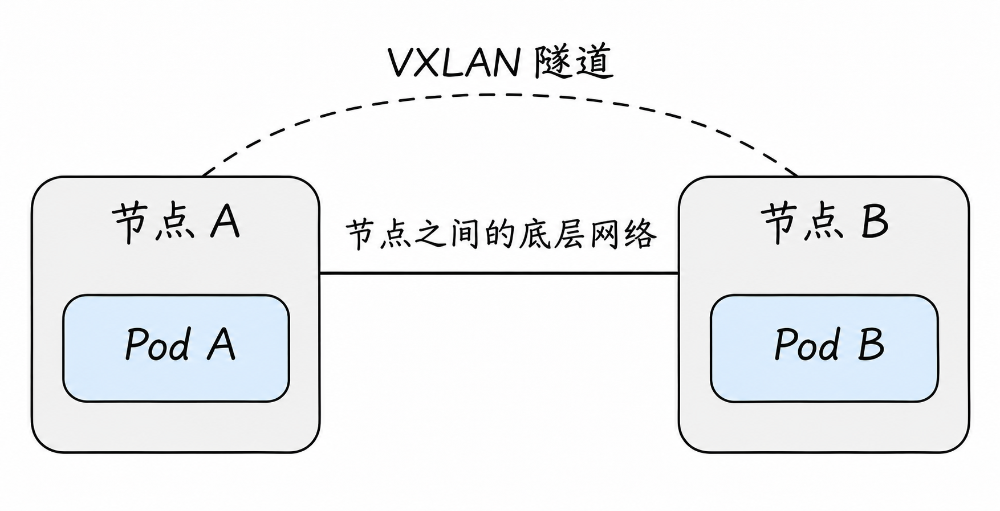
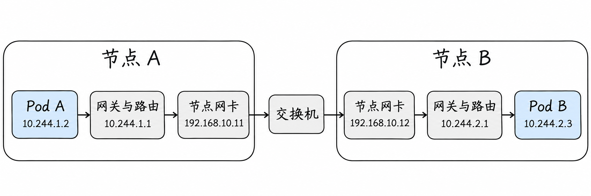
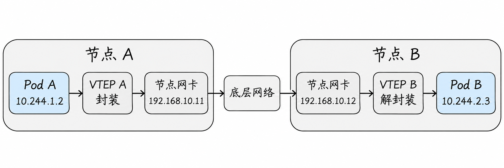
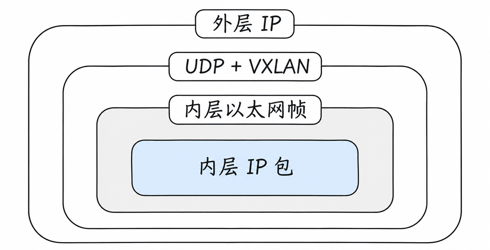

# 网络虚拟化与 SDN：把不同节点连接成一张网络

上一篇中，两个网络空间在同一台 Linux 节点上，通过虚拟网卡和网桥通信。现在把空间 B 搬到另一台节点：节点 A 上的网桥不能直接把帧交给节点 B 内的网桥，数据必须先经过节点之间已有的网络。

一个常见难题是：底层网络知道节点 A 和节点 B 的地址，却不一定知道每个 Pod 的地址。该怎么让 A 上的 Pod 找到 B 上的 Pod？

## 1. 先区分两张网络

假设节点 A 的地址为 `192.168.10.11`，节点 B 为 `192.168.10.12`；Pod A 是 `10.244.1.2`，Pod B 是 `10.244.2.3`。这些是示例地址，假设底层网络已经能让两个节点互通。

从节点视角看，`192.168.10.11 → 192.168.10.12` 是节点之间的通信；从应用视角看，真正要完成的是 `10.244.1.2 → 10.244.2.3`。

**Underlay** 通常指承载节点或隧道端点通信的底层网络，包括物理网络或云网络；**Overlay** 是建立在它之上的逻辑网络。图中以 VXLAN 为例：它给内部数据加上外层信息，利用底层网络传送；虚线表示这样的逻辑隧道，并不是新拉的一根物理线。我们稍后会拆开封装过程。



图没有画出节点内部的具体网卡和转发路径。隧道两端也不一定永远是节点本身，取决于部署；本篇先讨论常见的节点间隧道。

先把“节点能互相访问”和“Pod 能互相访问”分开看。节点 A 可以连接节点 B 的 `192.168.10.12`，只能说明节点地址之间存在可用路径。Pod A 要找的是 `10.244.2.3`：从 Pod 的网络空间到 A 节点、从 A 节点到 B 节点、从 B 节点到 Pod B，每一段都要能处理这个目标；响应也需要一条回到 Pod A 的路径。

接下来先不使用隧道，看看直接转发需要准备哪些信息。理解这条路径后，再看隧道替换了其中的哪一部分。这里说的“直接路由”，指原始 Pod IP 包不加隧道封装地按路由转发；它不要求节点用一根网线直连，节点之间仍可能经过交换机甚至路由器。

## 2. 方案一：让网络知道 Pod 网段

不使用隧道时，可以让相关节点和必要的底层网络具备到 Pod 网段的路由。这样，节点 A 收到发往 Pod B 的数据包后，就能按路由把它送往节点 B；节点 B 再负责交给自己的 Pod 网络。下面先把这些路由和连接逐一展开。

### 先把示例中的每一段接好

为了能完整跟踪一份数据，我们额外限定这个例子的拓扑：两个节点的物理接口属于同一个以太网，接口地址分别是 `192.168.10.11` 和 `192.168.10.12`，中间通过交换机连接。A 节点负责 `10.244.1.0/24`，B 节点负责 `10.244.2.0/24`。这是一种便于讲解的分配方式，实际网络插件不一定按节点分配 `/24`。

沿用上一篇的网桥方案，假设 A 节点桥接 Pod 的接口，并在桥上配置了 `10.244.1.1/24`，作为 Pod A 的网关；B 节点也有相应的 `10.244.2.1/24`。两个节点已启用 IP 转发，访问规则允许双向通信。真实 CNI 也可能不使用网桥，或者采用其他网关配置；这些地址只属于当前示例。



图只画 A 到 B 的请求方向；“网关与路由”合并表示节点内的网关接口和路由处理，并非一台额外的物理设备。图中节点网卡旁的 IP，是配置在操作系统中对应网络接口上的地址；网卡负责实际收发，不是说 IP 写在硬件里。为了把跨节点路径放在一张图里，Pod 与网关之间的 veth 和网桥端口没有展开；它们可对照上一篇的同节点网络图。

除了各自的本地 Pod 网段，两台节点还需要知道远端网段从哪里到达：

| 查路由的位置 | 远端目标网段 | 经过的下一跳 |
| --- | --- | --- |
| 节点 A | `10.244.2.0/24` | `192.168.10.12`，即节点 B |
| 节点 B | `10.244.1.0/24` | `192.168.10.11`，即节点 A |

表里是两台节点**各自**要具备的路由，不是 Pod A 自己的路由表。Pod A 的路由表则需要能把远端目标交给 A 节点的网关；Pod B 也需要能把响应交给 B 节点。路由由谁写入取决于部署，这里只先看它们存在时会发生什么。

### 一次请求怎样跨过去？

1. Pod A 的应用向 `10.244.2.3` 发起请求。Pod A 判断目标不在自己的 `10.244.1.0/24`，便依据自己的路由将包交给网关 `10.244.1.1`。如果 Pod A 尚不知道网关接口的 MAC，会先在自己的本地网络中通过 ARP 查询。
2. 节点 A 收到 IP 包后，查**节点 A 自己的路由表**，发现 `10.244.2.0/24` 的下一跳是 `192.168.10.12`。由于两台节点的物理接口在同一以太网，A 可通过 ARP 找到 B 物理接口的 MAC，再从自己的物理接口发出帧。
3. 交换机按照帧的目标 MAC 将帧交给 B。这里帧的目标 MAC 是 B 的物理接口地址，但帧内 IP 包的目标仍是 **Pod B 的 `10.244.2.3`**。路由里的下一跳不会自动替换最终目标 IP。
4. 节点 B 收到以自己 MAC 为目标的帧，取出 IP 包；B 的路由表发现 `10.244.2.0/24` 接在本地 Pod 网络，于是把数据交给 Pod B。Pod B 上的应用还需要监听相应地址和端口才能处理请求。

图中只有去程；返回时 Pod B 根据自己的路由把响应交给 B 的网关，B 查到 `10.244.1.0/24` 应经 A，再由 A 交付给 Pod A。两侧的路由、转发和策略都要成立。两台节点所在的以太网仅负责这一段的帧交付，不必把每个 Pod IP 都配置到交换机上。

注意这里“不封装”也不代表所有字段永远不变。IP 路由转发通常会更新 TTL 及 IPv4 头校验和；本例只是没有通过 NAT 改写 Pod 的源、目标 IP，也没有再加一层隧道头。

### 如果节点或网络继续增加呢？

如果 B 增加了一个新 Pod，例如 `10.244.2.4`，而同一节点网段的路由仍然有效，A 不一定要增加一条只针对这个 Pod 的路由；它仍可使用覆盖该地址的网段路由。这样可以减少路由条目，但是否采用按节点汇总的地址规划，取决于网络方案。

如果节点之间不是同一个二层网络，而是隔着 IP 路由器，路径就不同了。在一种常见路由配置中，A 查到的下一跳会是相邻路由器；A 发给路由器的帧使用路由器的 MAC，路由器再根据包的**目标 Pod IP**选择下一段。这时中间三层设备也必须有正确路由，或者由实际网络方案提供其他可达路径。不能把前面“节点 B 是下一跳”的示例原封不动套到所有底层拓扑。

### 那些远端路由从哪里来？

规模很小时，管理员可以手工添加路由；节点多、Pod 网段变化时，逐台维护容易遗漏。网络实现可以根据节点和地址分配状态自动配置路由，也可以用 BGP 与其他路由设备或节点交换路由信息。BGP 可以理解为“告诉邻居哪些网段可经我到达”的一套路由信息交换机制；真正转发业务包的仍是设备上的数据平面。

例如，B 有 `10.244.2.0/24` 后，将这个可达信息按配置传播出去；A 学到并安装合适路由后，才可能按上述路径发包。具体邻居、认证、过滤和下一跳由 BGP 拓扑与策略决定。BGP 会话建立、路由已收到、路由已被选用及实际报文可达是不同检查点，不能因会话存在就认定 Pod 通信一定正常。[Calico BGP 文档](https://docs.tigera.io/calico/latest/networking/configuring/bgp)

## 3. 方案二：把 Pod 数据包装进节点之间的通信

如果底层网络不容易学习 Pod 网段，可以在节点之间建立隧道。以 **VXLAN** 为例，在一种典型实现中：

1. Pod A 发出目标为 Pod B 的 IP 数据包。
2. 节点 A 的隧道端点将内部数据封装进一个外层 UDP/IP 数据包；外层地址指向节点 B 的隧道端点。
3. 底层网络根据外层地址把数据送到节点 B，不需要据此直接路由 Pod B 的内部地址。
4. 节点 B 解封装，取出内部数据，再交给 Pod B。

从 Pod 角度看，通信目标仍是 Pod B；从底层网络的外层包角度看，通信发生在隧道端点之间。封装是添加外层信息，不等同于修改内部源 IP 的 NAT。

VXLAN 还使用 **VNI** 区分逻辑网络；隧道端点通常称为 **VTEP**。不同方案如何学习远端端点、配置转发与处理多租户，取决于实现。VXLAN 规范见 [RFC 7348](https://www.rfc-editor.org/rfc/rfc7348.html)。

这两个名字分别回答不同的问题：VTEP 是“在哪里给数据加外层包装、又在哪里拆开”；VNI 是“拆开后，这份内层数据属于哪张逻辑网络”。例如同一对节点承载两组彼此隔离的工作负载时，方案可以为两组流量使用不同 VNI。收到外层包的端点不仅要能识别对方，还要根据 VNI 等信息把内层帧交给正确的逻辑网络。

把刚才的例子改为使用 VXLAN 后，可以对照下面这张图。假设隧道端点分别运行在两个节点，外层使用节点网卡对应网络接口的地址；实际端点的地址和位置取决于具体实现。



这张图同样只展示请求方向。VTEP A、B 是节点内参与封装和解封装的逻辑端点，并非必须各有一台独立硬件；图中省略了 Pod 到节点网络、解封装后到目标 Pod 的具体接口和路由。和上一张图相比，节点间增加了封装与解封装，底层仍要负责让两台节点的地址互相可达。

这并不表示集群里的每个 Pod 都需要自己创建 VXLAN 隧道。在本例中，Pod 仍按自己的网络配置发送普通 IP 数据，节点上的网络实现负责跨节点封装；Pod 感知到的目标依然是另一个 Pod 的地址。

### 从两层地址看一次封装

继续沿用开头的地址，并假设 VTEP 使用两台节点的地址：

| 位置 | 源地址 | 目标地址 | 谁负责读取 |
| --- | --- | --- | --- |
| 内层 IP 包 | Pod A：`10.244.1.2` | Pod B：`10.244.2.3` | 解封装前后的 Pod 网络处理逻辑 |
| 外层 IP 包 | 节点 A：`192.168.10.11` | 节点 B：`192.168.10.12` | 底层 IP 网络，用于送达远端端点 |

这是一个方向上的示例；返回方向的内外层源、目标会反过来。VXLAN 承载的是内层以太网帧，其中又可以包含 IP 数据包。节点 B 解封装后继续处理内层数据；底层网络传输的外层以太网帧在经过三层路由时也可能逐段变化。



图展示的是一份承载了 IPv4 数据的 VXLAN 包的包含关系：先找到外层 IP 的目的地址，才能把它交给远端隧道端点；该端点再按 UDP 和 VXLAN 信息找到内层帧。图为了突出封装而省略了外层链路使用的以太网帧以及各层其他字段。

隧道看起来像一条直接连接两个 VTEP 的逻辑线路，但它本身依靠底层网络送包。如果节点 IP 不可达，或承载 VXLAN 的 UDP 流量被防火墙阻断，逻辑隧道画得再完整也无法工作。

例如，A 的 VTEP 确定这份内层数据应交给 B 的 VTEP 后，外层 IP 才以 `192.168.10.11 → 192.168.10.12` 为源和目标。节点 A 将这个**外层包**交给底层网络；若中间是二层交换机，它按外层帧的目标 MAC 转发；若中间有三层路由器，它按外层 IP 的目标逐跳转发。交换机或路由器在完成外层交付时，不需要拿内层 `10.244.2.3` 作为路由目标。

B 的 VTEP 收到并确认外层包属于本机的 VXLAN 流量后，依据隧道信息处理它，再交出内层以太网帧。B 节点继续根据自身网络配置将内层数据交付给 Pod B。响应从 B 回 A 时也需有相应的隧道、路由与底层可达性；外层发送方向反过来，不能只验证 A 到 B 的单向传输。

抓包时还要区分两层端口：IP 包里的 **UDP 端口**用于底层识别并交付 VXLAN；内层应用可能另有 TCP 或 UDP 端口。RFC 7348 指定的 VXLAN UDP 目的端口是 `4789`，但一些实现可使用其他端口，检查防火墙和抓包过滤条件时应以实际插件配置为准。[RFC 7348](https://www.rfc-editor.org/rfc/rfc7348.html)

VTEP 从哪里知道 Pod B 对应哪个远端端点？不同实现可以通过控制平面分发映射，或采用其他学习机制。VNI 只是标识逻辑网络的一部分信息，不会自动替系统发现所有远端 Pod 和 VTEP。

例如，某种方案可能为 A 节点维护一项简化映射：“去 `10.244.2.0/24` 的流量，经对应隧道送往 `192.168.10.12`”；它还可能需要其他邻居或转发信息。不同实现可能使用路由、FDB（转发数据库）、控制器状态或其他数据结构，不能把这个示意当成所有产品实际的一张固定表。检查时不仅看隧道设备是否存在，也要确认**远端地址如何被选中、映射是否更新、外层路径是否能到达**。

## 4. VLAN、VXLAN 与 IP-in-IP

第二篇介绍的 VLAN 在二层网络中划分广播域；VXLAN 则通过 IP 网络承载逻辑上的二层帧。它们都可以参与网络隔离，但工作方式不同，不能把 VLAN ID 和 VNI 当成同一个字段。

另一种隧道是 **IP-in-IP**：它将一个 IP 包放入另一个 IP 包，和 VXLAN 封装以太网帧的方式不同。是否封装、只在跨子网时封装，均由实际网络方案配置；例如 Calico 支持多种模式。[Calico：Overlay 网络](https://docs.tigera.io/calico/latest/networking/configuring/vxlan-ipip)

可以把三者放在不同位置理解。VLAN 让交换机端口或带标签的以太网帧属于不同的二层网络；VXLAN 把一份内层以太网帧装入 UDP/IP 包，让它跨越底层 IP 网络；IP-in-IP 则直接用一个外层 IP 包承载另一个 IP 包。它们并非三个必须依次经过的步骤，一次部署可以只用其中某些机制。

隧道封装本身也不等于加密。VXLAN 的作用是承载和区分逻辑网络，不应仅凭数据“多了一层包装”就认为中间网络无法读取内容。是否加密、如何认证端点及限制访问，需要由实际安全方案另外提供。

## 5. 为什么 MTU 会受到影响？

外层隧道头也占空间。如果底层链路能承载的 IP 包大小有限，内部包必须为外层信息留出空间；否则可能发生分片、被丢弃或触发路径 MTU 问题。

不要把某个固定数字当成所有集群的答案：开销与 IPv4/IPv6、封装类型以及其他链路配置有关。检查时同时看 Pod 接口 MTU、隧道接口 MTU、节点接口和底层路径，确保 ICMP 等必要的错误反馈没有被误拦截。

举一个**仅用于理解**的数字：若底层 IP MTU 为 1500，外层使用不带额外选项的 IPv4，而内层以太网帧没有额外 VLAN 标签，常见 VXLAN 开销可按外层 IPv4 头 20、UDP 头 8、VXLAN 头 8、内层以太网头 14 字节估算，内部 IP 包可用空间约为 1450 字节。不同链路、IPv6 或额外封装会改变结果；应以实际实现和整条路径中最小 MTU 验证，而不是直接把 1450 写进所有集群。

为什么有时小请求正常，大请求却卡住？假设两个 Pod 间的可用 MTU 只有 1450，但发送方错误地认为可以发送更大的包：小包可能顺利通过；大包则可能在某段链路上无法继续，若相关的错误反馈又被阻断，发送方未能及时调整，就可能出现反复重传或超时。这个现象值得检查 MTU，但并不独有，应用和其他网络问题也可能造成类似表现。

在使用 Linux `ping` 且目标允许响应的测试环境中，可以从源 Pod 或其网络空间测试：`ping -4 -M do -s 1422 <目标Pod的IPv4地址>`。其中 `1422` 是 ICMP 载荷，加上通常的 8 字节 ICMP 头和 20 字节 IPv4 头，得到 1450 字节 IP 包；`-M do` 请求不分片。更改大小并比较结果能提供线索，但 ICMP 策略、工具版本、路由和回程也会影响结果，失败不等于已经证明 MTU 有问题。不要在缺乏权限或未经批准时向生产目标进行探测。

## 6. SDN 到底控制什么？

**软件定义网络（SDN）**是一种组织网络控制的思路：用软件维护网络状态并下发配置，使网络能够随着工作负载变化。为了理解，可以区分两部分：

- **控制平面**：收集节点、地址和策略等信息，计算或分发需要的配置。
- **数据平面**：依据当前配置实际处理数据包，例如路由、隧道封装、过滤或负载分担。

它们是职责划分，不要求所有控制逻辑必须集中在一个进程，也不意味着数据包必须经过控制器。控制信息更新和节点规则生效有时间差，因此变更期间可能短暂出现状态不一致。

例如，节点 B 新增一个 Pod 后，网络控制组件可能先获得这个变化，再把需要的地址或转发信息同步到节点 A。A 的数据平面随后利用已经安装的信息处理后续流量。**控制信息的传播路径和业务数据包的转发路径是两条不同的路径**：控制器参与更新规则，并不等于每一个业务包都要先发给控制器。

例如，Pod B 被重新创建、地址或所在节点发生变化时，控制组件需要获得新的状态，再让相关节点的数据平面更新路由、端点映射或规则。客户端之后的流量按新的状态处理；已有连接能否继续则取决于原后端、连接和实现。控制组件宕机并不必然立刻清空已经下发的规则，但后续变化可能无法及时收敛。

把这个变化按先后拆开：首先，Pod B 所在位置或地址发生变化；其次，负责网络状态的组件发现变化并计算需要更新的配置；最后，节点 A 上的路由或隧道映射生效。业务请求使用的是 A 当时已生效的数据，不是去询问控制组件“这一包怎么走”。因此排查时要区分**控制组件已看到新状态**和**相关节点的数据平面已完成更新**，中间可能存在传播延迟或错误。

虚拟交换机也可能参与数据平面。例如 Linux bridge、Open vSwitch 可提供不同的转发与管理能力；具体使用哪一个，取决于方案，不能将二者当成 Kubernetes 的硬性要求。

## 7. 同一请求在两种方案中怎样走？

Pod A 访问 Pod B 时，可以先问：节点 A 最终怎样把流量送到节点 B？如果是直接路由，沿途设备要具备与该方案相符的转发信息；如果是隧道，底层要能送达远端隧道端点并允许相应封装流量。

两种方式各有代价。直接路由需要考虑网络与路由分发的配合；隧道减少了底层直接理解工作负载地址的需求，却引入封装、MTU 和额外排查点。**BGP、VXLAN、eBPF 不是同一层面的互斥选项**：前者是路由信息交换协议，VXLAN 是封装技术，eBPF 是可用于实现数据处理的机制，具体可以怎样组合取决于产品。

再把同一份请求在两种方案下经过节点间网络时的主要信息对照一次。表中假设没有 NAT，且 VXLAN 端点使用节点地址：

| 观察的问题 | 前面的直接路由示例 | 前面的 VXLAN 示例 |
| --- | --- | --- |
| 应用想连接谁 | `10.244.2.3` | `10.244.2.3` |
| 节点间传递的 IP 目标 | 原始包中的 `10.244.2.3` | 外层包中的 `192.168.10.12` |
| B 节点到本地 Pod | 按本地网络配置转发 | 先解封装，再按本地网络配置转发 |
| 底层的主要要求 | 沿途转发方式能把原始 Pod 包交到 B | 能交付端点之间的外层包并允许隧道流量 |

直接路由表中的下一跳虽然是 `192.168.10.12`，原始包的目标仍是 `10.244.2.3`。这和 VXLAN 外层包的目标是 `192.168.10.12` 不同。两者都可以在节点间经过同一台交换机，差别是跨节点时承载的包是否增加了外层头，以及网络设备据哪一层信息转发。

## 8. 观察时从哪里入手？

在有权限的 Linux 节点上，可以先只读查看 `ip route`、`ip -d link show`、`ip neigh`；是否能看到名为 `vxlan` 的接口、从哪个端点封装以及具体规则，要结合网络插件文档。看见节点 IP 可达只能说明底层的一部分正常，并不能单独证明 Pod 路由、隧道、MTU 或策略都正确。

以前面的直接路由为例，在节点 A 上观察 `ip route get 10.244.2.3`，可能看到类似内容：

```text
10.244.2.3 via 192.168.10.12 dev eth0
```

这表示这次路由查询选择了 `eth0`，下一跳是节点 B。实际输出可能包含源地址、缓存等其他字段；接口名也可能不是 `eth0`。这条查询默认从本机发包的角度查路由；如果策略路由依赖源地址、入接口或其他条件，还需要按真实流量条件查询，不能把它直接等同于所有转发包的最终路径。然后可以用 `ip neigh show dev eth0` 检查 A 对 `192.168.10.12` 的邻居记录，但缓存尚未建立或已经老化并不自动表示链路失败。别忘了在 B 上也确认回到 `10.244.1.2` 的路径。

如果采用 VXLAN，还可以在节点上查看 `ip -d link show type vxlan`，结合网络方案的路由和转发状态确认端点与配置。但有的方案使用不同设备或 eBPF 数据平面，`ip route get` 和设备列表也不一定完整展示实际处理；空结果不能直接判定没有隧道。选择抓包点时，Pod 一侧观察内层 Pod 地址，承载隧道的节点接口一侧观察外层节点地址与实际 UDP 端口。捕获位置、网卡卸载和实现会影响所见，不能凭单处抓包断定整条路径。

网络虚拟化解决的是如何承载通信；Kubernetes 还需要在 Pod 创建时把网络接口和地址配置进去。下一篇进入 [Pod 网络与 CNI](05-pod-networking-and-cni.md)。

## 参考资料

- [RFC 7348：VXLAN](https://www.rfc-editor.org/rfc/rfc7348.html)
- [Linux VXLAN 文档](https://docs.kernel.org/networking/vxlan.html)
- [Calico：Overlay 网络](https://docs.tigera.io/calico/latest/networking/configuring/vxlan-ipip)
- [Calico：BGP](https://docs.tigera.io/calico/latest/networking/configuring/bgp)
