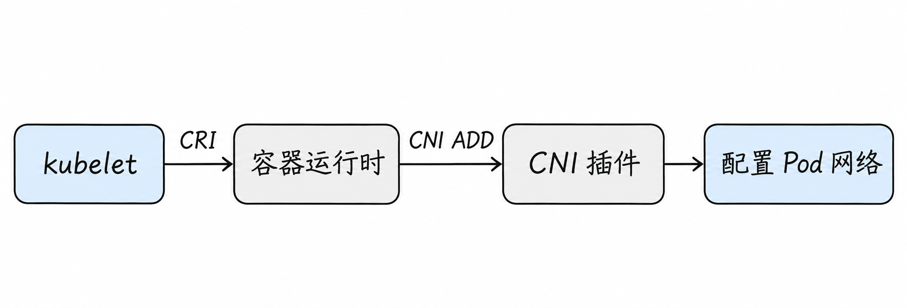
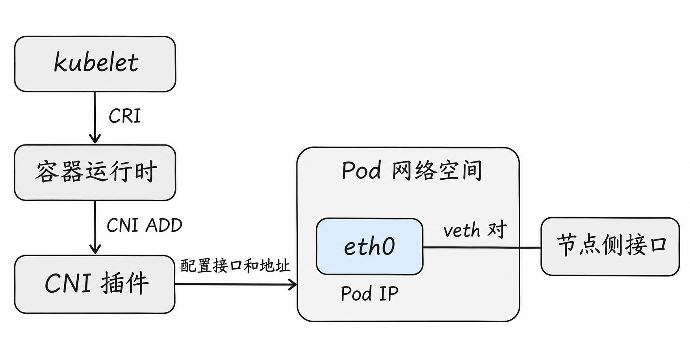
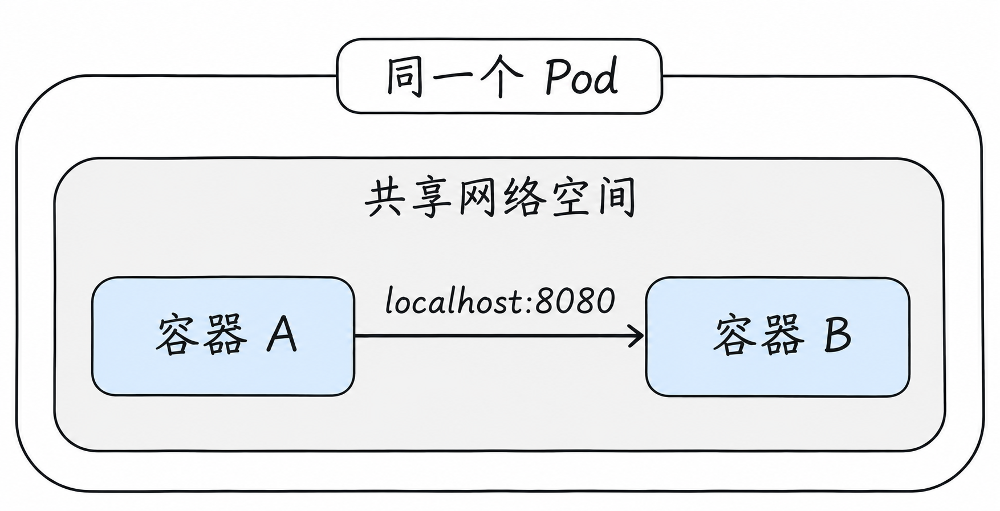
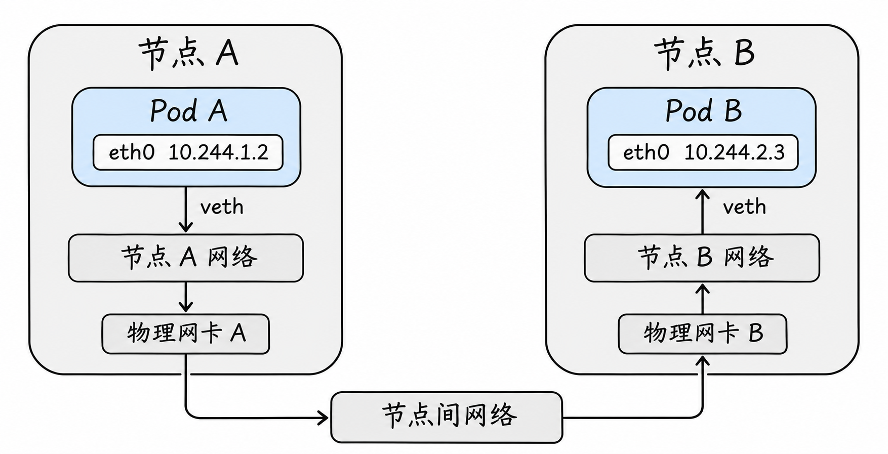

# Pod 网络与 CNI：Pod 怎样接入集群网络？

上一篇讨论了节点之间如何承载 Pod 流量。但在发出第一个数据包之前，Pod 还需要有自己的网络空间、接口和地址。这些东西从哪里来？

我们沿着一个 Pod 从创建到通信的过程来回答。本文以 Linux 上常见的容器运行时与 CNI 方案为例；不同插件的设备、路由和实现会有区别。

## 1. Kubernetes 对 Pod 网络提出什么要求？

Kubernetes 网络模型期望：普通 Pod 拥有集群范围内可区分的地址；没有有意隔离时，Pod 之间无论是否位于同一节点，都可以直接通信，不要求 Pod 间经过 NAT。同一 Pod 内的容器共享网络空间，可通过 `localhost` 联系；不同 Pod 的 `localhost` 则不是同一个地方。

这是**模型要求**。节点上的容器运行时、网络插件和节点之间的网络共同使它成立。NetworkPolicy、应用监听地址、宿主机防火墙和底层故障都可能影响实际连通性。`hostNetwork` 是特殊情况：Pod 使用节点网络命名空间，不应套用普通 Pod 的独立空间示意。[Kubernetes 网络模型](https://kubernetes.io/docs/concepts/services-networking/)

把这个要求放回网站的例子：网站 Pod 只需知道知识库 Pod 的地址和端口，不必先根据它们是否在同一台机器上，分别改写应用的访问方式。至于节点内部怎样连接虚拟接口、节点之间怎样运送数据，是集群网络实现需要处理的事。这里说的“直接通信”指 Pod 可以使用彼此的地址通信，**不表示数据不经过宿主机，也不表示物理上有一根专用网线连着两个 Pod**。

## 2. 从创建 Pod 开始

当 Pod 被调度到节点后，节点上的 **kubelet** 负责协调运行。它通过容器运行时接口 CRI 与容器运行时协作；在常见 Linux 实现中，运行时建立 Pod 所需的网络隔离环境，并按 CNI 配置调用插件。

先区分几个对象。kubelet 是每个节点上负责协调本节点 Pod 的组件；**容器运行时**负责创建、启动和管理容器。两者通过 CRI 约定如何提出请求、返回状态。Pod 被安排到节点，表示已经确定由谁负责运行它，并不意味着网络接口和应用都已经准备好。



图展示创建时的职责顺序，不是应用每次发包都要经过 kubelet 或重新调用 CNI。实际运行时、插件链和网络控制组件的细节可能不同。

**CNI（Container Network Interface）**是一套接口和调用约定。运行时通过它将要操作的网络空间、接口名等信息交给插件；常见操作包括 `ADD`、`DEL` 等。插件可以创建或配置接口、地址与路由，也可以调用其他插件或依赖网络方案中的组件。删除时还需要清理相应资源。[CNI 规范](https://github.com/containernetworking/cni/blob/main/SPEC.md)

在一个常见运行时中，可以把 Pod sandbox 理解为承载 Pod 共享运行环境的基础：运行时先准备网络空间，再让同一个 Pod 的容器使用它。实现中可能有用于维持这个环境的基础容器，具体机制取决于运行时。**Pod、网络空间和应用容器不是同一个对象**：一个 Pod 内的多个容器可以共享一套网络空间，但仍各自运行应用进程。

### `ADD` 大致做了什么？

用一条常见的插件链举例：运行时先准备好 Pod 使用的网络空间，再把这个空间、需要配置的接口名和网络配置交给 CNI 插件。插件可能创建 veth，将一端放进 Pod 空间；通过地址管理组件 IPAM 获取地址后，在接口上配置 IP、路由和其他所需设置，并将结果返回给运行时。IPAM 如何管理地址，下一节会细看。

例如，要给网站 Pod 配置网络，运行时告知插件应操作哪个网络空间，以及空间内需要的接口名 `eth0`。在一种 veth 方案中，插件将一对接口的一端放到该空间，另一端留在节点侧；随后网站 Pod 看到自己的 `eth0` 和分配到的 `10.244.1.2`。**节点侧接口不是另一块插进服务器的物理网卡**，它是 Linux 内核中 veth 对的另一端。



左边箭头表示创建阶段的调用和配置关系；右边连线表示配置完成后的一对接口。图中没有画出具体 IPAM 组件或节点转发规则，不应把左边的调用箭头当作业务数据包流经的路径。

这些动作只是示例，不是 CNI 规范强制要求每个插件都创建 veth 或网桥。插件可以串联：前一个插件输出的结果由后续插件继续处理。Pod 停止或网络附件删除时，运行时调用清理操作；清理失败可能导致遗留地址或设备，需要结合运行时与插件日志判断。

如果运行时报告 `FailedCreatePodSandBox` 一类事件，先读完整事件与节点日志：原因可能是插件不可用、配置错误、IPAM 失败、网络空间创建失败等。不能因为事件提到 sandbox 就直接认定是某一种插件错误。

注意区分**一次配置调用**和**持续的数据转发**。Pod 创建时调用插件，相当于把通信所需的接口、地址和规则准备好；网络准备成功后，应用发送的每个包由节点上已有的数据平面处理。某些网络方案还有常驻组件持续维护路由或策略，但这与“每个包都调用一次 CNI”是两回事。

### 应用容器重启，就一定会换 Pod IP 吗？

不一定。若只是同一个 Pod 里的应用容器重启，而该 Pod 的网络环境仍保留，重启后的容器通常继续使用同一个 Pod 的网络空间和地址。若 Pod 被删除、由工作负载控制器新建另一个 Pod，则是另一个实例，不能依赖新地址与旧地址相同。运行时重建 sandbox、网络附件重新配置等特殊情况也可能影响结果，应以实际 Pod 状态为准。

从生命周期看，`ADD` 与 `DEL` 不是一次业务请求的开始和结束，而是某个网络附件的配置与清理。删除时插件可能需要释放已分配的地址、删除接口或清理方案维护的状态；具体动作取决于插件。清理失败时，旧资源可能留存，所以排障要同时检查运行时事件、插件日志和 IPAM 状态，不能只看 Pod 对象是否已消失。

## 3. Pod IP 是谁分配的？

**IPAM（IP Address Management）**负责地址管理：从哪里分配、哪些地址已使用、如何回收等。CNI 插件可以委托 IPAM 插件或由特定网络方案实现相关能力。Pod IP、节点 IP、Service IP 常使用不同地址范围；这些范围需要与已有网络规划协调，避免冲突。

假设 Pod A 获得 `10.244.1.2`。在常见 veth 方案中，一端作为 Pod 空间内的接口，另一端位于节点侧；插件还会配置必要的路由。Pod IP 是该 Pod 网络接口的地址，并不是节点物理网卡地址。Pod 被重新创建后不应假设 IP 必然不变。

实际地址分配不一定严格按照“每个节点一个固定 `/24`”工作；IP 池、分配粒度、双栈及多网络均由方案与配置决定。

可以把 IPAM 想成维护一份“可分配地址与占用情况”的记录。新 Pod 接入时，需要从相应地址池找到可用地址并避免冲突；Pod 删除后，地址还需要按方案规则回收，才能在适当时候再次分配。具体是由每个节点管理一部分地址、由中心组件协调，还是直接使用底层云网络地址，要看网络实现。

假设某方案把 `10.244.1.0/24` 留给节点 A，地址池里记录网站 Pod 已使用 `10.244.1.2`；新建另一个 Pod 时，IPAM 就必须选择尚未使用的地址，例如 `10.244.1.3`。这里的表只是理解分配过程的示例，具体可用地址、保留地址与回收时机由 IPAM 实现决定。**Pod 名称与 IP 的关系也不是永久写死的**，应用不应把一个可替换 Pod 的地址当成稳定服务名。

因此，一个 Pod 长时间停在创建阶段时，除了检查网卡是否创建，还应看地址池是否耗尽、地址管理组件是否可用及其错误信息。扩容节点并不会自动解决所有地址池配置问题，是否增加可用地址取决于实际分配方式。

在示例中，节点地址使用 `192.168.10.0/24`，Pod 地址使用 `10.244.0.0/16`，而普通 Service 地址可能从另一段如 `10.96.0.0/12` 分配。三者是不同用途的地址范围，不代表必须采用这些具体数值；实际规划还要考虑数据中心、VPN、云 VPC 和其他集群的地址。

如果 Pod 网段与已有外部网络重叠，节点看到某个目标地址时可能选错路由或无法区分目的地。更大的网段也不是无限资源：还要考虑每节点分配方式、可用地址、双栈、路由规模和未来扩容。

举个冲突例子：假设公司外部数据库恰好也是 `10.244.2.3`，而集群还把这个地址分配给了 Pod B。调用方发往这个数字地址时，单靠地址本身无法表达“我想访问数据库，还是 Pod B”；路由选择和其他网络配置会决定它走向哪里。解决时应从整体地址规划入手，而不是只在应用配置里换一个名字——名字解析后仍要得到可区分、可路由的地址。

## 4. 同节点 Pod 之间怎样走？

沿用第 3 篇的示意：同一节点的 Pod A、Pod B 各有网络空间，各自通过虚拟接口连接节点网络。A 发出到 B 的 IP 包后，节点内部可以通过网桥二层转发，或通过节点三层路由及其他数据平面送到 B。

拿网桥方案具体走一遍：假设网站 Pod A 是 `10.244.1.2`，同节点的知识库 Pod C 是 `10.244.1.3`，它们的节点侧 veth 分别接到同一个网桥。A 的应用向 C 的地址发起请求，数据从 A 空间里的 `eth0` 到达节点侧的 veth 端；网桥再按照当前二层网络的转发信息，将帧送到 C 对应的 veth 端，最终进入 C 的网络空间。C 的应用收到请求后，还需要经自己的网络路径返回响应。

这一段路径在节点内部完成，并不需要先从物理网卡发到外部交换机再绕回。这里明确假设是同一子网、同一网桥的例子；如果网络插件采用三层路由或其他机制，实际设备和处理路径就可能不同。

两个容器如果在同一个 Pod 中，路径则不同：它们共享 Pod 网络空间，访问 `localhost` 不需要经过另一个 Pod 的虚拟接口。应用必须监听合适地址和端口：只监听 `127.0.0.1` 的服务，通常不能通过 Pod IP 从其他 Pod 访问。



例如，容器 B 中的服务监听 `127.0.0.1:8080`，容器 A 就可以在同一个 Pod 中连接这个地址。它们共享的是网络空间，而不是所有资源：各自的文件系统和进程可见范围仍由容器配置决定。因为端口也处于同一个网络空间，两边的进程通常不能同时绑定相同的地址、协议和端口；允许复用的特殊配置需要另行判断。

## 5. 跨节点 Pod 又多了什么？

假设节点 A 上的 Pod A 是 `10.244.1.2`，节点 B 上的 Pod B 是 `10.244.2.3`。A 发往 B 的包离开 Pod 后，节点 A 必须知道如何把它交给节点 B；节点 B 再将其交给目标 Pod。

从应用角度看，这次连接仍然是 Pod A 访问 `10.244.2.3:8080`；比同节点多出来的是两台节点之间的那一段路。以一套使用 veth 并通过节点网络发往远端的方案为例，A 空间里的接口把包送到节点 A；节点 A 根据本机配置选择到 B 的路径，使用节点间网络把包交给节点 B；B 的本地网络再把包送入 B 的接口。B 响应时，还需要一条从 B 回到 A 的可用路径。



图中箭头只画了请求从 A 发向 B 的方向；返回响应也需要相应的网络路径。两侧标为 veth 的线简化表示 Pod 内接口与节点侧接口组成的接口对，节点网络方框则概括了本例中节点内部的转发处理。为看清整体路径，图没有展开每条路由、隧道或交换设备；实际实现不一定采用 veth，也不一定是图中的物理网卡连接方式。

这不表示 Pod 自己的 `eth0` 与物理网卡之间一定直接相连，也不表示所有 CNI 都设置网桥。节点网络中具体有哪些接口、是否封装、转发规则在哪里，取决于部署。下文的路由和隧道是两种可选实现，不是同一个请求必然依次经过的两道工序。

一种部署让节点或底层网络具备到远端 Pod 网段的路由；另一种使用 VXLAN 等隧道将内部流量封装为节点间流量。两种情况都需要节点之间的底层连通、正确 MTU 和返回路径。封装可能改变外层报文，但不代表原始 Pod 到 Pod 流量必然被 NAT。

同节点可达而跨节点失败时，应把问题缩小到跨节点才新增的部分：远端路由或隧道、底层网络和防火墙、MTU、反向路径，以及可能影响两端的网络策略。它们是排查方向，而非仅凭现象就能确认的根因。

### 用同一个请求走两条可能路径

假设 A 的应用连接 B 的 `8080` 端口，目标始终是 `10.244.2.3:8080`。在直接路由示例中，A 侧节点依据到 B 所在 Pod 网段的路由把流量送到 B 节点；B 节点依据本地网络配置将其送入 B 的网络空间。

展开来看，Pod A 先在自己的网络空间查路由，决定通过哪个接口把目标为 `10.244.2.3` 的包交出去；离开 Pod 后，节点 A 根据它自己的路由或数据平面状态继续处理。若 A、B 节点能在底层直接互达，且 A 的路由配置将 B 的节点地址作为下一跳，A 可以把包发给节点 B。这里的下一跳帮助当前节点交付数据，**不是把应用原来要访问的 Pod IP 改成节点 IP**。

节点 B 收到后，也要知道怎样将目标为 `10.244.2.3` 的数据交给本地 Pod；这可能通过路由及对应的节点侧接口完成。若没有额外地址转换，业务 IP 包的源和目标仍是 `10.244.1.2` 与 `10.244.2.3`。B 处理完请求后，将响应发回 `10.244.1.2`；节点 B、底层网络和节点 A 的返回方向也必须具备相应路径。具体每台机器上的路由条目、二层地址和接口名称，应从该网络方案实际配置中查看。

在 VXLAN 示例中，A 侧节点将原始 Pod 包封装进发往 B 节点隧道端点的外层包；B 侧解封装后再进行本地交付。底层抓包可能看到节点地址和隧道流量，而 Pod 侧抓包看到的是内层 Pod 地址。图像与抓包的观察点不同，并不表示两个说法冲突。

按照这一条 VXLAN 路径看，Pod A 里看到的目标是 `10.244.2.3:8080`；在节点间承载隧道的链路上，外层目标可以是 B 的节点地址。到 B 节点解封装后，目标又是内层的 Pod 地址。排查时如果只在物理网卡上过滤 `10.244.2.3`，可能看不到被封装在外层包里的内层地址；应根据插件模式、实际接口和抓包工具选择观察点。

两种路径都需要检查响应。若策略允许去程但返回被防火墙丢弃，或远端没有回到 A 的路由，应用仍会超时。ARP 只解决所在链路上下一跳的地址解析；不能要求 A 在自己的二层网络直接广播查询跨节点远端 Pod 的 MAC，除非特定二层拓扑与实现确实提供该可达性。

## 6. CNI 和 Service 是不是同一个东西？

CNI 主要描述容器网络附件的配置接口；Pod 网络方案负责实现 Pod 连通。Service 则为一组后端提供稳定访问入口。客户端访问 Service 时，Service 数据平面先决定如何把连接导向后端，随后底层仍需要 Pod 网络将流量送达后端。

网络产品可能同时提供 Pod 连通、Service 代理和策略等能力，但能力集合由具体产品与配置决定。不能因为安装某个 CNI，就假定所有环境都启用 kube-proxy 替代、NetworkPolicy 或某种隧道。

## 7. Flannel、Calico、Cilium 怎么理解？

先不要把产品名等同于某一种机制。以官方文档所述的典型能力为例：Flannel 提供多种网络后端；Calico 可使用路由或封装；Cilium 可以利用 eBPF 实现多种网络、服务和安全能力。具体选择、版本、配置与平台决定真实路径。

阅读任一部署时，先查清四件事：Pod 地址如何分配；节点内如何连接；跨节点走路由还是隧道；Service 与 NetworkPolicy 分别由谁实现。再根据它们的配置和文档定位具体设备与规则。

## 8. 怎么观察一个 Pod？

在具备只读权限的集群中：

```bash
kubectl get pods -A -o wide
kubectl -n <命名空间> describe pod <Pod名称>
kubectl -n kube-system get pods -o wide
```

把尖括号连同其中内容替换为真实值。第一条帮助对应 Pod IP 与节点；第二条查看事件，包括网络创建失败等线索；第三条可辅助寻找网络组件，但组件名称和部署方式因发行版不同。`Running` 或有 IP 不足以证明任意路径都畅通。

例如，一份经过删减的 `kubectl -n shop get pods -o wide` 结果可能是：

```text
NAME         READY   STATUS    IP           NODE
frontend     1/1     Running   10.244.1.2   node-a
knowledge    1/1     Running   10.244.2.3   node-b
```

这一眼可以看出两个实例分别在哪台节点、使用什么地址；但它只是 Kubernetes 报告的对象状态，不能证明 `frontend` 到 `knowledge:8080` 的数据路径、访问规则或应用监听都正确。接下来从同一个客户端位置验证具体协议和端口，再结合实际 Pod 内的接口、节点路由及网络插件信息判断。

如果镜像提供工具且有执行权限，可以在 Pod 内检查地址和路由；生产环境应遵循访问规范。节点层面的 `ip route`、插件状态与日志也是重要证据，但不要盲目更改网络规则。

例如，已存在且包含 `ip` 命令的测试 Pod，可以用 `kubectl -n <命名空间> exec <Pod名称> -- ip address` 和 `kubectl -n <命名空间> exec <Pod名称> -- ip route` 查看自己看到的接口与路由。`kubectl exec` 需要相应权限，目标容器还必须正在运行并包含相应工具；结果只表示该 Pod 网络空间的视图，不是整台节点的完整接口列表。

常见线索与下一步：Pod 一直创建失败时查事件和运行时/CNI 日志；Pod 已有 IP 但无法到达同节点 Pod 时检查应用监听、策略与本地交付；只有跨节点失败时增加检查路由、隧道、节点网络与 MTU。每个现象都可能有多个原因，应保留同一协议、相同端口和同一客户端位置做对照。

## 9. 一个 Pod 与一个稳定服务

Pod IP 解决“找到具体实例”，但应用扩容、更新时后端可能改变。下一篇 [Service 与 DNS](06-service-and-dns.md) 会追踪客户端如何通过名字找到稳定入口，以及该入口如何选择后端。

## 参考资料

- [Kubernetes 网络模型](https://kubernetes.io/docs/concepts/services-networking/)
- [CNI 规范](https://github.com/containernetworking/cni/blob/main/SPEC.md)
- [Flannel](https://github.com/flannel-io/flannel)
- [Calico 网络选项](https://docs.tigera.io/calico/latest/networking/determine-best-networking/)
- [Cilium 网络概念](https://docs.cilium.io/en/stable/network/concepts/routing/)
