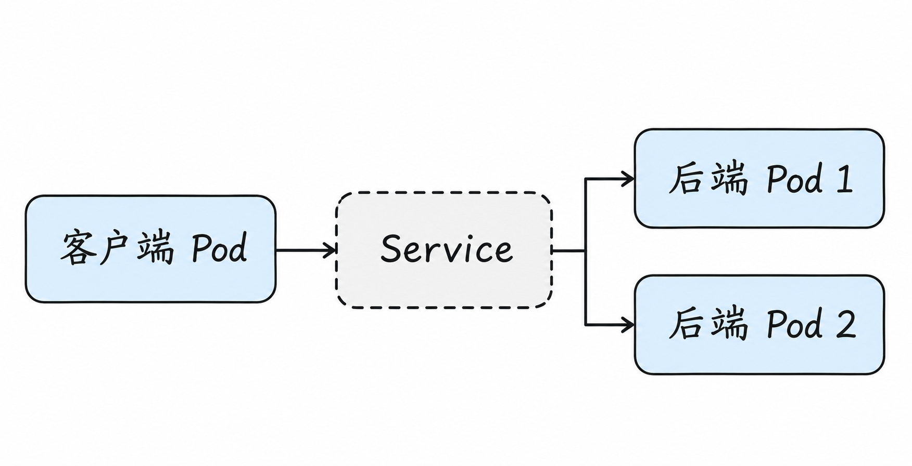
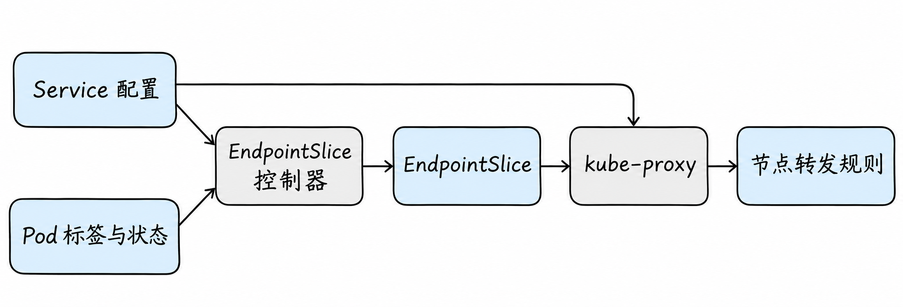
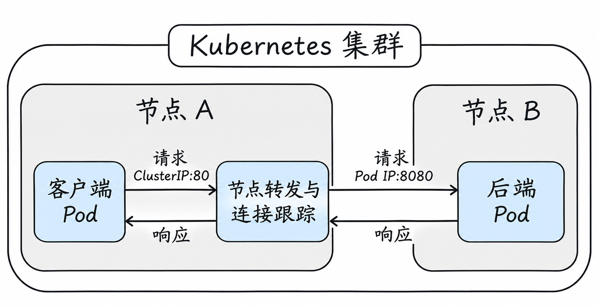
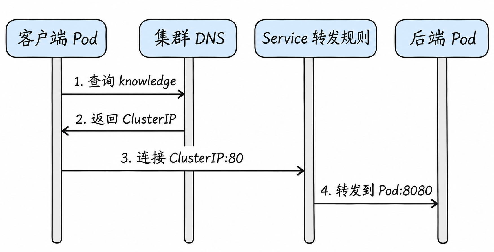

# Service 与 DNS：应用怎样找到稳定的服务？

上一篇中，Pod 可以通过 Pod IP 通信。但知识库应用有多个副本，Pod 被替换时地址也可能变化。如果网站把每个 Pod IP 写进配置，每次扩缩容都要更新调用方。

Service 的目的，是让调用方使用一个相对稳定的服务入口；DNS 则让调用方用名字找到入口。它们与 Pod 网络配合，但解决的不是同一个问题。

## 1. 从一个 Service 开始

假设 `shop` 命名空间中有两个知识库 Pod，都带标签 `app: knowledge`，应用监听 `8080`。创建下面的 Service：

命名空间可以先理解为集群中组织资源的一个范围；标签是附在对象上的键值信息。Service 在自己的命名空间内根据标签筛选 Pod，因此下面的 `app: knowledge` 是匹配条件，不是 Pod 的名字。

可以先想一想我们希望发生什么：调用方只保存服务的名字；后台的 Pod 被替换时，新 Pod 只要满足选择条件并准备好接收请求，就可以被纳入候选。Service 的配置描述这个关系，而 Kubernetes 还需要持续维护“现在有哪些候选”并让节点能够按这个关系转发。

```yaml
apiVersion: v1
kind: Service
metadata:
  name: knowledge
  namespace: shop
spec:
  selector:
    app: knowledge
  ports:
    - name: http
      protocol: TCP
      port: 80
      targetPort: 8080
```

`selector` 是选择后端的条件，`port` 是客户端访问 Service 的端口，`targetPort` 是后端端口。**使用 selector 自动选择时**，Service 与被选择的 Pod 需要在同一个命名空间，Pod 标签要匹配。Pod 是否在节点 A 还是 B，不由 selector 直接决定。没有 selector 的 Service 可以配合单独维护的 EndpointSlice 指定后端，不能把上述自动选择规则套用到所有 Service。



图中的两条分支表示可以选择的后端，不表示一次连接必然同时发往两个 Pod。虚线 Service 表达的是逻辑入口，并不意味着存在一个必须经过的独立 Service 进程。[Service 官方文档](https://kubernetes.io/docs/concepts/services-networking/service/)

## 2. 后端名单：EndpointSlice

对于带 selector 的 Service，Kubernetes 根据匹配的 Pod 维护 **EndpointSlice**。它记录地址、端口以及就绪等状态，供服务发现与数据平面使用。可能有多个 EndpointSlice；不能只看其中第一个就认为已经看到全部后端。

这里有两个不同问题：Service 的 `selector` 描述**想选择什么**；EndpointSlice 则记录控制器根据当前 Pod 状态整理出的**实际候选及其状态**。例如，控制器看到两个 Pod 的标签都符合 `app=knowledge`，就为该 Service 维护包含它们地址等信息的 EndpointSlice。Pod 新建、删除、标签变化或就绪状态变化时，这份记录也会被更新。

以 kube-proxy 实现为例，节点上的 kube-proxy 通过 Kubernetes API 观察 Service 与 EndpointSlice 的变化，再更新节点的数据平面规则。控制器和 kube-proxy 处理的是资源变化；客户端每次发起请求时，不需要先让控制器重新查询一次 Pod 名单。这两步是异步的，资源变更到各节点规则更新之间可能存在短暂的传播时间。



图中的箭头表示资源信息变化如何影响规则，不表示业务请求依次经过这些组件。图省略了 API 服务器等中间环节，也只展示了使用 kube-proxy 的一种实现；采用其他数据平面时，具体组件可能不同。

Pod 未就绪、标签不匹配、命名空间不对或 Pod 正在终止，都会影响匹配结果或后端状态。`ready`、`serving`、`terminating` 有各自含义；特殊设置如 `publishNotReadyAddresses` 会改变通常的就绪处理，不能只凭一个 Pod 的 `Running` 判断一定接收 Service 流量。[EndpointSlice](https://kubernetes.io/docs/concepts/services-networking/endpoint-slices/)

特别注意，**名单正确也不等于端口一定可用**。例如 `targetPort` 写成 `8080`，应用却只监听 `9090`，EndpointSlice 仍可能发布这个 Pod 地址和 `8080`；请求到达后依然可能失败。就绪探针检查什么取决于它的配置；如果没有探针，也不能据 `Ready` 状态推断业务端口一定符合预期。

```bash
kubectl -n shop get service knowledge -o yaml
kubectl -n shop get pods -l app=knowledge -o wide
kubectl -n shop get endpointslice -l kubernetes.io/service-name=knowledge -o yaml
```

这些是观察命令，假设命名空间和资源已经存在。若 selector 没有选中预期 Pod，先比较标签和命名空间；如果名单有地址但请求失败，再检查端口、应用监听、网络和策略。无 selector 的 Service 可配合手动管理的 EndpointSlice，不能按“没 selector 就一定没有后端”判断。

举例来说，Service 选择 `app=knowledge`，实际 Pod 却只有 `app=knowledge-api`，则即使它启动成功，也不会因为名字相似而自动成为后端。修改前应先确认团队期望的标签，再对 Service、工作负载和实际 EndpointSlice 一起核对。Pod 标签更改会引发控制器重新计算，但这种变化是异步收敛的。

EndpointSlice 的地址可能存在但没有处于可用于常规流量的状态；所以检查时不要只数 IP 个数。Pod 的 readiness 探针和真实业务准备状态是否一致，也属于排查的一部分。

例如，两个 Pod 的地址分别是 `10.244.1.4` 和 `10.244.2.3`。假设前者尚未准备好、后者已经就绪，那么一份简化的观察结果可能是：

```yaml
endpoints:
  - addresses: ["10.244.1.4"]
    conditions:
      ready: false
  - addresses: ["10.244.2.3"]
    conditions:
      ready: true
ports:
  - name: http
    port: 8080
    protocol: TCP
```

这是为解释字段而省略其他内容的示意片段，并非要求手动创建的完整资源。两条地址都出现，不等于两者都会作为普通可用后端接收新连接；应同时看状态以及 Service 的发布设置。它们可能分布在不同 EndpointSlice 中，实际查询时要看完整结果。

## 3. ClusterIP：稳定入口是什么？

假设集群给 Service 分配 `10.96.0.20`。客户端连接 `10.96.0.20:80`，Service 数据平面将连接导向某个可用后端，例如 `10.244.2.3:8080`。ClusterIP 是虚拟服务地址，不一定配置在某个专用网卡上。

以 Linux 上 kube-proxy 的 iptables 模式为例，kube-proxy 监听 Service 和 EndpointSlice 的变化，在节点配置规则；内核在处理客户端流量时选择后端并进行目标地址转换。**kube-proxy 通常不是每个请求的用户态中转进程。**其他模式或 kube-proxy 替代方案会采用不同机制。[虚拟 IP 与 Service 代理](https://kubernetes.io/docs/reference/networking/virtual-ips/)

当后端响应返回，在这种常见的地址转换实现中，连接跟踪参与反向地址处理，让客户端看到与原连接相符的响应。不同实现可能在不同位置处理；Service 本身不是固定的一台机器，不能只凭逻辑框图推断每一跳的真实路径。

### 用地址把请求跟一遍

假设网站 Pod 是 `10.244.1.2`，Service 是 `10.96.0.20:80`，选中的知识库 Pod 是 `10.244.2.3:8080`。在上述 iptables 示例中，客户端以 Service 地址发起连接；节点规则将目标改为后端地址和端口；Pod 网络再负责将包交给该后端。

后端发出的响应经过相应连接处理后，客户端继续看到自己访问的服务端地址。表述“Service 选中了后端”是逻辑上的简写，并不意味着一个独立 Service 设备接收并转发每个包。实际数据平面、网络策略观察点和节点位置需要按实现确认。

这里的端口变化也值得展开：客户端请求的目标是 Service 的 `80`，所选 Pod 的应用监听的是 `8080`。在这个例子里，节点规则不只是把目标 IP 从 Service IP 换成 Pod IP，也将目标端口从 `80` 换成 `8080`。所以后端应用并不需要监听 `10.96.0.20:80`；它需要在自己的网络空间里监听允许访问的地址和 `8080`。如果 `targetPort` 与实际监听不一致，找到 Pod 后仍然无法成功建立预期连接。

### 请求和响应里的地址分别是什么？

为了看清返回过程，继续采用前面的 Linux iptables 示例，并作几个限定：客户端位于节点 A，后端位于节点 B；这条连接不需要额外的源地址转换；响应会经过节点 A 上保存了该连接转换状态的网络处理路径。假设客户端临时使用端口 `53000`：



图中节点 A 内的方框代表内核里的转发和连接状态处理，是为了把过程画清楚，**不是一台独立的 Service 服务器**。上面的箭头画请求，下面画响应；下面的表再展开每一段看到的地址和端口。

| 观察位置 | 源地址 | 目标地址 |
| --- | --- | --- |
| 客户端刚发出请求 | `10.244.1.2:53000` | `10.96.0.20:80` |
| 节点 A 完成目标地址转换后 | `10.244.1.2:53000` | `10.244.2.3:8080` |
| 后端发出响应 | `10.244.2.3:8080` | `10.244.1.2:53000` |
| 响应经过反向转换、交给客户端 | `10.96.0.20:80` | `10.244.1.2:53000` |

可以把**连接跟踪**理解成内核为这条连接保存的一份关联记录：原来访问的是哪个服务地址，实际选择了哪个后端。响应到达执行反向转换的位置时，系统借助这份状态把响应的源地址和端口还原成客户端认识的 Service 地址和端口。因此客户端看到的是一条与 `10.96.0.20:80` 的连接，后端则处理了发往自身 `8080` 的连接。

为什么响应需要还原地址？客户端建立连接时认识的对端是 `10.96.0.20:80`。如果响应直接以 `10.244.2.3:8080` 的身份出现在客户端面前，它的源地址和端口就与客户端正在等待的连接对端不一致。反向转换让这个例子中的连接两端分别看到符合自身视角的地址。这里并不是说网络包返回时一定要重新找到一台叫 Service 的机器；负责处理的是实际数据路径上的转换状态和规则。

这是一条经过简化的示例，不是说返回包必须经过一个独立的 Service 机器。不同代理模式可能使用 eBPF、IPVS 等机制；源地址转换、节点本地流量、直返等情况也可能改变可观察的地址和位置。理解具体集群时，应先确定它采用的数据平面，再选择相应观察点。

连接建立后，数据平面通常会让同一连接继续对应已选的后端，不能把每个 HTTP 请求都想成重新选择一次 Pod。如果后端在连接期间消失，新连接可能转向其他可用后端，已有连接是否失败、应用何时重试，取决于连接状态、客户端和代理的行为。

## 4. 名字如何变成地址？

对普通 ClusterIP Service，集群 DNS 可以将 `knowledge.shop.svc.cluster.local` 解析为它的 ClusterIP；`cluster.local` 只是常见示例，实际集群域名可以不同。

通常，在 `shop` 命名空间中的 Pod 可以使用短名 `knowledge`；其他命名空间可以使用 `knowledge.shop`，也可使用完整名称。短名如何补全取决于 Pod 的 DNS 搜索配置。**DNS 查询和后续应用请求是两次不同的网络交互**：DNS 返回地址后，客户端再连接 Service 地址。[Service 和 Pod 的 DNS](https://kubernetes.io/docs/concepts/services-networking/dns-pod-service/)

把它分成两次交互来看：第一次是客户端向 DNS 问“`knowledge` 的地址是什么”，DNS 返回服务地址；第二次是客户端用得到的地址向 Service 发起业务连接。具体到本例，DNS 回答 `10.96.0.20` 后，客户端才会向 `10.96.0.20:80` 建立连接；DNS 服务器不会作为后续业务数据的必经中转站。首次解析后，客户端或中间解析组件可能缓存结果，因此后续请求未必每次都重新查询。DNS 缓存、TCP 连接复用和 Service 的后端选择是不同事情，排查时要分别看。



这是一张按时间从上往下阅读的**交互顺序图**。第 3 步的横线在画面上穿过 DNS 的竖线，但 DNS 不参与这次业务连接；该竖线只表示时间轴。第 3、4 步中的转发规则也不是一台接收请求的独立机器，图中省略了业务响应；上一节已说明响应在示例中的处理。

例如，在 `shop` 内查询短名 `knowledge`，解析器可能根据搜索列表尝试 `knowledge.shop.svc.cluster.local`；在另一个命名空间里相同短名则会优先按自己的搜索域处理。因此，跨命名空间访问时把命名空间写出来，通常比依赖短名更清楚。

`/etc/resolv.conf` 可能包含 `search` 和 `ndots` 等配置；它们影响解析器尝试名称的顺序和查询次数。不同应用使用的解析库、缓存和超时策略可能不同。排查时要观察实际 Pod 配置，而不是假设所有镜像的解析行为完全一致。

一份简化的配置可能长这样，具体 DNS 地址和搜索域以实际集群为准：

```text
nameserver 10.96.0.10
search shop.svc.cluster.local svc.cluster.local cluster.local
options ndots:5
```

`nameserver` 指定查询要发给谁；`search` 提供短名补全候选。比如应用请求 `knowledge` 时，解析器可能先尝试补全为 `knowledge.shop.svc.cluster.local`。`ndots` 是解析器判断优先尝试绝对名称还是搜索后缀时使用的配置之一；查询顺序、缓存和失败处理还与解析器实现有关。配置中出现 DNS 地址，只说明客户端知道要向哪里查询，不证明 DNS 服务一定可达。

若使用的镜像包含工具，可以在允许执行命令的测试 Pod 中检查：

```bash
kubectl -n shop exec <客户端Pod> -- cat /etc/resolv.conf
kubectl -n shop exec <客户端Pod> -- nslookup knowledge.shop.svc.cluster.local
```

将占位符替换为实际名称；精简镜像可能没有 `nslookup`。解析成功只说明取得 DNS 响应，不证明 Service 有后端、端口可达或应用正常。反过来，Pod IP 可达也不证明 DNS 正常。

## 5. Headless Service 与 ExternalName

设置 `clusterIP: None` 的 **Headless Service** 没有普通的 ClusterIP 负载分担入口。对于有 selector 的情况，DNS 通常返回可发布的后端地址，由客户端决定使用哪个地址；具体结果受后端状态及配置影响。它常与需要识别具体成员的有状态工作负载配合，但是否真正需要 Headless，要看应用的发现与连接方式。

两者对调用方的差异可以用一次查询来理解：普通 Service 的名称通常得到稳定的 Service IP，数据平面再为连接选择后端；Headless 名称可以返回多个后端 IP，客户端根据自己的解析与连接策略选择目标。如果客户端长期缓存地址，Pod 更新后是否重新解析、何时重连就成为应用需要处理的问题。

`ExternalName` 则通过 DNS 返回指向外部名称的 CNAME，不创建普通 ClusterIP 代理路径。客户端是否成功连接，还依赖外部名称解析、网络和应用协议；HTTP Host 与 TLS 证书名称也可能影响结果。

例如，客户端访问名为 `database.shop.svc.cluster.local` 的 ExternalName 时，DNS 可以回答“这个名字对应 `db.example.com`”，随后客户端继续解析外部名字并建立连接。DNS 给出的别名不会自动修改应用实际发送的 HTTP Host 或 TLS 校验名称；外部服务是否接受原来的名字，要由客户端协议行为和服务配置决定。

## 6. Service 类型与入口范围

`ClusterIP` 主要提供集群内部入口；`NodePort` 在符合代理配置的节点地址和端口提供入口；`LoadBalancer` 请求相应实现提供外部负载均衡入口。外部负载均衡器可能将流量送至节点，也可能采用实现相关的其他路径。没有对应实现时，创建 `LoadBalancer` 对象不保证出现可用的外部地址。

这些类型不等同于入口的 HTTP 域名和路径路由；Ingress、Gateway API 以及集群外访问将在下一篇展开。

## 7. 为什么请求不一定平均分布？

Service 的后端选择通常以连接或实现定义的流量单元为基础；HTTP 长连接、连接池、HTTP/2 或 gRPC 复用，可能让很多请求落在同一条已有连接上。副本刚创建但尚未就绪时也不会与就绪副本拥有相同的流量机会。

`sessionAffinity: ClientIP` 等配置可以影响后端选择。`internalTrafficPolicy: Local` 限制相关内部流量只使用本节点就绪后端；`externalTrafficPolicy: Local` 对相关外部流量使用本节点后端并影响源地址处理。没有本地可用后端时会影响可达性，不能只看是否有集群范围内的副本。

就近分配提示、终止中后端和返回流量细节与 Kubernetes 版本和具体代理实现有关；应以当前版本文档和集群配置为准。[Service 流量策略](https://kubernetes.io/docs/reference/networking/virtual-ips/)

## 8. 沿请求顺序检查

假设 `knowledge.shop` 访问失败，先分别验证“名字、入口、后端”：

1. **名字**：客户端能否解析到预期地址？命名空间和 DNS 搜索路径是否正确？
2. **入口**：Service 是否存在、端口和协议是什么？客户端访问的是否是 Service `port`？
3. **后端**：EndpointSlice 是否有预期地址与端口？Pod 是否就绪并监听可从网络访问的地址？
4. **交付**：直接访问相同后端地址和端口是否成功？策略、节点网络和数据平面是否工作？

直接 Pod 可达而 Service 不可达是有价值的对照，但要确保比较使用相同协议与后端端口；一种测试成功不能证明另一条路径上的所有规则都正确。

例如，假设测试 Pod 有 `curl`，也有权限访问示例服务，可以分别执行以下请求：

```bash
# 以下地址是本篇示例；实际测试前替换为集群中观察到的值
curl -v http://10.244.2.3:8080/
curl -v http://10.96.0.20:80/
curl -v http://knowledge.shop.svc.cluster.local:80/
```

第一条绕过 Service，检查这个具体后端；第二条经过 Service 的虚拟地址；第三条在第二条基础上增加名称解析。如果第一条成功、第二条失败，优先对照 Service 端口、EndpointSlice 和 Service 数据平面；如果第二条成功、第三条失败，再检查客户端解析器和集群 DNS。它们仍是缩小范围的线索：Service 可能选到另一个有问题的后端，而访问某个后端成功并不证明所有后端都正常。测试会产生实际请求，应选取适合测试的接口与环境。

### 动手观察 Service 和后端

如果手头有专门用于实验的 Kubernetes 集群，可以使用 [Service 实验清单](examples/06-service-lab.yaml) 复现上述关系。它会创建两个 Nginx 后端、一个 Service 和一个用于发请求的客户端 Pod。此处 Service 使用 `8080`，后端使用 `80`，与前文为解释原理而采用的端口数字相反，便于直接使用 Nginx 默认配置。

运行前确认：`kubectl` 当前连接的是实验集群，你有创建资源的权限，集群能获取清单中指定的镜像，而且 `kb-network-lab` 命名空间不存在。下面的命令会创建资源并产生网络请求；不要在生产集群随意执行。命令中的清单路径相对于本文所在目录：

```bash
kubectl config current-context
kubectl create namespace kb-network-lab
kubectl apply -f examples/06-service-lab.yaml
kubectl -n kb-network-lab rollout status deployment/knowledge
kubectl -n kb-network-lab wait --for=condition=Ready pod/client --timeout=120s
```

观察 Service 和它选择的 Pod：

```bash
kubectl -n kb-network-lab get pods -o wide --show-labels
kubectl -n kb-network-lab get svc knowledge
kubectl -n kb-network-lab get endpointslice -l kubernetes.io/service-name=knowledge -o yaml
kubectl -n kb-network-lab exec client -- curl -sS http://knowledge:8080/
```

最后一条命令正常时会输出 Nginx 欢迎页面。对照前面的输出：`knowledge` 通过 DNS 找到 Service；`8080` 是 Service 端口；EndpointSlice 中对应的后端端口是 `80`。如果镜像无法拉取、Pod 未就绪或 DNS/策略不同，实验可能失败，应先查看 Pod 事件；不要把示例中的成功当作所有集群的保证。两个后端返回相同页面，因此看到页面成功**不能证明流量已经均匀分配**。

实验结束后，确认 `kb-network-lab` 确实是本次新建、且没有其他需要保留的资源，再执行 `kubectl delete namespace kb-network-lab`。删除命名空间会删除其中所有资源；如果命名空间已存在，不要使用这个清理命令。

下一篇从集群外部访问同一个服务，继续看 [入口、出站与网络安全](07-ingress-egress-and-security.md)。

## 参考资料

- [Kubernetes Service](https://kubernetes.io/docs/concepts/services-networking/service/)
- [EndpointSlice](https://kubernetes.io/docs/concepts/services-networking/endpoint-slices/)
- [DNS for Services and Pods](https://kubernetes.io/docs/concepts/services-networking/dns-pod-service/)
- [虚拟 IP 与 Service 代理](https://kubernetes.io/docs/reference/networking/virtual-ips/)
