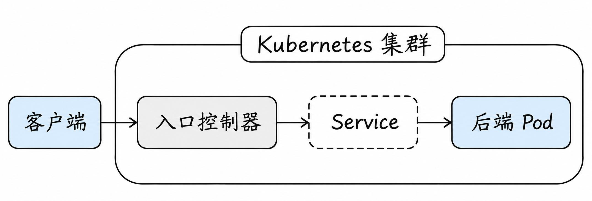
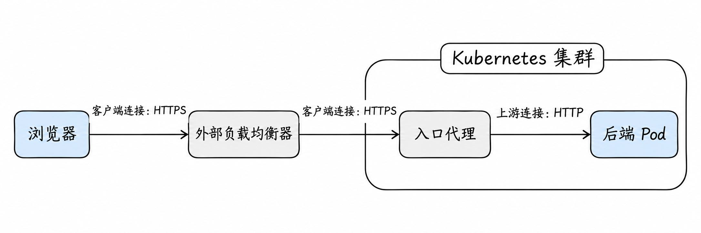
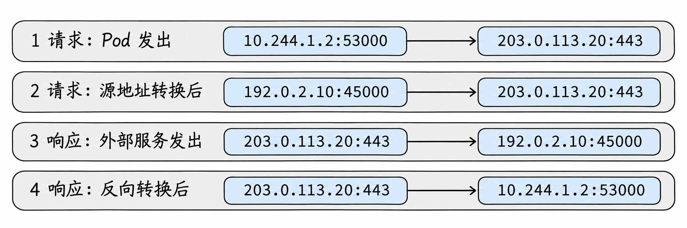
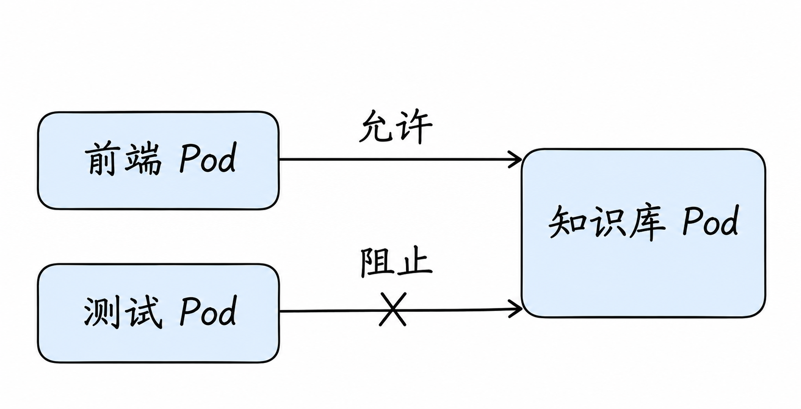

# 集群内外通信与网络安全

上一篇中，网站 Pod 在集群内通过 Service 找到知识库。现在用户在浏览器输入 `shop.example.com`，请求来自集群外；反过来，知识库也可能需要访问外部 API。入口和出口各怎样工作？又如何限制不该发生的访问？

为了把路径说具体，我们先约定一种可能的部署：用户浏览器通过外部 DNS 将 `shop.example.com` 解析为外部负载均衡器的地址；负载均衡器把连接送到集群中的入口代理；代理按请求的域名和路径找到对应的后端。这只是一个例子，实际部署中负载均衡器、TLS 终止位置和后端连接方式都可能不同。

假设外部 DNS 给出的入口地址是 `192.0.2.80`，那么浏览器会连接这个地址，但访问的网址仍是 `shop.example.com`。这个示例地址只用于文档；真实环境中的入口地址、解析配置和证书必须自行对应。

## 1. 先看外部请求的逻辑路径



用户先通过外部名称找到入口地址，连接到入口实现；入口根据配置决定目标服务，最终由某个后端 Pod 处理请求。图是**逻辑关系**：入口实现可能直接连接后端，也可能使用 Service 的虚拟地址；图中的 Service 不是必然存在的独立中转设备。

部署还可能包含云负载均衡器、节点端口、代理或防火墙。具体先经过什么，必须查看平台和控制器，不能只凭 Ingress 对象画出实际数据包路径。

这里的 DNS 与上一篇 Pod 查询集群内 Service 的 DNS 是两个用途：外部用户使用浏览器或所在系统配置的解析器，查找网站对外的名字；Pod 通常使用集群 DNS 查找集群内部服务。两者都把名称解析为地址，但它们并非必然是同一台服务器，也不会替应用转发后续的 HTTP 请求。

以我们约定的部署为例，浏览器解析到入口地址后，才会向这个地址建立网络连接，再发送网站请求；如果外部名称无法解析，请求还没有到达入口。反过来，名称能解析，只说明得到了一个地址，还需要检查连接能否到达、入口能否匹配规则以及后端是否正常。

## 2. NodePort：先找到集群的一台节点

`NodePort` Service 为服务分配节点端口。客户端如果能到达符合配置的节点地址与端口，Service 数据平面可把连接导向后端；后端可能在本节点，也可能在其他节点。

例如 Service 的 `port: 80`、`targetPort: 8080`、`nodePort: 30080` 是三处不同的端口。客户端访问的是节点地址的 `30080`；后端应用仍需要监听 `8080`。端口是否对外可达，还受节点地址选择、代理实现、网络和防火墙影响。

节点扩缩容和健康状态需要由外部客户端或负载均衡器处理。NodePort 本身并不提供按域名或 URL 路径选择网站的 HTTP 路由功能。

可以把它和上一篇 Service 的端口对应起来：`30080` 是节点一侧对外提供的端口，`80` 是 Service 的端口，`8080` 是实际应用监听的端口。这里给出的是不同层次的访问入口，不能只凭这三个数字推断数据包一定要经过三个独立的代理进程。

例如，用户请求 `192.0.2.11:30080` 时，`192.0.2.11` 是客户端选中的节点地址，`30080` 是该 Service 的节点端口。这个节点收到流量后，后端可能恰好运行在另一台节点，仍需要集群网络完成后续交付。因此，“外部能连上节点端口”和“所有后端都可达”也应分别验证。

## 3. LoadBalancer：给外部客户端一个入口

`type: LoadBalancer` Service 表达“需要一个外部负载均衡入口”。云提供商或其他负载均衡实现可以创建并维护相应资源；裸金属环境也需要合适的实现。没有实现时，Service 可以存在但外部地址一直未分配。

外部负载均衡器如何选节点或后端、是否通过 NodePort、是否分配公网地址、健康检查怎样工作，取决于实现。不要假定所有平台都使用相同数据路径。[Service 类型](https://kubernetes.io/docs/concepts/services-networking/service/)

例如，外部负载均衡器可能把公网地址上的连接交给多个节点，并通过健康检查避开当前不可用的目标。负载均衡器本身不是客户端的 DNS：DNS 负责告诉浏览器要连接哪个地址，负载均衡器在连接到达之后才决定交给哪个目标。

负载均衡器通常由云控制器或集群另外安装的实现创建与维护；`LoadBalancer` Service 是 Kubernetes 中的期望配置，不是“创建对象就凭空得到外部设备”。它可以用于直接暴露一个应用 Service，也可以用于让外部访问入口控制器。是否组合使用、入口后还有哪些代理，取决于部署。

## 4. Ingress 与 Gateway：按请求内容找服务

一台入口可能同时服务 `shop.example.com` 和 `api.example.com`。HTTP 请求具有域名、路径等信息，因此入口实现可以根据规则将请求导向不同 Service，也可以终止 TLS。

例如，`shop.example.com/api` 和 `shop.example.com/static` 都访问同一个入口地址和端口：只看地址与端口，入口还无法知道要去哪个应用；能够解析 HTTP 的入口代理可以进一步读取主机名和路径，把前者导向 API 服务、后者导向静态网站服务。若流量是 HTTPS，就需要在能读取 HTTP 的一侧先完成 TLS 处理；纯粹透传加密内容的设备无法直接读取其中的 HTTP 路径。

**Ingress** 是描述 HTTP/HTTPS 路由的 Kubernetes API。创建对象本身不会启动代理，集群需要相应 Ingress 控制器。Ingress API 已冻结，Kubernetes 项目建议考虑 Gateway API；现有 Ingress 部署仍然需要理解与维护。[Ingress 文档](https://kubernetes.io/docs/concepts/services-networking/ingress/)

将配置和工作中的代理区分开：Ingress 对象记录“哪个域名、路径对应哪个服务”；控制器读取这些配置，并让实际承担入口流量的代理按规则工作。没有实现该 IngressClass 的控制器时，即使对象成功创建，也没有保证会有代理执行这些规则。

**Gateway API** 将基础设施类别、监听入口和路由规则等职责拆开。常见对象包括 `GatewayClass`、`Gateway` 和 `HTTPRoute`；需要安装对应 API 和实现。不同实现支持的扩展能力可能不同，查看资源状态与实现文档比只看 YAML 是否创建成功更可靠。[Gateway API 概览](https://gateway-api.sigs.k8s.io/docs/concepts/api-overview/)

沿用同一个网站例子：`GatewayClass` 描述由哪类实现负责提供入口能力；`Gateway` 描述实际入口及其监听配置；`HTTPRoute` 描述网站请求如何匹配并转给服务。可以先把它们看成“入口由谁提供、在哪儿接收、收到后分给谁”三个相互关联的配置。写出这些资源不等于代理已经正常提供服务，路由也需要成功关联到可用的 Gateway；实际还要查看控制器和资源状态。

在排查 HTTP 路由时，除目标地址外还要核对 Host、路径、监听端口和证书。直接对 IP 发请求而未设置正确 Host，可能与真实浏览器请求匹配不同规则。

### 看一个请求如何被匹配

假设 `shop.example.com` 的 `/api` 请求应该进入知识库服务。用户先把域名解析成入口地址，与入口建立连接；入口读取适用的 HTTP 信息，根据其规则选择服务，再由实现连接对应后端。`/api` 是否保留、重写或截断取决于规则及实现，不能因为看到相同域名就假设后端会收到某个固定路径。

这个例子把 `/api` 直接交给知识库服务；另一个常见安排是先交给网站应用，再由网站在集群内调用知识库。两者都是可配置的请求路径，分析具体部署时要以实际路由为准。

### 连接入口后，为什么后端还需要另一条连接？

在本例的反向代理方案中，外部负载均衡器负责把客户端连接交给入口代理；入口代理在适用的 TLS 终止位置解密后，才能读取 HTTP 的域名和路径，匹配规则。代理选择后端之后，还要代表客户端把请求发送给后端：它会使用与后端之间的连接，后端响应先回到代理，代理再向客户端回复。

这两段连接是不同的连接：后端在网络层看到的对端通常是代理或中间转换后的地址，而不是浏览器直接与后端建立的同一条 TCP 连接。代理可以复用上游连接，也可以根据具体配置建立新连接；不能把一条 HTTP 请求机械地等同于两端各新建一次 TCP 连接。某些实现也可以透传 TLS，实际分段取决于它们的配置。

以一种具体方案为例：负载均衡器在四层转发并保留客户端与入口代理之间的 TCP 连接，入口代理终止 TLS，代理到后端使用 HTTP。浏览器到代理这一段是 HTTPS；代理到后端这一段是 HTTP。



图只画请求方向，假设入口代理直接连接 Pod；响应依次经代理和负载均衡器返回浏览器。Service 是规则引用的逻辑服务，并未画成必经设备；有些代理使用 Service 地址，也有负载均衡器会自己终止连接并新建另一条连接。此例中客户端到代理的 HTTPS 加密，并不自动保证代理到后端也加密；实际 TLS 终止点应按部署确认。

如果入口处理 HTTPS，先区分 TLS 在哪里终止：客户端到入口加密，不自动保证入口到后端也使用 TLS。证书有效性和域名匹配由实际终止 TLS 的一端承担；代理后的安全和身份需要单独设计。

浏览器访问 `https://shop.example.com/api` 时，域名不仅用于获取地址。建立 TLS 时客户端通常通过 SNI 告知期望的主机名，以便入口选择对应证书；建立 HTTPS 后，HTTP 请求也会携带目标主机信息，供代理匹配路由。两者属于不同阶段。把 URL 换成入口 IP，可能同时改变证书验证和路由匹配，因而不一定等价于真实请求。

例如，在具备 curl 的测试机器中，若需要验证某个入口 IP，同时保持正确的域名、Host 与 TLS 名称，可使用 `curl --resolve shop.example.com:443:<入口IP> https://shop.example.com/api`；替换占位符，且证书应与域名匹配。测试会产生真实请求，应使用有权限的测试环境。直接改为 `https://<入口IP>/api` 可能改变证书校验与路由匹配结果。

一份简化的 Ingress 可以把上面的选择关系写成这样：

```yaml
apiVersion: networking.k8s.io/v1
kind: Ingress
metadata:
  name: shop
  namespace: shop
spec:
  ingressClassName: nginx
  rules:
    - host: shop.example.com
      http:
        paths:
          - path: /api
            pathType: Prefix
            backend:
              service:
                name: knowledge
                port:
                  number: 80
```

这里的 `nginx` 只是示例：集群必须已有与该名称对应、正常运行的 IngressClass 和控制器。`backend` 引用同一命名空间中 `knowledge` Service 的 **80 端口**，不是直接指定 Pod 的 `8080` 端口。Service 再描述后端端口；控制器实际上如何连接后端则取决于实现。`Prefix` 依据 API 定义匹配路径前缀，不代表自动删除 `/api`。

这段配置没有 `tls`，因此不能仅凭它认为 HTTPS 已配置完成；证书、外部 DNS 和控制器的外部可达性也要另行准备。若对象已创建而请求失败，可分别查看 Ingress 的状态、控制器日志、Service 后端和真实请求的 Host/路径，而不是把资源创建成功当作入口已经可用。

## 5. 原始客户端 IP 为什么有时看不到？

连接穿过负载均衡、节点转发或代理时，后端看到的网络层源地址可能发生变化，具体取决于路径和配置。`externalTrafficPolicy: Local` 在适用场景下可以避免某些跨节点转发及源地址转换，但前提是流量进入的节点有可用本地后端，且外部负载均衡健康检查正确；它不保证代理链的每一层都保留原始地址。

HTTP 代理还可能在请求头中传递客户端地址。应用只应按可信代理边界解释这些头，不能把任意客户端传入的头都当成可信身份。网络层源地址与 HTTP 头是不同层次的信息。[源 IP 文档](https://kubernetes.io/docs/tutorials/services/source-ip/)

例如，入口代理收到浏览器请求后向后端新建或复用连接，后端从连接本身看到的源 IP 可能是代理地址。代理可以把原始地址放进 `X-Forwarded-For` 等 HTTP 头，但客户端也可能自行构造同名头；只有在入口清理、设置相关头并且应用只信任已知代理时，后端才能按约定使用它。若前面还有负载均衡器，还要逐段确定谁接收了哪个地址，不能只盯住 Pod 日志。

## 6. Pod 怎样访问外部服务？

Pod 出站可能先解析外部域名，再经过节点或出口网关以及底层路由到达目标；返回流量也需要可用路径。某些部署对 Pod 出站做 SNAT，让外部看到节点或出口地址；另一些部署允许外部网络直接路由 Pod 地址。

排查外部数据库无法访问时，分别确认域名、目标端口、Pod 出站策略、节点出口地址、外部防火墙及返回路由。外部服务白名单通常需要填写它**实际看到的源地址**，不能仅凭 Pod IP 猜测。

例如，Pod 使用 `10.244.1.2` 连接外部服务，若出口设备将源地址转换成 `192.0.2.10`，外部服务的日志和白名单需要按这一出口地址分析；响应也要经过能处理该转换状态的路径。若没有这种转换，且外部网络本来就能把流量路由回 Pod 网段，则可能保留 Pod 源地址。这两个例子都需要去程、回程以及两侧访问规则成立，不能仅从 Pod 里配置的地址推断外部看到什么。

把这次请求和响应的地址展开。假设 Pod 的临时源端口是 `53000`，外部服务是 `203.0.113.20:443`，出口设备在转换地址的同时选择了 `45000` 端口：



每行左边是该时刻的源地址，右边是目标地址；图展示的是四次观察到的地址，不是把四个地址画成四台顺序经过的设备。外部服务收到第 2 行请求后，按第 3 行回复到转换后的地址与端口；出口设备根据连接跟踪状态还原目标，再送回 Pod。出口端口实际可能保持不变，也可能改变。`192.0.2.0/24` 和 `203.0.113.0/24` 是文档示例地址，真实地址和路径由环境决定。

## 7. 限制 Pod 之间的访问

假设 `shop` 命名空间中，我们希望在普通 Pod 之间只允许标记 `role: frontend` 的网站 Pod 访问标记 `app: knowledge` 的知识库 Pod 的 TCP 8080 端口。可以为知识库 Pod 创建入站策略：



图中假设测试 Pod 没有前端标签、也没有其他策略为它放行；源 Pod 自身的出站策略也允许前端发出请求。图只表达这次连接是否被允许，并未把策略画成数据必经的一台设备。

```yaml
apiVersion: networking.k8s.io/v1
kind: NetworkPolicy
metadata:
  name: knowledge-ingress
  namespace: shop
spec:
  podSelector:
    matchLabels:
      app: knowledge
  policyTypes:
    - Ingress
  ingress:
    - from:
        - podSelector:
            matchLabels:
              role: frontend
      ports:
        - protocol: TCP
          port: 8080
```

这个策略选择 `shop` 中的知识库 Pod，并允许来自同一命名空间匹配标签的 Pod 访问指定端口；它不对这些 Pod 的出站作限制。实际效果取决于网络实现是否支持策略，以及是否有其他选中同一 Pod 的允许规则；不要在生产环境未评估现有规则前直接应用示例。

先看未设置任何策略时：普通 Pod 对入站和出站通常都不受 Kubernetes NetworkPolicy 限制。创建上面的策略后，匹配的知识库 Pod 在**入站方向**被隔离，只能接受适用允许规则放行的连接；没有被此策略选中的其他 Pod 不会因此自动被隔离。这里的“隔离”是该方向进入允许列表模式，不代表 Pod 从网络上消失。Kubernetes 对 Pod 与所在节点之间的流量还有特殊规定；不要把本例概括成“除了前端，任何来源都必然被拒绝”。

网站 Pod 发起连接时，可以分两侧判断：先看网站 Pod 是否被出站策略选中，以及连接目标是否获允许；再看知识库 Pod 是否被入站策略选中，以及来源和端口是否获允许。未在某个方向被任何策略隔离的一侧，通常不因 NetworkPolicy 阻断该方向。两侧都满足后仍需应用监听、路由和网络链路正常。

策略按方向分别隔离；多个选中同一 Pod 的允许规则取并集。若源 Pod 的出站和目标 Pod 的入站都被隔离，连接需要两侧都允许。同一条规则中的 `namespaceSelector` 和 `podSelector` 组合，与写成两个列表项的含义不同。[NetworkPolicy](https://kubernetes.io/docs/concepts/services-networking/network-policies/)

例如，策略 A 允许前端 Pod 访问 8080，策略 B 同时允许监控 Pod 访问 9090；两条策略都选中知识库 Pod 时，允许范围会合并。新增一个更窄的允许规则不会撤销另一条已经允许的流量。若需要默认拒绝某方向，应为相应 Pod 明确建立该方向的隔离策略，并在此基础上逐项允许。

跨命名空间时，同一个 `from` 项同时包含 `namespaceSelector` 与 `podSelector`，表示选择满足命名空间条件**且**满足 Pod 条件的来源；若拆成两个 `from` 列表项，则是两组允许来源的并集。缩进和列表层级会改变含义，应使用 `kubectl describe networkpolicy` 结合测试确认。

例如，若希望只允许带 `team: web` 标签的命名空间内、带 `role: frontend` 标签的 Pod，两个选择器要放在同一个列表项中：

```yaml
from:
  - namespaceSelector:
      matchLabels:
        team: web
    podSelector:
      matchLabels:
        role: frontend
```

如果在 `podSelector` 前额外写一个 `-`，它就成了另一个列表项：前一项允许匹配的命名空间，后一项在本策略的命名空间内允许匹配的 Pod，范围与“同一来源同时满足两个条件”不同。示例是规则片段，需要放入一条完整 NetworkPolicy 的 `ingress` 中。

默认拒绝出站时，DNS 查询也可能被阻止，需要根据集群实际 DNS 路径单独放行。Pod 的 `hostNetwork`、NAT 前后匹配以及插件扩展行为有实现差异，不能盲目从普通 Pod 推断。

这里还有一个容易遗漏的方向：上面的策略只选择**知识库 Pod 的入站**。它不会因为网站 Pod 带有 `role: frontend` 标签，就自动更改网站 Pod 自己的出站规则。若网站 Pod 已被另一份出站策略隔离，还需要那份策略允许它连接知识库；只修改知识库的入站策略不能覆盖来源侧的出站限制。

外部请求经过入口代理时，还应确认知识库看到的来源是什么。例如，假设入口代理作为另一个命名空间中的 Pod 直接连接知识库 Pod，那么知识库收到的新连接的来源可能是入口代理 Pod，而不是浏览器，也不是前面配置中的 `role: frontend` 网站 Pod。此前只允许同命名空间前端 Pod 的规则可能挡住它；应结合代理的命名空间、标签与真实连接路径设计放行。若代理使用主机网络、经过地址转换，策略如何观察来源还要根据网络实现确认。

对于已被允许建立的连接，Kubernetes NetworkPolicy 的模型会隐含允许对应的响应流量，因此通常不需要为了这条响应再写一条反向发起连接的允许规则。反过来，允许网站主动访问知识库，也不等于允许知识库另外主动发起一条连接访问网站；那是另一条连接，要按其方向判断。[NetworkPolicy：隔离与规则](https://kubernetes.io/docs/concepts/services-networking/network-policies/)

## 8. TLS、身份与网络策略各解决什么？

NetworkPolicy 主要表达 Pod 的三层/四层访问规则；它不自动加密数据，也不能替代应用的用户认证。TLS 可以保护传输并验证服务器身份；双向 TLS 还可用于双向身份验证。证书签发、轮换、代理信任和策略设计仍需单独配置。

服务网格可以通过代理或其他数据平面提供流量管理、身份和观测能力，但安装服务网格不会自动让每个集群拥有相同安全保证；必须检查实际模式和策略。

## 9. 观察一条外部请求

```bash
kubectl get service -A
kubectl get ingress -A
kubectl get networkpolicy -A
kubectl -n <命名空间> describe service <服务名>
```

Gateway API 是否安装、入口控制器位于哪里和日志名称，按集群实际情况确认。检查顺序可以从外部名称、入口地址、控制器规则和状态开始，再检查 Service、EndpointSlice、后端监听与策略。测试时保持 Host、路径、协议和端口与真实客户端一致。

下一篇将这些线索组合成 [排障、性能与生产设计](08-network-troubleshooting-and-design.md) 的方法。

## 参考资料

- [Kubernetes Service](https://kubernetes.io/docs/concepts/services-networking/service/)
- [Ingress](https://kubernetes.io/docs/concepts/services-networking/ingress/)
- [Gateway API](https://gateway-api.sigs.k8s.io/docs/concepts/api-overview/)
- [NetworkPolicy](https://kubernetes.io/docs/concepts/services-networking/network-policies/)
- [源 IP](https://kubernetes.io/docs/tutorials/services/source-ip/)
