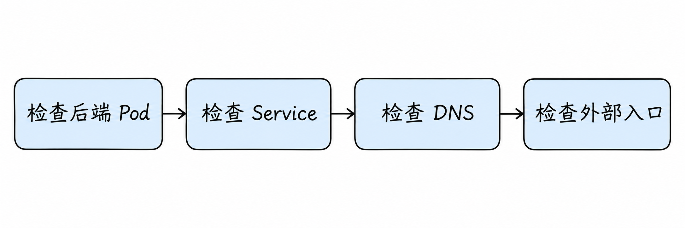
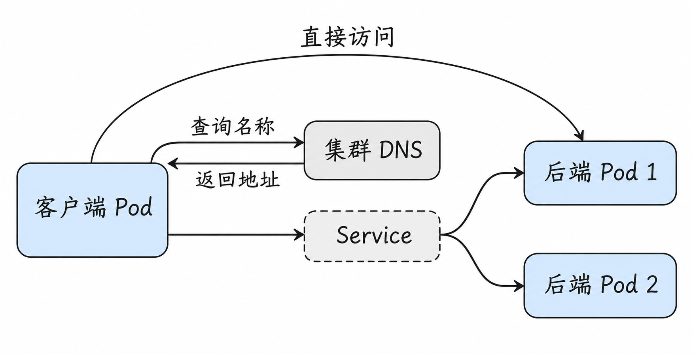
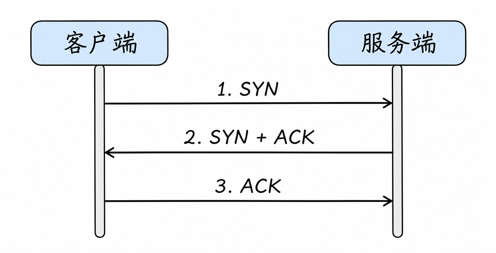
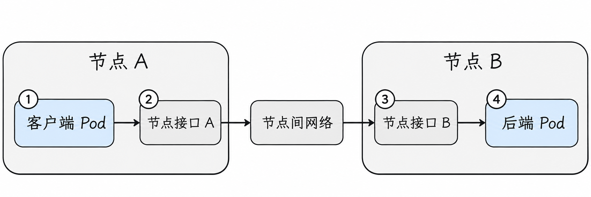

# Kubernetes 网络排障、性能与生产设计

前面一路追踪了应用从名称解析、Service 后端选择，到 Pod 网络和外部入口的路径。这篇把它们用在实际问题上：如果网站访问知识库超时，怎样逐段缩小范围，而不是一开始就重启网络组件？

## 1. 先把故障说具体

“网络不通”可能指名字无法解析、连接被拒绝、连接超时、TLS 失败或 HTTP 返回错误；这些现象的排查方向不同。

先记录五个事实：**从哪里发起、访问什么名称或地址及端口、使用什么协议、预期是什么、实际错误是什么**。再比较同节点与跨节点、直接 Pod IP 与 Service、单个客户端与所有客户端是否表现相同。保留时间点、源节点、目标节点和请求标识，有助于关联日志。

例如，同一客户端直接访问 `10.244.2.3:8080` 成功，而通过 Service IP 的对应端口失败，说明后端和该客户端之间至少有一条可用路径；接下来可优先看 Service 端口、EndpointSlice 与数据平面。它**不证明**其他 Pod、其他端口或所有后端都正常。

## 2. 选择一条对照路径



图是一种由内向外的检查顺序，不是数据包的真实流向。实际操作可从最先失败的位置开始：如果只有外部入口失败，先看外部入口与相同 Host 的请求；如果直接 Pod 连接已经失败，先看应用和 Pod 网络。

排查需要有可比性。例如，网站 Pod 在节点 A 上访问 `knowledge.shop` 出错，就应尽量从这个 Pod、使用同样的协议和请求内容测试。换一台客户端后，即使测试成功，也可能只是那台客户端所在的节点、网络策略或 DNS 配置不同，不能直接说明原问题已经消失。

先画出这次请求涉及的几条关系：名称查询是一条单独的交互；取得地址后，客户端才连接 Service；直接访问某个后端则绕过 Service 的后端选择。下面我们会分别测试这些部分，再把结果放在一起比较。



图中的 DNS 查询与业务访问是不同交互；Service 两条分支代表可能选中的后端，不代表每次请求都同时发给两个 Pod。Service 方框表达逻辑关系，并不意味着它是业务数据必经的一台独立机器。为突出测试入口，图只画出了 DNS 的响应以及业务请求方向；实际业务响应同样需要返回客户端。

## 3. 后端本身是否准备好了？

```bash
kubectl -n <命名空间> get pods -o wide
kubectl -n <命名空间> describe pod <后端Pod>
kubectl -n <命名空间> logs <后端Pod>
```

替换尖括号中的占位内容。检查 Pod 所在节点、就绪状态和事件；应用是否监听正确端口与地址。`Running` 表示 Pod 生命周期处于运行阶段，不等于应用就绪或网络一定可达。应用只监听 `127.0.0.1` 时，从其他 Pod 连接其 Pod IP 通常失败。

在有权限且镜像包含诊断工具时，可从目标内查看监听；从与故障客户端相同网络位置的测试环境，访问目标 Pod IP 和对应端口。不要把 `ping` 成功当作 TCP 应用可用；`ping` 失败也可能只是 ICMP 被过滤。

## 4. Service 和 EndpointSlice 是否一致？

```bash
kubectl -n <命名空间> get service <服务名> -o yaml
kubectl -n <命名空间> get endpointslice -l kubernetes.io/service-name=<服务名> -o yaml
kubectl -n <命名空间> get pods -o wide --show-labels
```

对照 selector 与 Pod 标签、Service `port` 与后端 `targetPort`、协议、地址和就绪状态。无 selector Service 可采用手动维护的 EndpointSlice。后端列表为空时，先确认是否真的应有匹配 Pod，再看就绪与发布设置。

Pod IP 能访问、Service IP 不能访问时，还要看该节点上的 Service 实现和流量策略；例如本地流量策略限制了后端范围。对于 kube-proxy 替代方案，不能只凭 iptables 中有没有某条规则下结论。

### 一个具体对照：名字、Service、单个后端

假设客户端位于 `shop`，Service 为 `knowledge:80`，目标 Pod 监听 `8080`。先记录 DNS 解析出的 Service 地址；从同一个客户端、用同一种 HTTP 请求分别访问名称、Service IP 的 80 端口和后端 Pod IP 的 8080 端口。如果应用依赖 Host，请保持 Host 一致。

如果名称失败但 Service IP 成功，优先查 DNS；名称和 Service IP 都失败但单个 Pod 成功，继续查 Service 与其他后端；单个 Pod 也失败，就先查后端应用、策略和 Pod 网络。这里的分支只表示缩小范围，不是对故障原因的最终判定；特别是 Service 有多个后端时，必须分别确认每个后端。

### 跟一次端口配置错误的排查

假设收到的现象是：`shop` 中的网站客户端访问 `knowledge.shop:80/health` 失败。我们先把测试环境说清楚：这是一个假想的普通 ClusterIP Service；它应该将 TCP 80 转到后端的 TCP 8080；每个后端的 `/health` 在正常情况下返回 HTTP 200；客户端 Pod 名为 `web-client`，并且有 `curl` 和 `nslookup`。下面的地址、输出都是**示意数据**，不是执行命令后保证出现的结果。

先在客户端查询名称，并分别访问得到的 Service IP 和两个后端。为避免应用根据 Host 返回不同内容，这几次 HTTP 测试都使用相同的 Host 和路径；Service 端口与 Pod 端口不同，是因为它们本来配置在不同位置：

```bash
kubectl -n shop exec web-client -- nslookup knowledge.shop.svc.cluster.local
kubectl -n shop exec web-client -- curl -sS --connect-timeout 2 --max-time 5 -o /dev/null -w '%{http_code}\n' -H 'Host: knowledge.shop' http://10.96.0.20:80/health
kubectl -n shop exec web-client -- curl -sS --connect-timeout 2 --max-time 5 -o /dev/null -w '%{http_code}\n' -H 'Host: knowledge.shop' http://10.244.1.4:8080/health
kubectl -n shop exec web-client -- curl -sS --connect-timeout 2 --max-time 5 -o /dev/null -w '%{http_code}\n' -H 'Host: knowledge.shop' http://10.244.2.3:8080/health
```

假设观察到：名称解析为 `10.96.0.20`；访问 Service IP 连接失败；两个后端 IP 的 `8080` 都返回 `200`。这说明在**这个客户端和这个时间点**，名称解析得到了预期地址，两个后端的对应 HTTP 路径也可以直接访问。它还不能证明 Service 的所有配置正确，也不能只凭这一组结果断言一定是 kube-proxy 出错。

接着查看 Service 和它发布的后端端口：

```bash
kubectl -n shop get service knowledge -o yaml
kubectl -n shop get endpointslice -l kubernetes.io/service-name=knowledge -o yaml
```

假设 Service 中出现下面的片段，而 EndpointSlice 的端口也显示为 `8081`；后端实际只在 `8080` 上提供这个服务：

```yaml
# Service 配置片段
ports:
  - name: http
    port: 80
    targetPort: 8081
```

这里的证据连起来了：直接测试访问的是 Pod 的 `8080`，而通过 Service 时，配置让连接转向了 `8081`。应检查这是否确实是配置错误，并结合 EndpointSlice 和后端监听状态确认，而不是看到一个不一致就立刻修改生产配置。如果 EndpointSlice 列出了多个后端，需要逐个核对；端口正确也不排除 Service 数据平面或策略存在问题。

在这个假想案例中，维护者确认期望端口为 `8080`，按正常变更流程修正 Service 后，再等待并检查 EndpointSlice 已更新。最后从**同一个客户端**重复名称、Service IP 和各后端测试，观察 Service 请求恢复 `200`，并继续结合真实业务监控。原问题的结论才是“本次故障由后端端口配置不匹配导致”，而不是“Service 访问失败都由端口错误导致”。

查看网络策略时，要同时看客户端出站和目标入站，以及是否有其他允许规则。`kubectl get networkpolicy -A` 列出的是声明，不保证当前 CNI 支持或已执行相应规则。

## 5. 名字解析失败还是连接失败？

如果测试 Pod 自带 `nslookup`：

```bash
kubectl -n <命名空间> exec <客户端Pod> -- cat /etc/resolv.conf
kubectl -n <命名空间> exec <客户端Pod> -- nslookup <服务名>.<命名空间>.svc.cluster.local
```

集群域名不一定是 `cluster.local`，替换为实际值；精简镜像也可能没有诊断命令。记录是超时、名称不存在还是解析出意料外的地址。随后单独测试解析出的地址和端口：解析成功与应用可用是两件事。

若默认拒绝出站，DNS 查询可能被 NetworkPolicy 阻止；也需检查 DNS 服务和后端、节点本地 DNS 或自定义 DNS 配置。不要通过临时关闭全部策略来替代定位。

## 6. 同节点通，跨节点不通

先确认比较的是相同协议、端口、应用和策略，而不是不同后端恰好配置不一致。若确实只有跨节点失败，新增路径包括：源节点到目标节点、路由或隧道、底层防火墙、目标节点交付以及返回路径。

在获授权的 Linux 节点上，`ip route get <目标PodIP>`、`ip -d link show`、`ip neigh` 可提供线索；具体接口和路由取决于网络实现。有些数据平面使用 eBPF 或云网络，不能假设一定存在某个网桥或 VXLAN 设备。再结合插件状态、指标、日志、节点间 MTU 与安全规则，确定哪个位置开始缺少预期数据。

例如，同一客户端分别访问同节点和跨节点的测试后端时，必须确认两边运行的是相同应用、监听相同端口、使用同样的策略，再比较路径。只有这样，“同节点成功、跨节点失败”才更有助于缩小到跨节点新增的部分。仍需记住：后端即使来自同一镜像，也可能因就绪状态、配置或节点环境不同而表现不同。

## 7. 超时、拒绝与应用错误

连接超时通常表示没有及时收到完成连接所需的响应，但可能来自丢包、过滤、返回路由或过载等多种原因。`connection refused` 常表示目标或中间设备明确拒绝，但不应仅凭这一条推断具体是哪条规则。TLS 错误要核对域名、证书和代理配置；HTTP 404、503 则要结合入口匹配和应用日志。

同样一个 IP 和端口，测试协议不同时结果也可能不同。测试入口时保留真实的域名、路径和 TLS 名称，否则可能命中不同路由。

把 TCP 建连过程展开，会更容易理解抓包线索。客户端先发出 `SYN`；服务端若接受连接，通常回复 `SYN, ACK`；客户端再回复 `ACK`，连接才进入可传输应用数据的状态。如果源侧反复发出 `SYN` 却看不到回复，问题可能在去程、目标处理或回程；仅凭源侧抓包无法知道到底丢在哪里。若已看到连接建立，随后应用仍报错，就应继续看 TLS、HTTP 和应用本身，不能停在“三次握手成功”。



图中从上到下表示时间顺序，只展示正常建连；失败时可能发生重传或出现拒绝。图里的服务端指 TCP 对端，它可能是最终应用，也可能是终止连接的代理，需要结合实际路径判断。

抓包中出现 `RST` 意味着连接被重置，但它可能来自目标，也可能来自路径中的设备；要对照源地址、出现位置和两端日志。网络设备可能改变报文，源地址本身也不总能唯一证明产生重置的进程。

## 8. 抓包看什么？

在授权环境中，`tcpdump` 可以观察某接口是否出现符合条件的流量，例如 `sudo tcpdump -ni <接口> host <目标IP> and tcp port <端口>`。抓包需要权限，可能包含敏感内容，保存和分享前应按环境要求处理。

不要只在一个位置抓包就推断全路径：在合适的源 Pod、源节点、隧道或物理接口、目标节点及目标 Pod 之间比较。观察 SYN 是否发出、是否有响应、地址是否按预期变化，以及请求和响应是否走了不同路径。封装流量在节点外侧可能显示节点 IP 与隧道端口，内侧才显示 Pod 地址；硬件卸载等也可能影响看到的校验和或报文形态。



图中的编号是可供选择的观察位置：1 在客户端网络空间，2 在源节点接口附近，3 在目标节点接口附近，4 在后端网络空间。图只画请求方向并省略节点内部的虚拟接口和具体转发规则；响应也需要回到客户端。实际抓包位置由 CNI、网络设备和权限决定，不要求每次都在四个位置抓包。

假设实际方案采用直接路由、没有对这次 Pod 流量做地址转换，客户端为 `10.244.1.2`，后端为 `10.244.2.3:8080`。在具备工具和权限、且确认接口名称后，可以在源 Pod 所在网络空间或相关节点接口上观察：

```bash
sudo tcpdump -nn -i <实际接口名> 'host 10.244.2.3 and tcp port 8080'
```

其中 `-i` 指定观察接口，`-nn` 避免将地址和端口反向解析成名字，后面是过滤条件；尖括号要连同内容一起替换。以下是**为说明而简化**的一种输出：

```text
10.244.1.2.53211 > 10.244.2.3.8080: Flags [S]
10.244.2.3.8080 > 10.244.1.2.53211: Flags [S.]
10.244.1.2.53211 > 10.244.2.3.8080: Flags [.]
```

三行依次对应客户端的 SYN、服务端的 SYN+ACK 和客户端的 ACK。假设源 Pod 侧看到 SYN，目标 Pod 侧却看不到，下一步是在两端节点合适的接口继续对照，而不是直接认定哪台交换机有问题。如果目标侧看到 SYN 并发出 SYN+ACK，而源侧看不到响应，则应进一步检查响应路径和过滤策略。每个结论都依赖抓包接口、时间窗口和过滤条件确实覆盖目标流量；看不到包也可能是观察点选错。

当集群使用 VXLAN 这类封装时，节点外侧可能看到的是节点地址之间的 UDP 包，而非直接可见的 Pod TCP 包。此时上面的 Pod IP/TCP 过滤条件可能在物理接口上没有结果；需要结合插件实际封装方式、隧道接口和外层地址制定过滤条件。多个节点的抓包要记录各自时间并核对时钟，才能避免把时间顺序误判成网络延迟。

## 9. 性能问题：先知道在测什么

时延、吞吐、丢包和连接建立速率是不同指标。应记录消息大小、并发、连接复用、服务端处理时间、跨节点位置和测量工具；单次 `ping` 不能代表应用吞吐。先分别测试应用处理、同节点与跨节点，再看 CPU、网卡、网络拥塞、重传、连接跟踪和队列指标。

隧道会增加封装开销，MTU 不一致可能使部分大包失败；但观察到“跨节点慢”并不自动证明是 VXLAN。对照测试要尽量只改变一个条件，并在真实流量允许的范围内执行。

例如，一次测试传输了 200 MB 的有效数据，用时 5 秒，平均应用吞吐约为 40 MB/s。这个结果要与消息大小、并发数、连接复用和同节点基线一起记录：如果同节点已经很慢，先检查应用处理与 CPU；如果只有跨节点明显下降，再比较网卡、节点间链路、重传和封装成本。单次平均值也可能掩盖抖动，应重复测量并观察分布，但需要控制并发与测试负载，避免测量本身干扰业务。

### 长连接和间歇故障怎么观察？

记录一条连接建立的时间、持续时间与后端 Pod：如果新连接正常、老连接在发布时中断，关注后端终止、连接排空、代理超时与客户端重试；如果只有长时间空闲后失败，核对路径中的空闲超时。单纯增加重试可能掩盖故障，还可能放大负载。

检查连接跟踪时，要将错误与节点指标、表容量及真实连接数对照；不能看到连接跟踪表就断言已经耗尽。大包异常也应对照实际路径 MTU、封装和必要 ICMP 反馈，区分应用消息大小与真实 IP 包大小。

### 跟一次间歇性失败

假设 Service 后面有两个 Pod，用户反馈“有时成功，有时超时”。先从同一个测试 Pod 分别访问每个后端的 `8080`，发现一个成功、另一个超时；再查看 EndpointSlice，确认两个地址是否都被发布并处于可用状态。此时有证据表明故障可能与特定后端路径有关，但还不知道是应用、节点网络还是策略。

接下来确认失败的后端是否监听 `0.0.0.0:8080` 或其 Pod IP，检查它的就绪状态和日志，再对照它所在节点。若它只监听回环地址，而就绪探针又未反映真实的外部可访问性（例如探针只在容器内检查本地进程），就可能被发布为后端但无法由其他 Pod 访问。修正后，应重新检查 EndpointSlice，并在相同客户端位置重复访问各后端和 Service；多次成功仍需结合监控确认，而不是靠一次成功宣布所有间歇故障已经解决。

## 10. 生产设计从地址和故障域开始

规划 Pod CIDR、Service CIDR 和节点网络时，先与现有机房、云网络、VPN 及未来互联范围核对，避免不可路由的地址冲突；留出增长空间，不要只按当前副本数估算。多网卡、多个集群和双栈时，还要明确哪一张网络承载什么流量。

外部入口需要考虑副本分布、健康检查、证书轮换和负载均衡故障域；`Local` 类流量策略要求特别关注本节点是否有可用后端。策略设计要包括 DNS 和必要的监控出口；网络变更应可观测、可回滚，并在接近生产的环境验证。

## 11. 一次故障的最小记录

把结果写成可复查的链条：客户端位置与时间 → 名称解析结果 → Service 和后端状态 → 对照测试 → 目标与节点上的证据 → 确认的根因与验证。区分“观察到的事实”和“目前的推测”，防止把相关性当成因果。

下一篇进入 [AI Infra 网络](09-ai-infra-networking.md)：当工作负载是跨节点 GPU 训练或推理时，还会出现哪些新的通信路径？

## 参考资料

- [Kubernetes：调试 Service](https://kubernetes.io/docs/tasks/debug/debug-application/debug-service/)
- [Kubernetes：DNS 调试](https://kubernetes.io/docs/tasks/administer-cluster/dns-debugging-resolution/)
- [Kubernetes：NetworkPolicy](https://kubernetes.io/docs/concepts/services-networking/network-policies/)
- [Linux 网络命名空间](https://man7.org/linux/man-pages/man7/network_namespaces.7.html)
