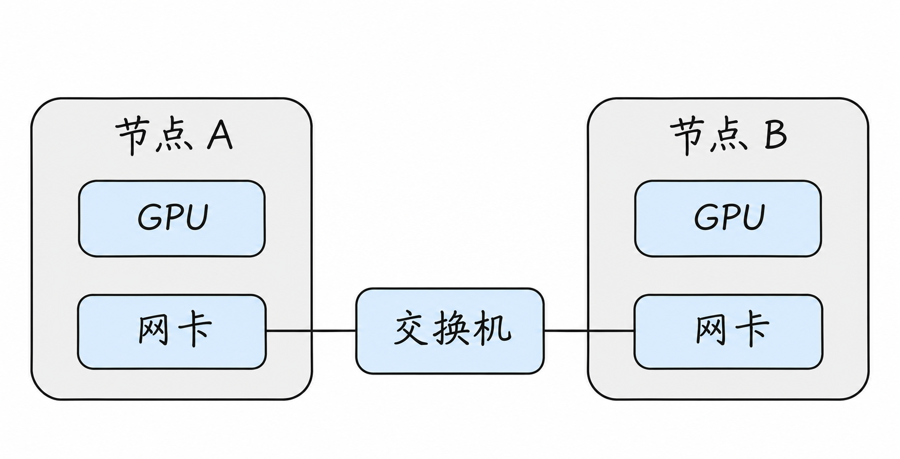
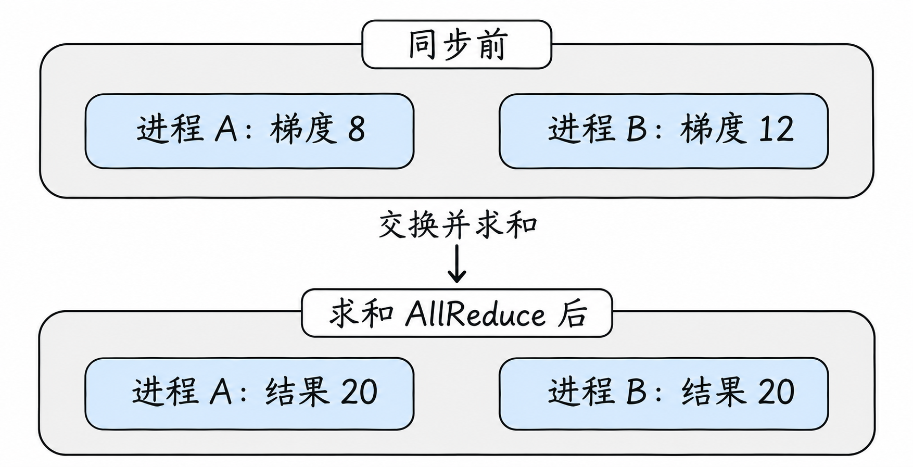
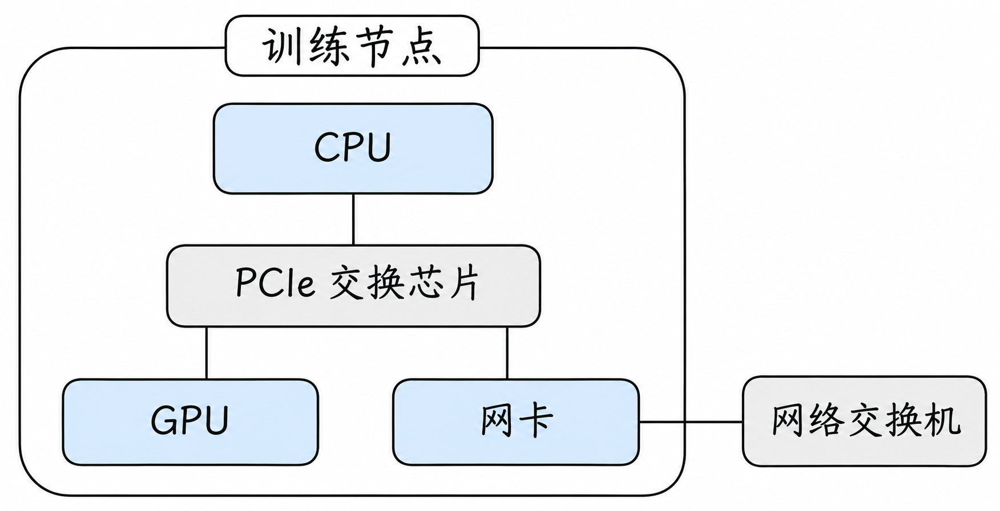
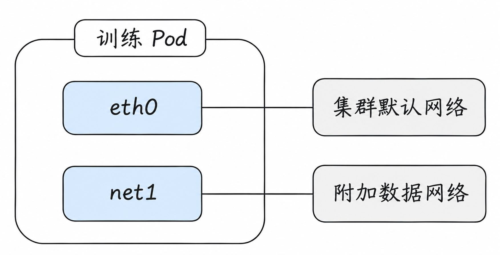
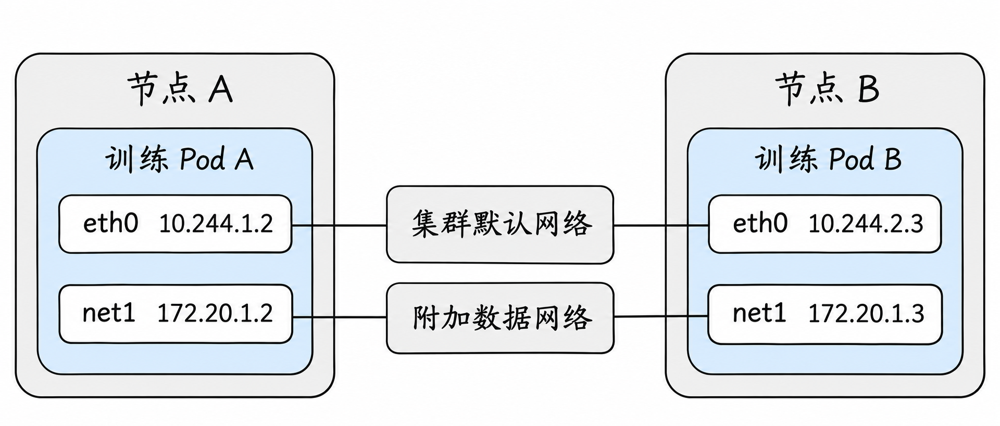

# AI Infra 网络：当 GPU 工作负载跨越节点

前面几篇主要讨论应用怎样被访问。到了 AI 集群，还要面对另一类流量：多个 GPU 在训练或推理中交换大量数据。此时，Pod 能互相访问是起点；设备分配、网络路径、拓扑与性能同样会影响任务能否正常完成。

## 1. 从两台 GPU 服务器开始

假设节点 A 和 B 各有 GPU 和网卡，它们的网卡通过交换机相连。两个训练进程分别运行在不同节点，需要在计算过程中交换数据。



图只表达设备与网络连接关系，不表示 GPU 一定能够直接访问网卡，也不表示链路已经启用 RDMA。节点内部 GPU 与网卡可能连接到不同 PCIe 层级或 CPU 插槽，实际路径取决于硬件与软件配置。

## 2. 训练中为什么需要通信？

以两个训练进程为例，A 算得梯度值 `8`，B 算得 `12`。一次求和式 **AllReduce** 可以让两边都得到 `20`；实际训练中还可能按进程数量求平均。真实数据是大量张量，不是一个数字，通信库会按拓扑和配置选择算法与分块方式。



图展示操作前后的数值，并没有规定中间的网络路径或算法。

先想象一个最简单的数据并行训练：两台机器各运行一个训练进程，各自保有一份模型副本。每一步中，A 和 B 分别用不同的小批数据计算梯度；然后交换并汇总梯度，再按一致的更新规则修改各自模型。重复很多次后，两边就像在共同处理更大的一批训练数据。

这里的“梯度”可以暂时理解为模型参数应该往哪个方向、调整多少的信号。前面的 `8` 和 `12` 只代表其中一个位置的数值；真实模型通常有很多参数，需要交换的是成批的数值数组，也就是张量。如果两份数据大小相同、算法使用平均梯度，那么两边在求和得到 `20` 后还可各自除以 `2`，得到 `10`。实际如何加权取决于训练算法和批次，AllReduce 的结果与随后的平均并不是同一个操作。

AllReduce 描述的是**结果**，不是规定所有节点必须把完整数据先发给某一台中央服务器。通信库可以根据参与者、消息大小和拓扑使用不同算法，例如把数据分块后在多个参与者间传递。理解性能时，既要看最终搬运的数据量，也要看实际算法、分块、并发与等待；不能直接把模型大小除以网卡速率就当作训练同步耗时。

再看另一种情况：如果一份模型太大，不能方便地放进一张 GPU，可以把一部分运算拆到多张 GPU。这就是一种**张量并行**思路。单层计算中，每张 GPU 各算一部分，但下一步可能需要合并或交换结果，才能继续执行。模型拆分方式决定需要交换什么；切得越细，不一定越快，因为每一步也可能增加通信和等待。流水线并行与它不同：把不同的层或阶段安排到不同设备，相邻阶段之间需要传递中间结果和反向计算所需的信息。专家并行中，不同 token 可能需要被分发给不同专家，进程之间的流量分布也可能随输入变化。

几种并行方式可以组合，通信库既可能承担集合操作，也可能参与点对点传输。排查时先确定当前作业到底采用哪种切分，才能判断应该关注“大批数据偶尔同步”，还是“每一层都在等待交换”。

**NCCL** 是常见的 GPU 集合通信库之一。它会根据可见设备、拓扑、软件环境和网络能力选择可用传输路径；最终选择应通过日志与测量验证，而不能仅凭机器安装了某种网卡就断定。[NCCL 排障文档](https://docs.nvidia.com/deeplearning/nccl/user-guide/docs/troubleshooting.html)

## 3. 一台节点内与跨节点有什么不同？

同节点 GPU 可能通过 PCIe 或符合条件的 GPU 互联路径交换数据；跨节点时则需要经过节点间网络。GPU、CPU、PCIe 交换设备、NUMA 与网卡的相对位置都可能影响路径。驱动、硬件拓扑和权限也会影响设备能否直接访问彼此的内存。[NCCL GPU 排障](https://docs.nvidia.com/deeplearning/nccl/user-guide/docs/troubleshooting/gpu_troubleshooting.html)

这里的 **PCIe** 是服务器中连接 GPU、网卡等设备的常见总线；一台机器有多个 CPU 插槽时，设备和内存通常会有“离哪个 CPU 更近”的差别，这与 **NUMA** 拓扑有关。假设 GPU 0 和网卡 0 位于较近的设备路径，GPU 1 与同一网卡之间却需要跨越其他互联，那么即便两张 GPU 型号一样，它们使用这张网卡时的实际性能也可能不同。这个“近”由机器内部连接决定，并不代表物理机箱里两个插槽看起来离得近就一定性能更好。



图只展示一种可能的硬件连接方式。机器内部的 **PCIe 交换芯片**连接 PCIe 设备，右侧的**网络交换机**连接不同机器的网卡，它们名称都带“交换”，但工作在不同位置。图上的线是设备连接关系，不能据此判断 GPU 到网卡的数据一定走哪条路径，也不能证明 GPUDirect RDMA 已启用。真实服务器可能有多个 PCIe 交换芯片、CPU 和网卡，连接方式也可能不同。

同节点通信还可能利用 NVLink 等设备互联，但实际机器是否具备这些链路、哪些 GPU 互连以及通信库使用哪条路径，都需要查看设备拓扑。跨节点通信则要考虑 GPU 到本机网卡、节点间网络、对端网卡到对端 GPU 等环节；节点间网卡速率只是其中一环。

常见网络指标需要分开看：**带宽**是单位时间能传多少；**时延**是完成一次传递需要多久；**消息率**反映大量小消息的处理能力。大消息同步可能受带宽影响，小消息和频繁同步可能更敏感于时延；拥塞、丢包和慢节点还会拉长整个同步阶段。

### 一个数量级计算

假设链路标称速率为 100 Gbit/s。按单位换算，理论上限约为 12.5 GB/s；真实应用能得到的吞吐还会受到协议开销、双向流量、NIC 与 PCIe、交换机、消息大小、并发及软件路径影响。100 Gbit/s 不等于应用一定能每秒完成 12.5 GB 的有效集合通信。

如果一次同步需要所有参与者完成，最慢节点可能拖住其余节点；因此除了平均带宽，还要检查每个节点、每条链路及每次同步的分布。用小规模基准建立基线，再和真实作业阶段耗时对照，才能判断是否有优化空间。

举一个只为说明等待的例子：A 完成这一轮计算和通信准备需要 80 毫秒，B 需要 120 毫秒；如果更新前必须等两边都进入同步，A 至少会有一段等待 B 的时间。B 慢可能是 GPU 计算、数据读取、网络或 CPU 调度造成的，仅凭 A 等待无法认定网络是根因。网络分析要和训练阶段时间线一起看。

## 4. RDMA、RoCE 与 InfiniBand 是什么关系？

**RDMA** 是一种远程直接内存访问能力，允许支持的网络适配器参与将数据传入或传出内存，减少部分传统软件路径开销；具体内存类型、权限、注册及数据路径取决于实现。

**InfiniBand** 是一种独立的高性能网络体系；**RoCE** 是在以太网中承载 RDMA 的方式。不能把 RDMA 当成网卡名称，也不能把以太网、RoCE 和 InfiniBand 当成同义词。普通 TCP/IP 以太网可以用于训练，但是否满足目标性能需要测量。

**GPUDirect RDMA** 涉及网络设备与 GPU 内存之间的数据路径；它需要兼容的 GPU、网卡、驱动、拓扑和配置。看到 Pod 里有 GPU 和网卡，不等于实际通信启用了 GPUDirect RDMA。

可以先将“远程内存访问”和“访问 GPU 内存”分开理解：RDMA 描述的是网络适配器参与两端内存数据传输的能力；GPUDirect RDMA 则关注符合条件的设备能否使用 GPU 内存作为这条数据路径的一部分。即使网络支持 RDMA，实际任务也可能因拓扑、权限或配置使用其他路径。应用和 CPU 仍需参与建立、管理与发起通信，不能理解为使用 RDMA 后 CPU 完全不工作。

在一种常见的 RDMA 编程模型中，程序需要先建立通信关系，并注册可供设备使用的内存区域；后续由网卡按请求参与数据搬运。这里的“直接”指减少某些 CPU 参与的数据复制和处理路径，并不是说远端进程能随意读取任何内存，也不是说网卡不用经过网络就能访问另一台机器。

普通以太网也可以运行 TCP/IP；RoCE 使用以太网承载 RDMA，InfiniBand 则有自己的网络体系。它们是不同的组合，不能因为两台机器都插着高速以太网卡，就认为应用已经在使用 RoCE。GPUDirect RDMA 进一步讨论网卡能否直接访问符合条件的 GPU 内存，仍要满足设备、驱动和拓扑等前提。[NVIDIA GPU Operator：GPUDirect RDMA](https://docs.nvidia.com/datacenter/cloud-native/gpu-operator/latest/gpu-operator-rdma.html)

RoCE 网络还要考虑拥塞控制、交换机与网卡配置、端到端路径及适用的流控策略。PFC、ECN 等机制有各自的适用条件与风险，不能只开启某一个开关就断定网络“无损”。[NCCL 网络排障](https://docs.nvidia.com/deeplearning/nccl/user-guide/docs/troubleshooting/networking_troubleshooting.html)

为了理解这些设置为何会影响训练，先看交换机的一个出口：当多个发送方同时把数据送往同一个接收方，流入速度可能暂时大于出口发送速度，数据便在队列中积压。**ECN** 可以通过报文标记反馈拥塞，使支持相应机制的发送方降低速率；**PFC** 则允许链路一端针对特定优先级请求另一端暂停发送。它们作用的位置和反馈方式不同，也不能代替容量规划。实际效果依赖两端和中间设备的配合；暂停可能把拥塞传递到其他位置，应结合队列、丢包、暂停和吞吐等指标判断。

## 5. 为什么一个 Pod 需要多张网络？

普通 Pod 的默认网络通常用于访问 Kubernetes 服务和其他应用。但训练进程还可能需要一张单独的高速数据网络。一个常见架构是：默认接口承载控制和服务发现，额外接口连接训练数据网络；具体用途由集群设计与应用配置决定。



例如，`eth0` 用于访问集群内服务，`net1` 用于连接训练伙伴的数据地址。这只是网络设计的一个例子：接口名和每条网络承担的流量都可不同，最终路径仍由应用、地址和路由共同决定。

**Multus** 是 CNI 元插件，可协调其他 CNI 为 Pod 附加额外网络接口。它本身不是一块高速网卡，也不自动实现 RDMA；附加网络需要对应的 CNI、地址管理与底层网络支持。[Multus](https://github.com/k8snetworkplumbingwg/multus-cni)

Pod 有多张网卡后，地址和路由决定不同目标走哪张接口。训练库使用哪个接口也可能有独立选择规则；“Pod 看到了 `net1`”不等于训练流量必然使用它。默认网络的 Service、DNS 或 NetworkPolicy 对额外网络的覆盖范围，需要按具体实现验证。

### 一次多网络启动中谁负责什么？

假设训练 Pod 需要默认网络和一张额外的高速网络。首先，调度器需要依据资源与约束把 Pod 放在有可用设备的节点；随后运行时与 CNI 配置默认网络。多网络组件再依据附件配置调用相应插件，为 Pod 创建或接入额外接口，并结合 IPAM 等机制配置地址。设备插件或其他分配机制负责向工作负载提供相应设备资源，具体时序和责任随方案而异。

最后，应用和通信库还需要识别可用接口与设备，并选择正确的通信地址。此时至少有三套需要对齐的信息：Kubernetes 资源分配、Pod 内接口及路由、训练库实际选用的设备。任何一套看起来正常，都不能单独证明另两套正确。

例如，同一个 Pod 的 `eth0` 地址是 `10.244.1.2`，`net1` 地址是 `172.20.1.2`；对端训练 Pod 的数据网地址为 `172.20.1.3`。如果网络配置让到 `172.20.1.0/24` 的流量从 `net1` 发出，访问对端的这个地址时可以选中附加网络；但如果训练程序拿到的是对端的默认网络地址，或者库按其他规则选择接口，就不一定使用这条路径。附加网络还必须在两个节点间真实连通，并具备正确的返回路径。



图中的线表示各接口可连接的**逻辑网络**，不是实际线缆或 GPU 到网卡的数据搬运路径。这里假设 `net1` 是可以在 Pod 里看到的普通网络接口，并没有据此断定它采用了 RDMA、SR-IOV 或 GPUDirect。真实网络也可能复用物理设备或通过其他方式隔离，是否共享带宽和故障域取决于实际部署。

假设 Pod A 内的路由查询对该目的地址返回下面的示意结果：

```text
$ ip -4 route get 172.20.1.3
172.20.1.3 dev net1 src 172.20.1.2
```

这表示在当前网络空间及所使用的查询条件下，内核为发往该地址的普通 IP 流量选择 `net1`，源地址为 `172.20.1.2`。它不能单独证明对方可达，也不能证明训练库的大数据传输使用了某个 RDMA 设备；使用设备专用传输路径时，还要检查通信库选中的设备和实际连接。不同网络空间、策略路由或应用绑定条件也可能让结果不同。

同样，初始协调进程可能使用默认网络交换成员信息，后续大规模数据通信使用另一张网络；也可能两者共用网络。这取决于框架和配置。排查时应把“启动时连到了哪里”和“训练数据实际经过哪里”分别记录下来。

## 6. SR-IOV 和设备分配

支持 SR-IOV 的网卡可由物理功能（PF）创建虚拟功能（VF），将部分设备能力以可分配单元暴露给工作负载。Kubernetes 中通常还需要设备插件或其他设备分配机制，以及能够配置该设备的 CNI；Multus 可参与选择并调用额外网络插件。

**设备能被调度**、**接口在 Pod 中出现**、**应用有权限使用 RDMA**、**跨节点能连通**是四个不同检查点。SR-IOV 也不是 RDMA 的同义词：是否支持以及如何暴露 RDMA 取决于设备、驱动和集成方式。[SR-IOV CNI](https://github.com/k8snetworkplumbingwg/sriov-cni)；[设备插件](https://github.com/k8snetworkplumbingwg/sriov-network-device-plugin)

把分工展开看：管理员需要先在支持的物理网卡上准备 VF；设备插件向 Kubernetes 报告节点上可分配的设备资源；Pod 声明需要的资源后，调度器才可以据此选择资源充足的节点。随后节点上的设备分配与网络插件配合，把已分配设备交给该工作负载并按方案配置。**Multus 负责协调网络附件，设备插件负责设备资源的发现和分配；两者都不能单独代替底层网络配置。**

例如，下面是一个 Pod 片段，只用来说明请求之间的关系，不能直接作为完整可用的部署清单：

```yaml
metadata:
  annotations:
    k8s.v1.cni.cncf.io/networks: training-net
spec:
  containers:
    - name: trainer
      resources:
        limits:
          nvidia.com/gpu: 1
          example.com/rdma-vf: 1
```

这里的 `nvidia.com/gpu` 和 `example.com/rdma-vf` 是示例资源名；后者必须与集群中实际设备插件公布的名称一致。`training-net` 也必须是已存在的网络附件定义，且该定义、设备资源与 CNI 的关联要按集群方案配置。只有资源请求，没有这些前提，Pod 不会自动获得一张可用的训练网络。GPU 请求与网络设备请求还是两项独立资源；同时满足数量也不自动保证它们的拓扑位置最优。Kubernetes 的设备插件和拓扑管理器可参与提供相关信息与资源对齐，但实际结果取决于节点策略和设备插件支持。[Kubernetes 设备插件](https://kubernetes.io/docs/concepts/extend-kubernetes/compute-storage-net/device-plugins/)

也不要把“成功分配设备”与“必定能看到 `net1`”画等号。某些 VF 使用内核网络驱动，可以作为接口出现在 Pod 中；若 VF 被绑定到面向用户态程序的驱动，设备使用和地址配置方式就不同，未必会出现同样的内核接口。应按设备插件、CNI、驱动与应用的组合检查，而不是只靠 `ip address` 认定设备没有分配。[SR-IOV CNI：驱动类型](https://github.com/k8snetworkplumbingwg/sriov-cni)

## 7. 推理服务有哪些不同流量？

一个在线推理请求可能先经过入口、服务发现和负载分配，随后才到 GPU 推理进程。如果系统拆分 Prefill 与 Decode、使用跨节点张量并行，或者将专家放在不同节点，还会出现实例之间的中间结果、KV Cache 或专家路由流量。

先以生成一段回答为例。**Prefill** 阶段处理输入提示词，并生成后续计算需要的注意力缓存；**Decode** 阶段基于已有上下文逐步生成输出 token，通常会不断读取和更新这些缓存。这里的 **KV Cache** 可以先理解为保存先前计算中一部分注意力中间结果的缓存，避免每生成一个 token 都从头重复计算全部历史。

如果 Prefill 与 Decode 运行在不同实例，系统可能需要把相应状态从前者转移到后者，或者让后者通过某种机制访问该状态。此时请求到达入口的延迟、状态传递耗时和生成阶段速度是不同指标。若框架采用其他部署方式，可能没有这条跨实例缓存传递路径；具体传什么、何时传以及走哪张网，必须查看实现和部署。

这些路径不是每个推理框架都采用：同一节点的多个 GPU 通信、跨节点并行和不同服务之间的网络请求需要分别画图与测量。关注的业务指标也不同：首 token 时延、持续输出速度、并发与尾延迟可能受不同阶段影响；网络指标需要与阶段时间对应，而不是孤立地看链路峰值。

## 8. 排障：从设备到应用逐层核对

先明确任务的节点数、GPU 数、每节点网卡、预期网络和故障开始时间。然后依次确认：

1. **调度和设备**：Pod 是否分到预期节点、GPU 与网络设备是否可见，设备请求与资源分配是否一致。
2. **接口和地址**：默认网络与附加网络分别有什么接口、IP 和路由；进程实际绑定或选择了哪张网卡。
3. **节点间路径**：两端链路、交换机、MTU、ACL 和返回路径是否符合设计；区分管理网络与训练数据网络。
4. **GPU 到网卡拓扑**：查看设备拓扑、驱动状态和可用能力，确认预期的设备直达路径是否真的可用。
5. **通信库与工作负载**：结合通信库日志与小规模基准，记录消息大小、节点数、带宽和错误，再逐步扩大范围。

`kubectl get pods -o wide` 主要帮助确认 Pod 和节点位置；它不能证明 RDMA、GPU Direct 或网络性能正常。具体设备工具和 NCCL 诊断命令随环境、权限和版本不同，应参考相应文档，并在获准的测试窗口运行。不要在没有证据时盲目固定网络接口、禁用 GPU 功能或修改交换机流控。

在已安装相应工具、且具备读取权限的节点上，`nvidia-smi topo -m` 可帮助查看 GPU 与部分设备之间报告的拓扑关系；`ibv_devices` 或 `ibv_devinfo` 可辅助确认系统看到的 RDMA 设备。工具不存在、设备未暴露进容器或权限不足都会影响观察结果。即使命令列出了设备，也还要结合通信库日志和实际测试，确认具体作业使用了哪个设备及传输路径。

以 NCCL 为例，`NCCL_SOCKET_IFNAME` 用于选择 IP 网络接口，而 `NCCL_IB_HCA` 用于选择 RDMA 适配器；两者作用的对象不同。手动指定前要核实接口在所有参与节点上是否真实可用、命名规则是否一致，以及当前 NCCL 版本支持的语法。它们不是“开启高速网络”的通用开关：设置错误可能让初始化失败或选择意外路径。[NCCL 环境变量](https://docs.nvidia.com/deeplearning/nccl/user-guide/docs/env.html)

### 跟一次双节点训练变慢的线索

假设单节点训练正常，扩展到两节点后每一步明显变慢。先记录相同模型、批量和并行配置下的阶段时间：如果双节点时每一步的通信等待增加，才有理由进一步调查节点间通信；如果 GPU 一直在等输入数据，也要同时检查数据读取和预处理。这里的“等待增加”是观察结果，还不是网络故障的结论。

接下来在两边分别确认训练 Pod 所在节点、资源分配、接口地址，以及作业日志记录的通信设备。若预期使用附加网络，却发现某一侧没有相应附件，先查资源和 CNI 配置；若接口存在但连接失败，检查两端地址、路由、实际物理网络、交换机和返回路径。若低层网络测试正常而训练仍慢，再比较 GPU 到网卡的拓扑、通信库实际传输方式和不同消息大小下的性能。

NVIDIA 文档建议按条件使用 `ib_write_bw` 等工具比较设备间带宽，也可以在支持的环境中比较主机内存与 GPU 内存路径。此类测试需要两端工具、兼容驱动及适当权限，并会占用网络和设备；要在测试窗口中记录设备名、消息大小及结果，不能把某一次基准分数直接当成训练吞吐。[NCCL 网络排障](https://docs.nvidia.com/deeplearning/nccl/user-guide/docs/troubleshooting/networking_troubleshooting.html)

## 9. 如何设计验证实验？

把变量拆开：先在单节点测试 GPU 间通信，再在两节点上验证所选网络，随后增加节点数；同样记录消息大小和并发。分别比较预期路径与实际选路，并结合训练阶段耗时判断网络是否为瓶颈。多机实验还需检查时间同步、作业启动与地址解析；初始连接使用的网络和大规模数据传输路径不一定相同。

当基础实验成功，再考虑生产容量、隔离和故障域：多条网卡是否落在同一交换机、同一电源或同一上联？网络拥塞时多个训练任务如何互相影响？这些问题需要结合机房拓扑和业务负载回答。

## 参考资料

- [NCCL：网络排障](https://docs.nvidia.com/deeplearning/nccl/user-guide/docs/troubleshooting/networking_troubleshooting.html)
- [NCCL：GPU 与设备拓扑排障](https://docs.nvidia.com/deeplearning/nccl/user-guide/docs/troubleshooting/gpu_troubleshooting.html)
- [Multus CNI](https://github.com/k8snetworkplumbingwg/multus-cni)
- [SR-IOV CNI](https://github.com/k8snetworkplumbingwg/sriov-cni)
- [SR-IOV 网络设备插件](https://github.com/k8snetworkplumbingwg/sriov-network-device-plugin)
